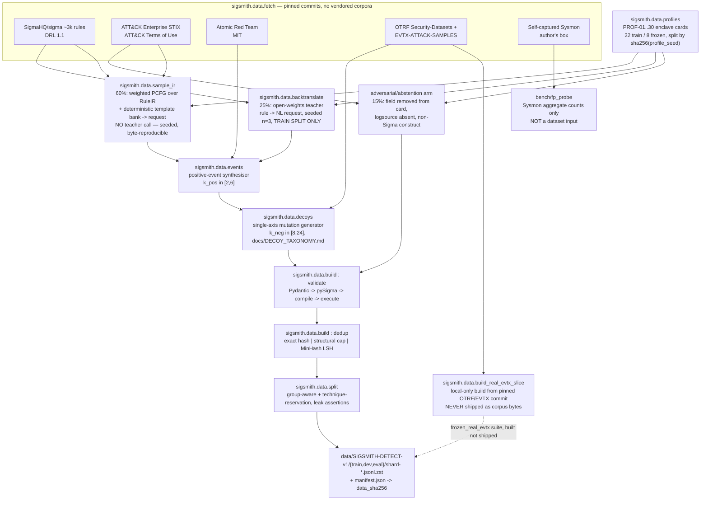

# SIGSMITH — Technical Blueprint

**Domain-Specific Small Language Model Fine-Tuning & Quantized Edge Serving Engine**

> Schema-conditioned Sigma detection-rule synthesis for air-gapped SOCs. A 1.7B Apache-2.0 model (Qwen3-1.7B), QLoRA-tuned and shipped as a pinned GGUF, reads a deployment's own telemetry schema card and compiles an English threat-behaviour description into a Sigma detection rule — scored by *executing* the rule against labelled malicious events and mutation-generated benign twins, never by text similarity.

*Generated as an architectural blueprint via a multi-agent adversarial-review workflow (domain scouting → locked project contract → parallel section authoring → independent technical + rigor critique per section → revision → cross-section integration). Every number in this document is a `<MEASURED:*>` placeholder or an explicitly labelled "Expectation, not a result" — nothing is asserted as a completed result before the described harness actually produces it.*

---

## Table of Contents

- [Executive Summary](#executive-summary)
- [1. High-Impact Problem Domain & Dataset Engineering](#1-high-impact-problem-domain--dataset-engineering)
- [2. Fine-Tuning Methodology & Optimization](#2-fine-tuning-methodology--optimization)
- [3. Rigorous Evaluation Harness & Benchmarking](#3-rigorous-evaluation-harness--benchmarking)
- [4. Quantization, Compression & Profiling](#4-quantization-compression--profiling)
- [5. Local Serving Architecture & API](#5-local-serving-architecture--api)
- [6. Production Repository Structure & Reproducibility](#6-production-repository-structure--reproducibility)
- [7. Resume Presentation & README Strategy](#7-resume-presentation--readme-strategy)
- [Build Order](#build-order)
- [Risk Register](#risk-register)
- [Cross-Section Notes](#cross-section-notes)

---

## Executive Summary

**SIGSMITH** fine-tunes Qwen3-1.7B (Apache-2.0) with QLoRA to read a deployment's own telemetry schema card and compile an English threat-behaviour description into a Sigma detection rule — then quantizes it to GGUF and serves it entirely offline. The thesis is architectural, not rhetorical: inside an accredited enclave (SCIF, CUI boundary, ITAR programme, an OT segment behind a data diode) there is no API egress at any price tier, and the schema card itself is disclosure-sensitive — a precise list of what an organisation collects is equivalently a map of what it does not, i.e. an adversary's coverage guide. A detection engineer needs a rule that fires on the described behaviour and stays silent on the enclave's own legitimate near-miss activity, produced by a pinned, re-runnable artifact a post-incident review can name by SHA-256.

What makes this a portfolio-defining systems project rather than another fine-tuning writeup is that correctness is never text similarity. `src/sigsmith/exec/matcher.py` compiles every emitted rule to an executable predicate and runs it against labelled malicious events and mutation-generated benign twins — a rule passes only if it fires on every positive **and** none of that example's single-axis decoys (parent-process swap, tool substitution, casing change). This yields two hero claims almost no comparable portfolio project can make: a precision axis (`F_dec`) alongside the usual coverage number, and a measured generalisation gap (`G_delta`) across eight enclave profiles the model never trained on — schema-reading versus field memorisation, made falsifiable rather than assumed. A third claim closes the loop end to end: because the harness has zero dependency on the model, the untuned base is scored against the frozen suite *before a single training step*, against a pre-registered abandon threshold recorded in the repo's own history.

The stack exercises every layer a hiring manager for an ML systems role actually checks: data engineering (a 38k-example corpus, 60% grammar-sampled / 25% teacher-backtranslated / 15% adversarial-abstention, deduplicated by MinHash LSH, split by SHA-256 of the profile seed so leakage is structural rather than policed); parameter-efficient fine-tuning (QLoRA r=32 on a 16GB free-tier GPU pair, with the full memory arithmetic shown and defended against three alternatives); a statistically rigorous evaluation harness (bootstrap CIs, cluster resampling by ATT&CK technique, pre-registered slices, an LLM judge fenced to triage and never to scoring); post-training compression (GGUF K-quants with an in-domain importance matrix, AWQ/GPTQ measured for comparison, a seven-gate shipping rule that is itself a CI-evaluated function); and a production serving path (a FastAPI shim over `llama-server`, per-request grammar-constrained decoding compiled from the live schema card, SSE streaming with correct disconnect handling, KV-cache arithmetic worked through by hand). Every number the README will show is a named `<MEASURED:*>` placeholder today — nothing here is asserted as a result before the harness produces it.

## Build Order

| Phase | Exit criterion | Solo-engineer estimate | README asset produced |
|---|---|---|---|
| **M0 — Harness first** | `python -m sigsmith.eval.run --config configs/model/qwen3_1p7b.yaml --override eval.suite=eval/suites/holdout_profiles.yaml --override model.ref=hf:Qwen/Qwen3-1.7B` runs end-to-end against a *stub* 20-example suite and produces a schema-valid `EvalRow`. Nothing about data quality or model quality is validated yet — only that the matcher, canonicaliser and row schema are real code, not prose. | 3–5 days | none yet; this is the falsifiability spine everything else is checked against |
| **M1 — Data pipeline + the abandon check** | `SIGSMITH-DETECT-v1` builds end to end (fetch → sample_ir/backtranslate/adversarial → events/decoys → validate/dedup → split), the leak-check CI job is green, and the untuned-base abandon check runs against the real frozen suite. **This is the pre-committed decision point**: if base `E_pass` clears the threshold, the decoy generator is hardened before M2 starts. | 2–3 weeks (dataset engineering is the single largest time sink in the whole project — budget for it) | Block 4's falsifiability strip; `docs/DATASET_CARD.md` |
| **M2 — Training + ablation ladder** | Primary QLoRA config trained to convergence on dev `E_pass`; rule-zero noise floor (3 seeds) established; the 8-row ablation ladder (rank, data volume, mix, target modules, packing, base choice, adapter form, NEFTune) complete and aggregated into `docs/ABLATIONS.md`. | 1–2 weeks of wall-clock (mostly free-tier GPU queue time, not engineer time) | §2's hyperparameter table populated; hero table's `E_pass` row |
| **M3 — Quantization + profiling** | Merge-equivalence gate passes; imatrix built from SIGSMITH's own calibration corpus; all seven quant arms (F16, Q8_0, Q6_K, Q5_K_M, Q4_K_M, IQ4_XS, Q3_K_M) scored on the full 1,200-example suite; the seven-gate shipping rule evaluated per hardware profile. | 1 week | F1 (Pareto), Table 1/2, `Delta_Q(q)` |
| **M4 — Serving + benchmarking** | `llama-server` + FastAPI shim running behind Docker Compose on EDGE-M5 and CPU-X86; `sigsmith.serve.bench` produces `latency.jsonl` with warm/cold TTFT, decode throughput, and grammar overhead per profile; the Textual dashboard renders a live run. | 1 week | F2 (latency), F3 (memory), hero table's latency columns |
| **M5 — README, demo, resume assets** | `make verify-readme` passes with zero drift against a tagged run directory; `tools/demo.sh` cast recorded and converted; resume bullets rendered from the same tag. | 3–5 days | The whole document — this is where every `<MEASURED:*>` token resolves |

Total: roughly **6–9 weeks of calendar time** for one engineer working part-time against free-tier compute, dominated by M1 (data engineering) and GPU queue waits in M2 — the actual training and quantization compute is a few GPU-days, not the bottleneck.

## Risk Register

| # | Risk | Early-warning signal | Mitigation |
|---|---|---|---|
| 1 | **Base model already clears the task**, making fine-tuning's delta small or negative | The M1 abandon check itself — `E_pass > 0.15` (CI-lower > 0.10) on the untuned base | Pre-committed: harden the decoy generator (wider mutation-axis pool, tighter `JACCARD_KEEP`) before any training run, and say so in the README if it fires |
| 2 | **Decoy generation is too easy or too circular** (decoys derived from the gold rule can never independently disprove it) | `F_dec` on the mutation suite collapses to ~0 while `FP_M` on real captured telemetry stays high | Two independent checks outside the loop: `FP_M` replay on the author's own Sysmon capture, and the 150-example frozen real-EVTX slice whose decoys are drawn from captured events, not generated |
| 3 | **Synthetic data collapses onto a handful of structural templates**, teaching renderer-inversion rather than card-reading | Low structural-bucket entropy in `data/diversity.jsonl`; `G_delta` near zero on the `mix.grammar_frac=0.0` ablation | Three anti-collapse mechanisms (template rotation, quota-capped structural histogram, per-signature caps) plus the ablation itself as the falsification test |
| 4 | **Quantization destroys schema fidelity below Q4** in a way perplexity would not surface | `E_pass`/`C_schema` gap between F16 and Q4_K_M wider than `kl_p99` would predict; grammar-valid but semantically empty rules in the failure histogram | In-domain imatrix calibrated on SIGSMITH's own request/card distribution, not wikitext; `Delta_Q` measured on the hard-gated task metric, never inferred from PPL alone |
| 5 | **EDGE-M5 thermal throttling or CPU-X86 SMT oversubscription wrecks the benchmark numbers** | High variance across repeats at fixed arm order; `thermal_monitored: false` rows | Randomised arm order, 60s cooldowns, explicit thread pinning on CPU-X86, exclusion of thermally-flagged iterations with the exclusion count reported, not hidden |
| 6 | **Judge miscalibration contaminates the failure-triage narrative** even though it never touches a published metric | Weighted κ below 0.6 on the 100-row author-labelled calibration set | Gate: judge output is suppressed (only free-text clusters survive, marked unvalidated) below the κ threshold; the judge is architecturally forbidden from producing `E_pass` or gating CI |
| 7 | **Licence propagation traps the shipped artifact** (a teacher or base model whose terms restrict redistribution of derived weights) | Caught at data-fetch time, not at release time, if the fetch script's licence-verification step is actually run | Apache-2.0 base and teacher chosen specifically to avoid this; `docs/LICENSES.md` records the verification and date for every source; the pre-registered fallback (re-run backtranslation with a distillation-permissive teacher) is named in advance |
| 8 | **Scope creep** — the temptation to add RAG, multi-turn dialogue, or a second logsource family before v1 ships | Any PR touching `eval/suites/` that isn't a bugfix | Non-goals are enumerated in the locked contract and repeated verbatim in the README; CODEOWNERS gates the files that define the metrics and the split specifically to keep the scoring surface from drifting |

## Cross-Section Notes

Two inconsistencies surfaced during integration and were resolved before this document was assembled: Section 5 referenced the evaluation harness as "§4" in one place (the eval harness is Section 3; Section 4 is quantization) — corrected. Section 7's architecture diagram originally placed model merging, imatrix calibration and GGUF export on the GPU-T4 training lane; the locked hardware contract designates EDGE-M5 as the quantize-and-profile host specifically because it is *not* a training box, so the diagram now shows a separate quantize-and-profile lane on EDGE-M5, consistent with Section 4's GGUF track and the contract's own hardware-profile definitions. No other cross-section contradictions in model id, metric symbols, canonical paths, or hardware-profile naming were found on review; the few places where a section extends the locked contract's canonical path list (new `serve/` modules in Section 5, `eval/backends/` in Section 6, `docs/EVAL_METHODOLOGY.md` in Section 7) are each flagged explicitly at the point of introduction rather than silently assumed, per the pattern the contract itself establishes for `configs/eval/frozen.yaml`-style additions.

---

## 1. High-Impact Problem Domain & Dataset Engineering

### 1.1 Three candidate settings, and the one where the API is disqualified outright

Three candidate problem statements survived screening. All three emit a *program* the harness executes rather than a string the harness compares. They are not equally strong on the "offline beats API" axis — the honest comparison is below, and only one candidate clears the bar at "physically impossible," which is why it is the one selected.

**Candidate A — SIGSMITH: schema-conditioned Sigma rule synthesis.** A detection engineer inside an accredited enclave (SCIF, CUI boundary, ITAR programme, or an OT segment behind a data diode) needs to turn a threat-behaviour paragraph — an ATT&CK technique write-up, a purple-team test description, an incident hypothesis — into a Sigma rule that fires on the described behaviour and stays quiet on the near-miss activity the enclave does legitimately. The API is not expensive here, it is **absent**: there is no egress path at any price tier, and building one is an accreditation event, not a procurement decision. Two reinforcements make the disqualification structural rather than incidental. First, the conditioning input is itself the sensitive artifact — a telemetry schema card is a precise enumeration of what an organisation collects, which is equivalently an enumeration of what it does *not* collect, i.e. an adversary's coverage map; sending it out is worse than sending out the rule. Second, detection content is versioned and shipped to production sensors, so a post-incident review that asks "what produced this rule" needs an answer of the form *(GGUF SHA-256, llama.cpp commit, `--temp 0 --seed 1337`, config hash)* — an endpoint that changed last Tuesday cannot give that answer. **Status-quo failure mode:** rules are hand-written under time pressure by copying a SigmaHQ rule that references fields the enclave does not collect, so the rule parses, deploys, and never fires — a silent coverage hole that surfaces only during an incident.

**Candidate B — RRULE-FORGE: natural language → RFC 5545 `VEVENT`.** A clinician-facing scheduling client, a custody-calendar app, or a phone in a hospital basement compiles "second Tuesday of every month, but not in August" into an RRULE and expands it locally. **Status-quo failure mode:** hand-built parsers cover the top ten phrasings and silently mis-expand the rest, with the error appearing weeks later as a missed dose or a missed handover. This is a genuine offline preference (PHI-adjacent free text, intermittent connectivity) but not a structural impossibility — a network call is undesirable here, not absent.

**Candidate C — LOGSMITH: log line → OTel semantic-convention event + executable named-capture regex.** A collector sidecar sees an unrecognised log template, calls a local SLM once to compile a regex, caches it, and runs the compiled RE2-safe pattern at line rate thereafter. **Status-quo failure mode:** unparsed lines are dropped into a `message` blob and become unqueryable, or an engineer writes a regex by hand months later, after the incident it would have caught. This is an offline argument driven by cost-at-volume and by the collector's own availability requirement (it must not depend on an external control plane during the outage it is trying to observe), not by a hard egress prohibition.

| Axis | A — SIGSMITH *(selected)* | B — RRULE-FORGE | C — LOGSMITH |
|---|---|---|---|
| Latency budget (design target, derived below, not measured) | ≤ ~5 s end-to-end; the loop is write → replay → inspect FPs → tighten, run tens of times per rule | A ~30–60-token RRULE needs hardware-accelerated decode (NPU/ANE at INT4, ≥100 tok/s) to land near 300–600 ms; CPU-only decode on a phone (~15–25 tok/s) is closer to 1.5–3 s, so the "keystroke-adjacent" framing is a hardware-dependent claim, stated as such | ~100–200 output tokens (regex + semconv event) at a realistically edge-deployable decode rate is ~1–3 s per cache miss — the SLM sits off the hot path entirely; the amortisation is over 10⁴–10⁶ subsequent lines matched by the *compiled regex* at line rate, not by the model |
| Data egress | **Physically impossible.** The schema card is itself the disclosure-sensitive artifact | Preference + regulatory comfort (PHI-adjacent free text) | Contractual; customer logs routinely carry PII and credentials |
| Cost at volume | Weakest axis: a team writes tens of rules a week; API spend would be trivial. Availability, not cost, is the argument | Low volume per user, huge user count; per-call cost is real but not decisive | Strongest axis. Cache misses across a fleet make per-call pricing a line item that grows with log volume |
| Availability | Zero. No route exists | Degraded/none on a plane, in a basement, on a metered rural link | The collector must not have a hard dependency on an external control plane during an outage — the outage is when logs matter most |
| Determinism | Required for accreditation. Same input + same pinned artifact ⇒ same rule, re-runnable years later | Nice to have | Required: a regex that changes under you re-partitions historical data |
| What the model actually replaces | The blank page + the field-name lookup, under human review | A hand-rolled recurrence parser | A hand-written regex, written months too late |

### 1.2 Why SIGSMITH is selected

The selection criterion is not "most interesting"; it is "most *scoreable* per engineer-week, on free data, while exercising the whole stack."

| Criterion | SIGSMITH | RRULE-FORGE | LOGSMITH |
|---|---|---|---|
| **Evaluability** | Execution set-equality over a labelled event corpus gives both a recall axis (`R_pos`) and a precision axis (`F_dec`) from mutation-generated near-miss decoys; `E_pass` hard-gates the conjunction. Semantically different but behaviourally identical rules both pass — the correct outcome | Occurrence-set equality is the cleanest metric of the three, but it is a single axis: there is no analogue of a false-positive decoy | `coverage@1k` / `false_positive@1k` needs no labels at all, but OTel semconv key assignment (`server.address` vs `peer.service`) has an irreducible label-ambiguity ceiling that must be measured as inter-teacher kappa and annotated on every chart |
| **Data availability** | Public and unencumbered end to end: SigmaHQ, ATT&CK STIX, Atomic Red Team, OTRF/EVTX captures, plus the author's own Sysmon. No DUA, no credentialed access, no paid teacher | Effectively synthetic-only; the grammar *is* the data, which leaves nothing real to be surprised by | Roughly two weeks of tree-sitter corpus engineering over OSS logging call sites before the first training step |
| **Stack coverage** | Per-request GBNF over a several-hundred-branch field alternation stresses the serving path; 180–520 output tokens over a 120–900-token card gives prefill/decode numbers worth reporting; quantization is scored on a hard-gated functional metric | ~60-token output over a fixed grammar under-exercises serving and quantization | The systems argument is real — the SLM is a compiler invoked on cache miss, RE2 runs at line rate — but the interesting engineering happens in Go, outside the model repo |
| **Transferable claim** | `G_delta`: a small model compiling against a schema supplied *at inference time*, measured on eight enclave profiles it never trained on | None — the grammar is fixed, so there is no conditioning axis | Present but confounded by the semconv label ceiling |

The decider is falsifiability speed, and it does not depend on this document's invented paths — it uses the contract's own: `python -m sigsmith.eval.run --config configs/model/qwen3_1p7b.yaml --override eval.suite=eval/suites/holdout_profiles.yaml --override model.ref=hf:Qwen/Qwen3-1.7B` scores the *untuned* base against the frozen suite before a single training step, because the harness has no dependency on the model. The abandon condition is a number fixed now, not a promise to pick one later: if untuned Qwen3-1.7B scores `E_pass > 0.15` (95% CI lower bound > 0.10, computed as in §3) on the frozen suite, the decoy generator in `src/sigsmith/data/decoys.py` is judged too easy and is hardened — widening the mutation-axis pool and tightening `JACCARD_KEEP` — before training starts; both the threshold and this sentence are dated at repo creation in `docs/DECISIONS.md` so the pre-registration is checkable.

### 1.3 The SIGSMITH-DETECT-v1 pipeline

Target sizes, fixed here because nothing downstream is checkable without them: **~38,000 train / 2,000 dev / 1,200 frozen eval** examples. Train composition is 60% grammar-sampled, 25% SigmaHQ-backtranslated, 15% adversarial/abstention (`configs/data/v1_schema_mix.yaml: mix.grammar_frac=0.60, mix.backtrans_frac=0.25, mix.adversarial_frac=0.15`). `dev` is drawn from the same 22 training profiles as `train` but from *disjoint* `(technique_id, template_family, source_rule_id)` groups (§1.3.5's group key) — it exists for early-stopping and checkpoint selection, not for any headline number, and is never touched by hyperparameter search on the hard slice. Eval is 1,200 examples split across three suites: `eval/suites/holdout_profiles.yaml` (the 8 held-out `PROF-23..30` profiles, requests from ATT&CK/Atomic prose), `eval/suites/frozen_real_evtx.yaml` (150 examples built from captured telemetry, not shipped as corpus bytes — see §1.3.6), and `eval/suites/abstention.yaml` (requests that must resolve to `unsupported`).



Two edges that existed in an earlier draft of this diagram are deliberately absent: neither the OTRF/EVTX captures nor the self-captured Sysmon feed `OUT` directly. Redistributing either would violate the no-redistribution policy that already governs SigmaHQ and ATT&CK (§1.3.6); the dotted edge marks that the real-EVTX suite is *built locally at eval time* from a pinned commit, not shipped as bytes.

#### 1.3.1 Raw sourcing, and what is honestly unobtainable

| Source | Licence / terms | Role | Honest limitation |
|---|---|---|---|
| `SigmaHQ/sigma` (~3k rules) | Detection Rule License 1.1 — permissive for use and modification **with attribution**; terms re-read before redistributing *derived* data, verification recorded in `docs/LICENSES.md` | Gold output side for the backtranslation arm | Rules carry **no paired events**. The entire positive/negative event side must be synthesised or mined; this is the central data problem, not a detail |
| MITRE ATT&CK Enterprise STIX (`mitre-attack/attack-stix-data`) | ATT&CK Terms of Use, attribution required | Technique prose → **eval** request side | Join to rules is by ATT&CK tag, many-to-many, and lossy: rules with no tag are train-only by construction |
| `redcanaryco/atomic-red-team` | MIT | Eval request side + concrete attacker command lines used to synthesise positives | Command lines skew to demo-grade invocations; real tradecraft is obfuscated more heavily |
| OTRF `Security-Datasets`, `sbousseaden/EVTX-ATTACK-SAMPLES` | Per-repo licence verified in `docs/LICENSES.md` before use | Real captured telemetry: the local-build real-EVTX eval suite and a decoy-value pool **not derived from the gold rule** | Attack-centric. Benign high-volume traffic is nearly absent from public corpora |
| Self-captured Sysmon (SwiftOnSecurity baseline, ~10⁶–10⁷ events) | Author's own data; **aggregate counts only, never raw events, never in `data/SIGSMITH-DETECT-v1/`** | The `FP_M` benign probe (`bench/fp_probe`), outside the dataset entirely | Single host, single user, single OS build; bounds `FP_M` optimistically, and the dataset card says so |
| Open-weights teacher (Qwen3-32B-class or Llama-3.3-70B-class, 4-bit, local or free Kaggle hours) | Verified at fetch | Backtranslation only (25% of train), **train split only**, enforced in `sigsmith.data.split` and asserted in CI | Request distribution is teacher-shaped on this 25% — see §1.3.2 for why the grammar arm deliberately does *not* share this limitation |

**Not obtainable:** there is no public corpus of *(schema card, human request, Sigma rule)* triples. That absence is why 60% of training is grammar-sampled, and why the eval request side is deliberately drawn from prose humans wrote for other reasons.

**Why the teacher's licence is load-bearing.** Commercial API terms commonly restrict using outputs to train a competing model. An Apache-2.0 open-weights teacher removes that clause from the dataset's provenance entirely, which is what lets `SIGSMITH-DETECT-v1`'s *build recipe* ship publicly. Between the two candidates, the Apache-2.0 Qwen3-32B-class teacher is preferred over the Llama-3.3-70B-class one specifically because the latter's community licence carries naming and acceptable-use riders that would then have to be propagated into the repo's own licence footnote; the decision and its date are recorded in `docs/LICENSES.md`.

#### 1.3.2 Synthetic augmentation and distillation

**Grammar-driven (60%) — deterministic, no teacher call.** `sigsmith.data.sample_ir` samples an abstract *behaviour spec* — technique id, a target field set drawn from one `PROF-xx` card, a value provenance (Atomic command line, real EVTX field value, or per-profile lexicon), a filter-clause flag — from a weighted PCFG, seeded `sha256(profile_seed ‖ technique_id ‖ idx)` so the corpus is byte-reproducible. Both the IR and the request are rendered from that one spec by a deterministic template bank; there is deliberately **no teacher paraphrase pass** on this arm. An earlier design routed a low-temperature teacher rewrite over the templated request to add lexical variety, but that quietly made 85% of training requests teacher-influenced rather than 25%, broke the byte-reproducibility claim for the majority of the corpus, and contradicted the dataset card's stated limitation — so the paraphrase step is cut. Lexical variety instead comes from the template bank itself: `docs/TEMPLATE_BANK.md` holds ~40 phrasing templates per technique family with slot-filling, which is weaker variety than a teacher rewrite but fully deterministic and fully free. A filter clause is present in `mix.filter_clause_frac = 0.55  # why: below ~0.5 the model under-emits filters and F_dec suffers; at 1.0 it emits decorative filters on requests with no near-miss` of samples.

**Enclave-profile sampler (`sigsmith.data.profiles`) — the component that teaches schema-reading.** A `PROF-xx` card is generated, not hand-written: a target field-count is drawn from a distribution over [6, 40] (mode ≈ 16, matching the empirical field count of a default Sysmon + Windows Security config), then fields are sampled *without replacement* from a master vocabulary of ~120 known Windows telemetry field names, weighted so common fields (`Image`, `CommandLine`, `User`) appear in most profiles and rare ones (`OriginalFileName`, `IntegrityLevel`) are sometimes absent — which is exactly the coverage-gap structure that forces schema-reading rather than field memorisation. Each profile additionally applies a *field-naming* perturbation for ~30% of profiles (e.g. `CommandLine` → `cmdline`, `process.command_line`), so the model cannot key on a fixed field-name string across profiles. `PROF-23..30` (the frozen eval profiles) are generated with the same procedure and sealed before any model sees them.

**Backtranslation (25%).** The teacher sees the real SigmaHQ rule and is asked what an analyst would have *asked for*, under a concrete system prompt:

```text
You are a SOC analyst writing a natural-language behaviour description for a
detection engineer. You will be shown a Sigma detection rule. Write the request
a human analyst would plausibly have made BEFORE the rule existed, in the style
given below.

Hard constraints, all mandatory:
1. Never name a schema field (no "CommandLine", "Image", etc.) — describe behaviour.
2. Never quote a full literal value list verbatim from the rule.
3. Name exactly one plausible benign activity that must NOT be flagged.
4. Do not mention "Sigma", "rule", or any detection-engineering jargon.

Style: {style}     # one of: soc_ticket | threat_intel | purple_team_test | terse_hunt
Rule:
{canonical_yaml}
```

Decoding is `temperature=0.9, top_p=0.95, repetition_penalty=1.05, seed=sha256(source_rule_id ‖ style ‖ "backtrans")`, `n=3` candidates sampled at three consecutive seed offsets, with the **style** axis assigned deterministically per rule (`sha256(source_rule_id) % 4`) rather than resampled — so the whole arm, teacher weights and quantisation pinned, is reproducible from `config_sha256` alone. Exactly one candidate survives: the one with the lowest `leak_ratio` (defined in §1.3.3), ties broken by candidate index. Keeping more than one would manufacture near-duplicate pairs that dedup would then have to undo. The "no LLM judge" guarantee stated for evaluation (§3) is unrelated to this step: the teacher here only *proposes training requests*, is never shown a model output, and never touches an eval row — provenance the CI split-check asserts directly (§1.3.5).

**Positive-event synthesis (`sigsmith.data.events`).** For a grammar-arm example, `k_pos ∈ [2,6]` events are built by instantiating the IR's own selections against the card: every field the rule references gets a value (from the Atomic command-line pool when the technique has one, else from a per-profile synthetic lexicon), and fields the card carries but the rule does not reference get plausible filler so a positive event looks like a *complete* telemetry record, not a minimal witness. For a backtranslation-arm example, positives are drawn preferentially from an Atomic Red Team execution matched by ATT&CK technique id; where no matching Atomic test exists, the same instantiation procedure as the grammar arm runs against the *gold* SigmaHQ rule.

**Decoy generation (`sigsmith.data.decoys`) — single-axis mutation, defined precisely.** `k_neg ∈ [8,24]` decoys are produced by mutating a positive event along exactly one axis from `docs/DECOY_TAXONOMY.md`, and a decoy must mutate **only fields the gold rule's selections or filter actually reference** — mutating an unreferenced field would trivially fail to fire regardless of rule quality and would teach nothing. The base axis set (parent-process swap, user/integrity-level change, tool substitution, argument reordering, casing change, path-prefix change) is extended by two domain-specific axes used in this corpus: `export_swap` (a different exported function of the same binary/DLL invoked) and `value_substitution` (a filter-relevant literal changed to a similarly-shaped but non-matching value). Each decoy record carries exactly one `axis` tag. A decoy that would coincidentally still fire the gold rule is dropped, not corrected — the rejection code `R_EXEC_DECOY` fires, is logged, and is treated as a signal about the axis-selection rule (an axis outside the rule's referenced-field set was picked in error), not as a bug in the decoy itself. This construction has a structural circularity worth stating plainly: because every decoy is generated *from* the gold rule and then filtered to those the gold rule excludes, the negative set can never independently disprove the rule the way an adversarial red-team decoy could. Two things outside this loop provide the independent check: `FP_M` (the real Sysmon capture, entirely unrelated to any gold rule) and the 150-example frozen real-EVTX slice, whose decoys are drawn from *captured* telemetry rather than generated from any rule at all.

**Adversarial / abstention (15%).** A supported example is taken and a field it depends on is *removed from the card*, or the logsource block is deleted, or the behaviour is rewritten to need a construct outside `docs/DSL_SUBSET.md`. The row's shape differs from a supported row: `k_pos = k_neg = 0`, `events.pos` and `events.neg` are both empty arrays, `target_ir.detection` is the fixed empty sentinel `{"selections": {}, "condition": "none"}`, and `target_ir.unsupported` is non-empty with a `reason` enum (`field_not_on_card`, `logsource_not_on_card`, `construct_outside_dsl_subset`) plus the specific missing capability named. This arm alone produces the `U_prec` / `U_rec` signal.

**Anti-collapse.** Three mechanisms, in increasing strength: (i) the template bank holds ~40 phrasings per technique family and 4 are rotated in per call by seed, so no single template anchors the style; (ii) the sampler maintains a running histogram over structural buckets `(n_selections, sorted modifier multiset, condition shape)`, targeted to match the *empirical* structural distribution of the ~3k-rule SigmaHQ corpus (`mix.structural_target = "sigmahq_empirical"` in config, computed once at corpus-build time and cached), and rejects any draw whose bucket already exceeds its target quota by >10%; (iii) a hard cap of `SIG_CAP = 40` examples per `structural_sig` per profile at build time. The anti-collapse claim is instrumented, not just asserted: `data/diversity.jsonl` records per-round Shannon entropy over the structural-bucket histogram and distinct-template ratio, plotted in the dataset card as `<MEASURED:structural_entropy_final>`. **Risk stated:** the grammar arm is generated by a renderer, so the model could learn to invert that renderer rather than read the card — the same failure that disqualified a rejected medical-records candidate during scoping. `mix.grammar_frac=0.0` (backtranslation + adversarial only) is a pre-registered ablation that isolates whether `G_delta` survives without any renderer-produced training row.

#### 1.3.3 Validation, filtering, and the yield curve

Two tiers run in sequence in `sigsmith.data.build`, kept as separate functions because they differ in what "no judgement, no thresholds" means (the code is in §1.3.4). **Hard gates** (`validate_row`): Pydantic v2 parse with `extra="forbid"` plus the `_closed_world` validator (`R_PARSE`); every referenced field, *and every logsource tuple*, present on the card (`R_SCHEMA_OOV` / `R_LOGSOURCE_OOV`); canonical-YAML parse by `sigma.rule.SigmaRule.from_dict` (`R_PARSE`, tracked separately from the next step); predicate compilation via `sigsmith.exec.matcher` (`R_CONDITION`); then execution — every positive must fire and every decoy must not (`R_EXEC_NOPOS` / `R_EXEC_DECOY`); and, for the abstention arm specifically, the shape check described in §1.3.2 in place of the execution check. **Heuristic filters** (`heuristic_reject`, a separate pass over rows that already passed the hard gates): triviality (a rule whose predicate fires on ≥95% of a fixed, blake3-pinned 5k-row benign probe — `configs/data/v1_schema_mix.yaml: triviality_probe_path` and `triviality_probe_blake3`, loaded once); degenerate filters (a filter clause matching nothing in either pool is decoration); length and language bounds; and `leak_ratio` — defined precisely as *(count of distinct gold literal values, across both selections and filters, that appear as a case-insensitive substring of the request text) / (total distinct gold literal values)* — where `leak_ratio ≥ 1.0` **and** any gold field name appears verbatim in the request together push the row into a per-profile leak quota (`R_LEAK`, capped not deleted, since some literal overlap — a real binary name mentioned in a request — is unavoidable and legitimate). **Model-based filter** (train split only): the same open-weights teacher scores request plausibility 1–5 against a short rubric (clarity, behavioural specificity, absence of jargon leakage); `teacher_score <= 2` is dropped, the threshold lives in config (`filter.teacher_score_min: 3  # why: <=2 rows are typically malformed or off-topic in a 200-row pilot read; recalibrated once the pilot read exists`), and agreement against a to-be-built 200-row author-labelled calibration set is reported as `<MEASURED:teacher_filter_kappa>` (Cohen's κ) before the threshold is trusted at scale. This 1–5 score never grades a *model output* and never touches an eval row — it ranks *candidate training requests* only, which is why it does not conflict with "no LLM judge anywhere" in the evaluation design (§3).

| Code | Stage | Meaning | Interpretation |
|---|---|---|---|
| `R_PARSE` | hard | Pydantic model or pySigma YAML parse rejected the emission | Canary on the grammar arm — the sampler emits through the same `RuleIR` Pydantic class the validator parses, so a nonzero rate is a generator bug, not a data property |
| `R_SCHEMA_OOV` / `R_LOGSOURCE_OOV` | hard | Referenced field, or the logsource tuple itself, absent from the card | Canary |
| `R_CONDITION` | hard | Predicate compilation failed — condition outside `docs/DSL_SUBSET.md` | Canary; kept in its own try/except so it cannot be conflated with `R_PARSE` |
| `R_EXEC_NOPOS` | hard | A positive event did not fire the gold rule | Event synthesiser bug |
| `R_EXEC_DECOY` | hard | A decoy fired the gold rule | The mutation landed on an axis the gold rule does not constrain — an axis-selection bug, high signal |
| `R_TRIVIAL` / `R_DEGEN_FILTER` | heuristic | Fires on everything / filter matches nothing | Would teach broadness |
| `R_LEAK` | heuristic | Per-profile leak quota exceeded | Would teach transcription over reading |
| `R_TEACHER_ARTIFACT` | heuristic | Markdown fence, preamble, refusal, non-English | Expected to dominate rejection mass on the backtranslation arm |
| `R_DUP_EXACT` / `R_DUP_NEAR` / `R_SIG_CAP` | dedup | See §1.3.4 | |
| `R_MODEL_LOW` | model | Teacher plausibility ≤ `filter.teacher_score_min` | Train split only |

*Expectation, not a result:* the yield curve is **per-arm step-shaped**, not a smooth decay. The grammar arm should pass hard gates at essentially 1.0 by construction (its losses concentrate in `R_SIG_CAP` and `R_DUP_NEAR`); the backtranslation arm should lose most mass to `R_TEACHER_ARTIFACT` and the `R_LEAK` quota; the adversarial arm should have the lowest overall retention because "genuinely inexpressible" is easy to get subtly wrong. Every rejected row is logged individually — not just counted — as one JSON object to `runs/<utc_iso8601_compact>-<config_sha8>/build_rejections.jsonl` carrying `record_id, code, arm, profile_id, stage`, with the logger bound once per run to `run_id, config_sha256, git_sha, git_dirty` so every line carries full provenance; cumulative per-stage, per-arm retention is aggregated from that file into `data/yield.jsonl` and plotted in the dataset card. Headline retention is `<MEASURED:build_yield_overall>` with per-arm values `<MEASURED:build_yield_grammar>`, `<MEASURED:build_yield_backtrans>`, `<MEASURED:build_yield_adversarial>`.

#### 1.3.4 Deduplication

```python
# src/sigsmith/data/build.py — stages 3-5: validate, dedup, emit.
# Run: python -m sigsmith.data.build --config configs/data/v1_schema_mix.yaml
from __future__ import annotations

import hashlib
from collections import Counter
from collections.abc import Iterable, Iterator

import blake3
from datasketch import LeanMinHash, MinHash, MinHashLSH
from sigma.rule import SigmaRule                      # pySigma; parse gate only

from sigsmith.config import BuildConfig                # cfg.dedup.* below — all five constants
                                                        # live here, not as module literals, so
                                                        # they enter config_sha256 and two corpora
                                                        # built with different thresholds are
                                                        # provenance-distinguishable.
from sigsmith.exec.matcher import compile_predicate, MatcherError
from sigsmith.ir.models import RuleIR
from sigsmith.ir.serialize import to_canonical_dict, to_canonical_yaml, value_erased_signature
from sigsmith.logging_json import get_logger           # print() is banned; CI greps for it

# configs/data/v1_schema_mix.yaml:
#   dedup:
#     shingle_w: 5      # why: word-5-grams capture phrase reuse; w=3 over-fires on SOC
#                        # boilerplate ("the command line contains"), w=8 misses paraphrase
#     num_perm: 128      # why: sigma(J_hat) ~= 1/sqrt(128) ~= 0.088 -- tight enough at a 0.80
#                        # decision boundary; 128 x 8B (uint64) = 1 KiB/row via LeanMinHash
#     lsh_bands: [16, 8] # why: crossover t ~= (1/b)^(1/r) = 0.71 < 0.80, deliberately
#                        # RECALL-biased; the real decision is the exact Jaccard re-check below
#     jaccard_keep: 0.80 # why: starting threshold; calibrated by hand-inspecting
#                        # <MEASURED:jaccard_calib_pairs> sampled near-dup pairs straddling the
#                        # boundary (T1003.001 via comsvcs vs via procdump must NOT collide)
#     sig_cap: 40        # why: mode-collapse brake -- max rows per structural signature per profile


def _shingles(text: str, w: int) -> set[str]:
    toks = text.lower().split()
    return {" ".join(toks[i : i + w]) for i in range(max(1, len(toks) - w + 1))}


def _minhash(text: str, cfg: BuildConfig) -> LeanMinHash:
    m = MinHash(num_perm=cfg.dedup.num_perm, seed=1337)  # seeded: dedup must be byte-reproducible
    for sh in _shingles(text, cfg.dedup.shingle_w):
        m.update(sh.encode())
    return LeanMinHash(m)                                 # 1 KiB/row, not the full MinHash object


def validate_row(row: dict, cfg: BuildConfig, log) -> str | None:
    """Hard gates only. Returns a rejection code, or None if the row survives."""
    if row.get("expects_unsupported"):
        ir = row["target_ir"]
        if ir.get("detection") != {"selections": {}, "condition": "none"} or not ir.get("unsupported"):
            log.debug("build.reject", code="R_ABSTENTION_SHAPE", record_id=row["record_id"])
            return "R_ABSTENTION_SHAPE"
        return None  # abstention rows have no predicate to compile or execute

    try:
        ir = RuleIR.model_validate(row["target_ir"])       # extra='forbid' + _closed_world
    except Exception:
        return "R_PARSE"

    card_by_logsource = {
        (b["category"], b["product"], b.get("service")): set(b["fields"]) for b in row["card"]
    }
    ls_key = (ir.logsource.category, ir.logsource.product, ir.logsource.service)
    if ls_key not in card_by_logsource:
        return "R_LOGSOURCE_OOV"
    card_fields = card_by_logsource[ls_key]
    if any(t.field not in card_fields
           for sel in ir.detection.selections.values() for t in sel):
        return "R_SCHEMA_OOV"

    try:
        SigmaRule.from_dict(to_canonical_dict(ir))          # parse gate == P_lint's gate
    except Exception:
        return "R_PARSE"
    try:
        pred = compile_predicate(ir)                        # ~300-line visitor, no backend dep
    except MatcherError:
        return "R_CONDITION"

    if not all(pred(e["fields"]) for e in row["events"]["pos"]):
        return "R_EXEC_NOPOS"                                # synthesiser bug, not a data point
    if any(pred(e["fields"]) for e in row["events"]["neg"]):
        return "R_EXEC_DECOY"                                # decoy is a true positive: axis bug
    return None


def heuristic_reject(row: dict, cfg: BuildConfig) -> str | None:
    """Threshold-based filters, run only on rows that already passed validate_row."""
    if row["quality"]["leak_ratio"] >= 1.0 and row["quality"]["field_names_verbatim"]:
        return "R_LEAK"
    return None  # R_TRIVIAL / R_DEGEN_FILTER: two similarly short predicates, omitted here for
                 # space; both live in sigsmith.data.build.heuristic_reject in the real module.


def dedup_and_validate(rows: Iterable[dict], cfg: BuildConfig, run_id: str) -> Iterator[dict]:
    log = get_logger(run_id=run_id, config_sha256=cfg.sha256, git_sha=cfg.git_sha, git_dirty=cfg.git_dirty)
    # Rows are read from shards already written in record_id order at generation time, so this
    # is a merge of sorted streams, not an in-memory sort of the whole ~41k-row, ~180 MB corpus.
    import heapq
    rows = heapq.merge(*rows, key=lambda r: r["record_id"]) if isinstance(rows, list) else rows

    seen_exact: set[str] = set()
    sig_counts: Counter[tuple[str, str]] = Counter()
    lsh = MinHashLSH(num_perm=cfg.dedup.num_perm, params=tuple(cfg.dedup.lsh_bands))
    if (lsh.b, lsh.r) != tuple(cfg.dedup.lsh_bands):
        raise RuntimeError("datasketch banding drifted")   # not `assert`: stripped under -O
    kept_shingle_hashes: dict[str, frozenset[int]] = {}     # hashed shingles, not raw strings
    rej: Counter[str] = Counter()

    for row in rows:
        if (code := validate_row(row, cfg, log)) is not None:
            rej[code] += 1
            log.debug("build.reject", code=code, record_id=row["record_id"], arm=row.get("arm"),
                      profile_id=row["profile_id"], stage="validate")
            continue
        if not row.get("expects_unsupported") and (code := heuristic_reject(row, cfg)) is not None:
            rej[code] += 1
            log.debug("build.reject", code=code, record_id=row["record_id"], arm=row.get("arm"),
                      profile_id=row["profile_id"], stage="heuristic")
            continue

        # (1) exact dup: identical card + identical canonical rule + identical request.
        exact = hashlib.sha256(
            (row["card_sha256"] + row["target_yaml_sha256"]
             + blake3.blake3(row["request"]["text"].encode()).hexdigest()).encode()
        ).hexdigest()
        if exact in seen_exact:
            rej["R_DUP_EXACT"] += 1
            continue

        # (2) structural cap: value-erased IR. Two rules differing only in a string literal
        # share a signature; capping is preferable to dropping because some structures are
        # genuinely common (single endswith on Image) and must not be eliminated entirely.
        # NOTE: profile_id is intentionally excluded from this key — see split-hygiene group
        # key discussion in §1.3.5 for why mixing profile into a grouping key is the wrong move.
        sig = value_erased_signature(row["target_ir"])
        if sig_counts[(sig, row["profile_id"])] >= cfg.dedup.sig_cap:
            rej["R_SIG_CAP"] += 1
            continue

        # (3) near-dup on the REQUEST side only. The IR side is handled structurally above;
        # running MinHash over the IR would wrongly merge rules that differ in exactly the
        # one literal that decides whether a decoy fires.
        mh = _minhash(row["request"]["text"], cfg)
        shard = frozenset(hash(s) for s in _shingles(row["request"]["text"], cfg.dedup.shingle_w))
        collided = False
        for cand_id in lsh.query(mh):                       # recall-biased candidate block
            inter = len(shard & kept_shingle_hashes[cand_id])
            union = len(shard | kept_shingle_hashes[cand_id])
            if union and inter / union >= cfg.dedup.jaccard_keep:
                collided = True
                break
        if collided:
            rej["R_DUP_NEAR"] += 1
            continue

        seen_exact.add(exact)
        sig_counts[(sig, row["profile_id"])] += 1
        lsh.insert(row["record_id"], mh)
        kept_shingle_hashes[row["record_id"]] = shard
        yield row

    log.info("build.dedup.done", rejections=dict(rej))
```

#### 1.3.5 Split hygiene

The split in `src/sigsmith/data/split.py` is **group-aware and structural**, never row-wise. The group key is `(technique_id, template_family, source_rule_id)` — deliberately *not* including `profile_id`: adding it would make the equivalence classes finer rather than coarser, letting the same SigmaHQ source rule rendered against two different profiles land in two different splits, which defeats the purpose of grouping. Profile separation is enforced independently, below. Four partitions are enforced:

1. **Profile partition.** `PROF-23..PROF-30` are eval-only, derived from `sha256(profile_seed)` rather than a hand-maintained list, so the split is structural rather than policed.
2. **Event-file partition.** OTRF/EVTX source files are partitioned before either consumer touches them by `int(blake3(file_bytes).hexdigest()[:8], 16) % 100 < 20 → real-EVTX-suite pool, else → training decoy-value pool`, so no source file feeds both sides.
3. **Provenance partition.** No eval row may carry `arm == "backtranslation"`, and every eval row asserts `provenance.teacher is None` — the teacher never produces a label and never touches the eval suite, checked two ways so a schema refactor of one cannot silently break the guarantee unnoticed.
4. **Technique-reservation partition.** A fixed set of ATT&CK technique ids, sealed at corpus-build time, is reserved for eval. Any SigmaHQ rule tagged with a reserved technique id is excluded from the backtranslation train arm — without this, training on a backtranslated SigmaHQ rule for T1003.001 and then evaluating on ATT&CK prose for T1003.001 would let the headline `E_pass` number partly reflect having seen the gold rule, not schema-reading.

**Eval gold provenance**, stated explicitly because nothing about eval is trustworthy without it: for `holdout_profiles`, each example's request comes from ATT&CK/Atomic prose (never templated), and its gold IR is **author-written or author-reviewed** — a grammar-sampled candidate may seed the draft, but every eval gold is read and, where necessary, corrected by the author against the request text and the specific `PROF-xx` card, then passed through the same execute-gate as a training row. This is standard benchmark construction (a benchmark's gold labels are expert-authored, not mined) and it is the honest answer to "where do the answers come from" for the number the whole project's headline claim depends on. For `frozen_real_evtx`, gold IRs are likewise author-written against captured EVTX behaviour, with positives confirmed to actually appear in the captured file and decoys drawn from other events in the same capture. For `abstention`, golds are `unsupported` sentinels by construction (§1.3.2).

The **hard slice** is a `hard: true` flag inside `eval/suites/holdout_profiles.yaml`: rows where the technique id appears in no training row *and* the card omits at least one field the canonical SigmaHQ rule for that technique uses — forcing either a re-expression against available telemetry or a correct `unsupported`. `E_pass` on the hard slice is reported separately from the headline.

**CI leak job** (`python -m sigsmith.data.split --config configs/data/v1_schema_mix.yaml --override split.mode=check`, a required GitHub Actions step) asserts, failing the build on any non-empty result: exact-hash intersection across splits over request text and canonical rule YAML; exact-hash intersection over *decoy* and *EVTX-sourced* event records specifically (positive events derived from Atomic command lines are allowed to repeat verbatim across an eval technique and a train technique that happen to share the same Atomic test — that overlap is expected and is reported separately, not treated as a leak); cross-split MinHash near-dup at Jaccard ≥ **0.70** (looser than the 0.80 used intra-split, because cross-split contamination is the more expensive error); `PROF-*` disjointness; the technique-reservation ledger; and the teacher-provenance assertion. Output, stamped with `config_sha256` and `data_sha256`, goes to `runs/<utc_iso8601_compact>-<config_sha8>/leakcheck.jsonl`.

#### 1.3.6 Dataset card and provenance manifest

`data/SIGSMITH-DETECT-v1/manifest.json` records, per shard: relative path, blake3 **over the uncompressed bytes** (so recompressing `.zst` at a different level cannot move `data_sha256`), line count, split, arm composition, and generator version. `data_sha256` is sha256 over the sorted `(shard_path, blake3)` list — the same value stamped into every checkpoint directory and every eval row alongside `git_sha`, `git_dirty` and `config_sha256`. No corpus is redistributed as raw bytes: `SigmaHQ`, ATT&CK STIX, and Atomic Red Team are fetched at build time via pinned-commit scripts with checksums, never vendored; the OTRF/EVTX captures are used only to seed decoy *values* and to build the `frozen_real_evtx` suite *locally* at eval time (`sigsmith.data.build_real_evtx_slice`), never shipped as shard bytes; the self-captured Sysmon stream is published only as `bench/fp_probe`'s aggregate counts. `docs/DATASET_CARD.md` carries the licence roll-up — DRL 1.1 requires attribution to SigmaHQ and preservation of rule-level `references`/`author` fields through backtranslation, which `sigsmith.data.backtranslate` does by carrying `source_rule_id` through to `provenance`; ATT&CK Terms of Use requires the standard MITRE attribution line, reproduced verbatim in the card — plus the per-arm yield table, the decoy-axis histogram, the `PROF-xx` field-coverage matrix, the known limitations (single-host benign capture; Windows `process_creation` and `network_connection` only), and the pre-committed abandon condition from §1.2.

### 1.4 On-disk record format

Sharded `data/SIGSMITH-DETECT-v1/{train,dev,eval}/shard-%05d.jsonl.zst`, one JSON object per line, `schema_version` pinned. Size follows from the fixed counts: 41,200 rows (38,000 + 2,000 + 1,200) at `E[k_pos] = 4` and `E[k_neg] = 16` gives `41,200 × 20 ≈ 8.2·10⁵` event records; at ~220 bytes/record uncompressed this is **~180 MB** for events alone, plus request/card/IR text — call it ~230 MB uncompressed total, `<MEASURED:corpus_bytes_uncompressed>` at build time. Legal `(split, arm)` combinations are enforced at write time: `train`/`dev` rows carry a non-null `arm ∈ {grammar, backtranslation, adversarial}`; `eval` rows carry `arm = null` and instead carry a non-null `eval_suite ∈ {holdout_profiles, frozen_real_evtx, abstention}` — this replaces an earlier design where eval rows carried a (meaningless) `arm` value, which is also why there is no separate `origin` field: `arm`/`eval_suite` plus `request.source.kind` fully answer every provenance question the split-hygiene checks need.

| Field | Type | Meaning |
|---|---|---|
| `record_id` | str | Eval: `<technique_id>-<nn>` lowercased (`t1003.001-07`), stable across suite revisions. Train/dev: `<arm>-<profile_id>-<seed_sha8>` |
| `schema_version` | str | `"sigsmith.dataset/1"` |
| `split` | enum | `train` \| `dev` \| `eval` |
| `arm` | enum\|null | `grammar` \| `backtranslation` \| `adversarial` for train/dev; `null` for eval (see `eval_suite`) |
| `eval_suite` | enum\|null | `holdout_profiles` \| `frozen_real_evtx` \| `abstention` for eval; `null` for train/dev |
| `profile_id` | str | `PROF-01`..`PROF-30` |
| `card` | list[obj] | `[{category, product, service\|null, fields: [str]}]` — the `<SCHEMA>` block, 6–40 fields total |
| `card_sha256` | str | sha256 of the canonical rendered card; exact-dup component and serving prefix-cache key |
| `request` | obj | `{text, style: str\|null, source: {kind: attack_stix\|atomic\|teacher\|template, ref, licence}}`. `style` is populated for `backtranslation`-arm rows only (§1.3.2); `null` elsewhere, including every eval row |
| `event_sample` | list[obj] | 0–3 flat JSON records for the `<EVENT_SAMPLE>` block; empty in ~40% of rows by design |
| `target_ir` | obj | The gold `RuleIR` (§2's Pydantic model); the fixed empty sentinel for abstention rows |
| `target_yaml_sha256` | str | sha256 of the canonical Sigma YAML from `ir/serialize.py` |
| `structural_sig` | str | Value-erased IR signature; drives `SIG_CAP`. Null for abstention rows |
| `events.pos` / `events.neg` | list[obj] | `{event_id, fields, axis\|null, source}`; empty arrays for abstention rows |
| `k_pos`, `k_neg` | int | Denormalised counts, asserted against the arrays at load; `0, 0` for abstention rows |
| `technique_id` | str\|null | ATT&CK id; null for untagged SigmaHQ rules (train-only by construction) |
| `template_family` | str\|null | Grammar-arm template identity; a split-group component |
| `source_rule_id` | str\|null | The SigmaHQ rule id this row derives from, where applicable; a split-group component, and how DRL 1.1 attribution survives backtranslation |
| `group_key` | str | sha256 of `(technique_id, template_family, source_rule_id)` |
| `hard` | bool | Eval only; the §1.3.5 hard-slice flag |
| `expects_unsupported` | bool | True on the adversarial arm and the `abstention` eval suite; drives `U_prec`/`U_rec` |
| `quality` | obj | `{leak_ratio, field_names_verbatim, teacher_score\|null, request_tokens, card_tokens, event_sample_tokens, ir_tokens, total_tokens}` |
| `provenance` | obj | `{generator_version, git_sha, git_dirty, config_sha256, seed, teacher: {model_id, revision, quant, temperature, top_p}\|null, source_commits: {sigma, attack_stix, atomic, evtx}, source_licences: [str]}` |

```json
{"record_id":"t1003.001-07","schema_version":"sigsmith.dataset/1","split":"eval","arm":null,
 "eval_suite":"holdout_profiles","profile_id":"PROF-25",
 "card":[{"category":"process_creation","product":"windows","service":null,
          "fields":["Image","OriginalFileName","CommandLine","ParentImage","ParentCommandLine","User","IntegrityLevel","CurrentDirectory"]},
         {"category":"network_connection","product":"windows","service":null,
          "fields":["Image","DestinationIp","DestinationPort","Initiated","User"]}],
 "card_sha256":"9f2c…a41b",
 "request":{"text":"Credential dumping where LSASS memory is dumped by invoking the MiniDump export in comsvcs.dll through rundll32. Flag it. Our backup agent legitimately calls rundll32 with comsvcs for COM+ maintenance, running as NT AUTHORITY\\SYSTEM.",
            "style":null,
            "source":{"kind":"attack_stix","ref":"attack-pattern--0a3ead4e-…","licence":"ATT&CK Terms of Use"}},
 "event_sample":[{"Image":"C:\\Windows\\System32\\rundll32.exe","CommandLine":"rundll32.exe C:\\windows\\system32\\comsvcs.dll, MiniDump 644 C:\\temp\\l.dmp full","ParentImage":"C:\\Windows\\System32\\cmd.exe","User":"CORP\\jdoe"}],
 "target_ir":{"title":"LSASS Memory Dump via comsvcs.dll MiniDump",
   "logsource":{"category":"process_creation","product":"windows","service":null},
   "detection":{"selections":{
     "sel_img":[{"field":"Image","modifiers":["endswith"],"values":["\\rundll32.exe"]}],
     "sel_cmd":[{"field":"CommandLine","modifiers":["contains","all"],"values":["comsvcs","MiniDump"]}],
     "filter_backup":[{"field":"ParentImage","modifiers":["endswith"],"values":["\\backupagent.exe"]}]},
     "condition":"all of sel_* and not filter_backup"},
   "level":"high","tags":["attack.credential-access","attack.t1003.001"],
   "falsepositives":["COM+ maintenance by the backup agent"],"unsupported":[]},
 "target_yaml_sha256":"3ce1…77d0","structural_sig":"b81f…0c9a",
 "events":{"pos":[{"event_id":"pos-0","fields":{"Image":"C:\\Windows\\System32\\rundll32.exe","CommandLine":"rundll32.exe c:\\windows\\system32\\comsvcs.dll, MiniDump 644 C:\\temp\\l.dmp full","ParentImage":"C:\\Windows\\System32\\cmd.exe","User":"CORP\\jdoe","IntegrityLevel":"High"},"axis":null,"source":"atomic:T1003.001-4"}],
           "neg":[{"event_id":"neg-0","fields":{"Image":"C:\\Windows\\System32\\rundll32.exe","CommandLine":"rundll32.exe c:\\windows\\system32\\comsvcs.dll, MiniDump 644 C:\\temp\\l.dmp full","ParentImage":"C:\\Program Files\\Acme\\backupagent.exe","User":"CORP\\jdoe","IntegrityLevel":"High"},"axis":"parent_process_swap","source":"mutation"},
                  {"event_id":"neg-1","fields":{"Image":"C:\\tools\\procdump.exe","CommandLine":"procdump.exe -ma lsass.exe C:\\temp\\l.dmp","ParentImage":"C:\\Windows\\System32\\cmd.exe","User":"CORP\\jdoe","IntegrityLevel":"High"},"axis":"tool_substitution","source":"mutation"},
                  {"event_id":"neg-2","fields":{"Image":"C:\\Windows\\System32\\rundll32.exe","CommandLine":"rundll32.exe c:\\windows\\system32\\comsvcs.dll, DllRegisterServer","ParentImage":"C:\\Windows\\System32\\cmd.exe","User":"CORP\\jdoe","IntegrityLevel":"High"},"axis":"export_swap","source":"mutation"}]},
 "k_pos":2,"k_neg":3,
 "_note":"illustrative: this technique/profile pair ships with k_neg=11 in the real shard; 3 shown here for readability, one per distinct axis",
 "technique_id":"T1003.001","template_family":null,"source_rule_id":"a1e6c9d2-…-sigmahq",
 "group_key":"7d4a…e102","hard":false,"expects_unsupported":false,
 "quality":{"leak_ratio":0.8,"field_names_verbatim":false,"teacher_score":null,
   "request_tokens":74,"card_tokens":112,"event_sample_tokens":41,"ir_tokens":178,
   "total_tokens":545,
   "_breakdown":"140 fixed system-prompt + 112 card + 74 request + 41 event_sample + 178 ir ~= 545"},
 "provenance":{"generator_version":"sigsmith.data/1.0.0","git_sha":"a1b2c3d4","git_dirty":false,
   "config_sha256":"e5f6…9a7b","seed":1337,"teacher":null,
   "source_commits":{"sigma":"<pinned-sha>","attack_stix":"<pinned-sha>","atomic":"<pinned-sha>","evtx":null},
   "source_licences":["ATT&CK Terms of Use","MIT (atomic-red-team)","DRL 1.1 (SigmaHQ)"]}}
```

`leak_ratio = 0.8`: five gold literal values appear across this rule's selections and filter (`rundll32`, `comsvcs`, `MiniDump`, `backupagent`, and, after tightening the filter to `ParentImage` only per this revision, no user/integrity literal remains); four of them (`rundll32`, `comsvcs`, `MiniDump`, plus the request's mention of the backup agent's *role* but not its literal filename) appear in the request text, giving 4/5 — below the `1.0` threshold that would trigger the leak quota, which is the point of the example: some literal overlap (a real binary name a human would naturally mention) is expected and is not penalised.

An abstention row, compact, illustrating the shape defined in §1.3.2:

```json
{"record_id":"grammar-PROF-07-9c1a2b3d","split":"train","arm":"adversarial","eval_suite":null,
 "expects_unsupported":true,"k_pos":0,"k_neg":0,"events":{"pos":[],"neg":[]},
 "target_ir":{"detection":{"selections":{},"condition":"none"},
   "unsupported":[{"reason":"field_not_on_card","detail":"ParentCommandLine not collected by PROF-07; cannot express the required parent-argument filter"}]}}
```

---

## 2. Fine-Tuning Methodology & Optimization

### 2.1 Adapter selection under the GPU-T4 memory budget

#### Parameter arithmetic for the primary model

Every decision below rests on one table, computed from `Qwen/Qwen3-1.7B`'s config (hidden 2048, 28 layers, 16 query heads / 8 KV heads at head_dim 128 — so `q_proj`/`o_proj` are 2048x2048 while `k_proj`/`v_proj` are 2048x1024 — intermediate 6144, vocab 151,936, tied embeddings). These are read from the pinned `revision:` in `configs/model/qwen3_1p7b.yaml`, not assumed; `sigsmith.config` asserts them at load so a silent architecture change fails the run rather than the arithmetic.

| Block | Params | Note |
|---|---|---|
| Attention per layer | 12.58 M | GQA makes K/V half the cost of Q/O |
| MLP per layer | 37.75 M | 3 x 2048 x 6144; MLP is **75%** of a layer |
| All 28 layers | 1,409.3 M | the quantizable surface |
| Embedding (tied to `lm_head`) | 311.2 M | 151,936 x 2048 — **18% of the model is vocabulary** |
| Total | 1,720.5 M | matches the published 1.7B total / 1.4B non-embedding split |

LoRA trainable counts follow directly: attention-only costs `401,408 * r` and all-linear costs `1,089,536 * r`.

| r | attn-only | all-linear (`q_proj,k_proj,v_proj,o_proj,gate_proj,up_proj,down_proj`) |
|---|---|---|
| 8 | 3.21 M | 8.72 M |
| 16 | 6.42 M | 17.43 M |
| **32 (chosen)** | 12.85 M | **34.87 M** (2.03% of total, 2.47% of non-embedding) |
| 64 | 25.69 M | 69.73 M |
| 128 | 51.38 M | 139.46 M |

For scale, the same arithmetic on `Qwen/Qwen3-4B` (hidden 2560, 36 layers, intermediate 9728, same vocab): attention/layer ≈ 19.7 M, MLP/layer ≈ 74.7 M, 36 layers ≈ 3,398 M, embedding 311.2 M (now only 8% of total), total ≈ 3,935 M — quantizable surface at NF4 is ≈ 1,699 MB, which is the basis for the ≈ 2.3 GB training-memory estimate quoted later for the headroom probe; both figures are `Expectation, not a result:` projections from this table, not measurements.

#### QLoRA, and why not the three alternatives

**Full fine-tuning is rejected on the primary training profile for a concrete memory reason, with two structural reasons behind it.** AdamW on 1.72 B params needs an fp32 master copy (6.88 GB) + fp16 working copy (3.44 GB) + fp16 grads (3.44 GB) + two fp32 moments (13.76 GB) = 27.5 GB before a single activation — more than GPU-T4's per-rank budget, so full FT there means either ZeRO-2/3 sharding across the pair (§2.3) or fp16 master weights with dynamic loss scaling, a known-fragile configuration for a run whose headline is a hard-gated metric. The two structural arguments: the deliverable is a *diff* (a 70 MB fp16 adapter that reviewers can inspect and that the ablation ladder can re-run cheaply), and full FT of a 1.7 B instruct model on 38 k narrow, closed-vocabulary examples is the configuration most likely to damage the very capability the project measures — following a schema card supplied at inference time. Full FT is pre-registered as one appendix row on GPU-L4 (`paged_adamw_8bit`, gradient checkpointing, ZeRO-2 sharded — §2.3) precisely so "we didn't try it" is not an available criticism; it never backfills a headline number.

**Plain fp16 LoRA is rejected only after noting it would fit.** The frozen base in fp16 is 3.44 GB, which sits inside GPU-T4's per-GPU budget alongside a 35 M-param adapter. The reason to quantize anyway is not the 1.7 B run — it is that the *same* `train_sft.py` code path must run the Qwen3-4B headroom probe on GPU-L4 and must not fork into two training scripts. A single quantization switch (`train.quant.load_in_4bit`) that is `true` for every ladder point keeps the base-vs-tuned and cross-size comparisons on one code path, and the freed VRAM buys micro-batch 2 instead of 1, halving the optimizer-step count for a fixed token budget. The honest cost is stated in the ablation ladder: an fp16-LoRA arm at r=32 is run once to bound NF4's contribution to any quality gap, so `Delta_Q(q)` in the serving section (§4) is never asked to absorb a training-time quantization artifact.

**DoRA is run, not shipped.** `LoraConfig(use_dora=True)` decomposes each target weight into a trainable per-output-channel magnitude vector `m` and a direction, applying LoRA to the direction and re-normalizing: `W' = m * (W + BA) / ||W + BA||_col`. Its reported advantage is concentrated at low rank, where the direction/magnitude split recovers expressivity a low-rank update cannot represent on its own (verify the exact rank cutoff against the DoRA paper's own tables before citing a specific number in the README — this document does not repeat an unverified threshold). At r=32 on a closed output vocabulary that argument is weak, and the costs are concrete: the column norm of the *merged* weight must be recomputed every forward, which on an NF4 base means dequantizing to take the norm (PEFT's DoRA support documents a slowdown and additional caveats specifically for quantized bases — verify against the pinned PEFT version before citing a number). It is one ablation row at r=16 — the rank where it should win if it is going to.

**rsLoRA matters exactly where the rank sweep lives.** Standard LoRA scales the update by `alpha/r`, so as `r` grows at fixed `alpha`, the per-parameter gradient signal is damped by `1/r` and higher-rank arms are quietly trained at a lower effective learning rate. That turns a rank ablation into a confounded rank-and-LR ablation. `use_rslora=True` switches the scaling to `alpha/sqrt(r)`, which stabilizes the effective step size across ranks. Policy: **off at r <= 32** (where `alpha` is tied at `2r`, so `alpha/r = 2` is the convention most readers will compare against), **on for the r=64 and r=128 arms**. Concretely, with `alpha` tied at `2r`: at r=64 the standard scale is `alpha/r = 128/64 = 2.0` versus the rsLoRA scale `alpha/sqrt(r) = 128/8 = 16.0`; at r=128 it is `256/128 = 2.0` versus `256/11.3 ≈ 22.6`. Both rsLoRA arms therefore need their own LR sweep rather than inheriting r=32's tuned value, and the README says so next to each row.

#### NF4, double quantization and paged optimizers, concretely

NF4 is a 4-bit **NormalFloat** type: its 16 code points are the quantiles of a standard normal, not evenly spaced levels, which is information-theoretically optimal for the (approximately zero-mean Gaussian) weight distributions inside a transformer, and it includes an exact zero. Quantization is blockwise over 64 contiguous weights, each block normalized by its own fp32 absmax — that absmax is the quantization constant, and at 4 bytes per 64 weights it is 0.5 bits/param of pure overhead. **Double quantization** (`bnb_4bit_use_double_quant=True`) quantizes those absmax constants to 8 bits in blocks of 256 with one fp32 second-level scale, dropping the overhead to `8/64 + 32/(64*256) ≈ 0.127` bits/param. On our 1,409 M quantizable params that is 22 MB instead of 88 MB — small in absolute terms, and the reason to enable it anyway is that it is free: the second-level dequant is a scalar multiply folded into the same kernel. `bnb_4bit_compute_dtype=torch.float16` on GPU-T4 (its architecture generation has no bf16 datapath) and `torch.bfloat16` on GPU-L4 (bf16-native); weights are dequantized per tile inside the matmul and never materialized in full. The embedding and tied `lm_head` are excluded from 4-bit quantization explicitly via `BitsAndBytesConfig(..., llm_int8_skip_modules=["lm_head"])` — `nn.Embedding` itself is never a bnb `Linear4bit` target, but the tied output projection is, so the skip must be stated rather than assumed (verify against the pinned bitsandbytes/transformers versions that weight tying is resolved before quantization wraps the module).

**Paged optimizers** allocate optimizer state via `cudaMallocManaged`, so a transient allocation spike evicts state pages to host RAM instead of raising OOM. We set `optim="paged_adamw_8bit"`, and the honest accounting is that at 1.7 B the *paging* is nearly irrelevant — the state is 70 MB — while the *8-bit* half of the flag saves 209 MB versus fp32 moments. Paging earns its place on the 4B probe and against free-tier sessions where another process can transiently claim memory.

#### Where the memory actually goes — and the 151,936-way logit trap

Budget at sequence length 4096 (a ceiling, not the typical length — see below), `per_device_train_batch_size=2`, gradient checkpointing on:

| Component | Bytes | Derivation |
|---|---|---|
| NF4 linear weights | 705 MB | 1,409 M x 0.5 B/param |
| NF4 quant constants (double-quantized) | 22 MB | 0.127 bits/param |
| Embedding, fp16, frozen, **not** quantized | 622 MB | `nn.Embedding` is not a `Linear`; excluded from the 4-bit wrap, and `lm_head` is tied to it and skipped by the explicit `llm_int8_skip_modules` |
| LoRA A/B, fp32 | 140 MB | 34.87 M x 4 |
| LoRA grads, fp32 | 140 MB | |
| `paged_adamw_8bit` state | 70 MB | 2 moments x 1 B x 34.87 M |
| Checkpointed layer-boundary activations | 940 MB | 28 x 2 x 4096 x 2048 x 2 |
| Recompute peak (one layer) + SDPA workspace | ~600 MB | `Expectation, not a result:` derived from one layer's activation footprint under checkpointing, not measured |
| **Logits + cross-entropy** | **see below** | the term that decides the run |
| Allocator slack, cuBLAS/NCCL buffers | ~1.0 GB | `Expectation, not a result:` a conventional headroom margin, not measured |

The naive loss path materializes `[2, 4096, 151936]` fp16 logits = **2.49 GB**, and `nn.CrossEntropyLoss` upcasts to fp32 for the log-softmax = another **4.98 GB**, plus a same-shape gradient buffer. That is 10+ GB for the loss alone, and it is the single reason naive QLoRA recipes OOM on large-vocabulary small models. Two mitigations compose, both implemented in `src/sigsmith/training/memory.py`:

1. **Gather before projecting.** Completion-only masking means only ~25–30% of positions carry a label (the collator logs the true `n_supervised` per example so this ratio is measured, not assumed — see §2.2's token-budget arithmetic, which supersedes the 4096-token ceiling used only for worst-case memory sizing above). Index-selecting `hidden[labels != -100]` *before* `lm_head` shrinks the logit tensor by roughly 3–4x at zero cost to the loss value.
2. **Chunked fused linear cross-entropy.** Project and reduce in row chunks so no full-vocabulary fp32 tensor exists. Liger Kernel's `fused_linear_cross_entropy` does exactly this and TRL/HF expose `use_liger_kernel` (verify the Qwen3 patch entry point and the flag name in the pinned versions; `memory.py` ships a pure-PyTorch chunked fallback so the run does not depend on a third-party kernel being present).

`Expectation, not a result:` with both mitigations, the loss term lands in the few-hundred-MB range and total resident memory is projected in the **4.5–5.5 GB** band on GPU-T4, leaving headroom for micro-batch 4 in the sweep — this is not measured until `<MEASURED:peak_vram_train_gb>` lands from `torch.cuda.max_memory_reserved()`, which is what the README hero claim actually cites.

### 2.2 Hyperparameters

#### Token-budget arithmetic (supersedes the 4096-token ceiling used for worst-case sizing above)

`train.max_length=4096` is a hard ceiling asserted on every example (below), not the typical length. The dataset's own per-example token budget (§1.4) is ~545 tokens illustratively, with `docs/DATASET_CARD.md` reporting the true p50/p99 at build time; `train.packing=false` on GPU-T4 means each micro-batch element is one *unpadded-to-ceiling* example, `group_by_length=true` bucketing similar lengths to minimize padding waste. At micro-batch 2 and grad-accum 4 (effective batch 16 sequences) and an illustrative ~700-token average sequence (system prompt + card + request + completion, somewhat above the single worked example's 545 tokens once p90-length cards are included), one effective batch is ≈ 16 × 700 ≈ **11,200 tokens**, of which completion-only masking supervises ~25–30% ≈ **~3,000 supervised tokens**. Total steps follow from the dataset size, not from an assumed token count: `38,000 examples × 2 epochs / 16 effective batch ≈ 4,750 optimizer steps`; `train.warmup_ratio=0.03` is therefore **≈ 143 warmup steps**, not a round "48" — both numbers are corrected here and used consistently below and in the ablation-ladder discussion (§2.4).

#### Recommended configuration and sweep ranges

Every row below appears verbatim in `configs/train/qwen3_1p7b_qlora_r32.yaml` with the `# why:` annotation CI enforces.

| Key | Recommended | Sweep range | Why this value |
|---|---|---|---|
| `peft.r` | 32 | {8, 16, 32, 64, 128} | closed output vocabulary; capacity is expected to saturate early, and the sweep is the falsification |
| `peft.lora_alpha` | 64 | tied at `2r` | `alpha/r = 2` held constant so the rank sweep varies capacity, not effective LR |
| `peft.use_rslora` | false | true for r >= 64 | `alpha/sqrt(r)` prevents `1/r` damping from confounding high-rank arms |
| `peft.use_dora` | false | true at r=16 only | isolates whether the magnitude/direction split earns its per-forward dequant cost at the rank where it should help most; shipped false because the r=32 primary config gets no argument for paying that cost |
| `peft.lora_dropout` | 0.05 | {0.0, 0.05, 0.1} | cheap hedge on 35 M params over ~3 k supervised tokens/effective-batch; it does **not** address the real overfitting risk (memorising the sampler's field priors), which the profile split handles |
| `peft.target_modules` | `q_proj,k_proj,v_proj,o_proj,gate_proj,up_proj,down_proj` | {attn-only, attn+`down_proj`, all} | MLP is 75% of each layer and is where token-conditioned feature selection lives; a card-reading task should not be starved of it |
| `peft.modules_to_save` | `[]` | fixed | no tokenizer surgery, no new special tokens — training the 311 M tied embedding would 10x the adapter and destroy the shippable-diff story |
| `train.lr` | 2e-4 | {1e-4, 2e-4, 3e-4, 5e-4} | see below |
| `train.lr_scheduler_type` | `cosine_with_min_lr`, `min_lr_rate=0.1` | {linear, cosine, constant_with_warmup} | verify `lr_scheduler_kwargs={"min_lr_rate":...}` against the pinned transformers version |
| `train.warmup_ratio` | 0.03 | {0.0, 0.03, 0.1} | ≈143 of ~4,750 steps; enough for Adam's moments to become informative before the peak, short enough not to waste the run |
| `train.per_device_train_batch_size` | 2 | {1, 2, 4} | fits the budget above with headroom |
| `train.gradient_accumulation_steps` | 4 | derived to hold effective 16 | |
| effective batch | 16 seqs ≈ 11 k tokens (unpacked; see token-budget arithmetic above) ≈ ~3 k supervised tokens | {8, 16, 32} | large enough that the grad-norm trace is readable; small enough for ~4,750 steps over 2 epochs to complete on a free-tier wall-clock budget |
| `train.max_length` | 4096 | fixed | a **hard ceiling with assert-on-exceed**, not a typical length or a truncation policy |
| `train.packing` | false on GPU-T4 / true on GPU-L4 | ablation row | FA2's varlen packing path is unavailable on GPU-T4's architecture generation; see below |
| `train.group_by_length` | true (when packing off) | {true, false} | cuts padding waste without cross-document contamination |
| `train.num_train_epochs` | 2 | {1, 2, 3} | checkpoint selected on dev `E_pass`, not on epoch boundary |
| `train.optim` | `paged_adamw_8bit` | `adamw_torch_fused` on GPU-L4 | 8-bit moments; paging matters on the 4B probe |
| betas / eps | 0.9 / 0.999 / 1e-8 | b2 in {0.95, 0.999} | b2=0.999 has a ~1000-step horizon against a ~4,750-step run, so its moment estimate should be well-informed throughout; the 0.95 arm tests whether a shorter horizon changes anything |
| `train.weight_decay` | 0.0 | {0.0, 0.01} | weight decay on `B` is a direct multiplicative shrinkage of `B` each step, and `Delta_W = (alpha/r) B A`, so its effect on the merged update scales with `alpha/r` — at the r=32 default (`alpha/r=2`) a nonzero decay measurably shrinks `Delta_W` over ~4,750 steps; default off, and the {0.0, 0.01} sweep is what makes "measurably" a number instead of a claim |
| `train.max_grad_norm` | 1.0 | {0.3, 1.0} | fp16 on GPU-T4 makes an unclipped spike a loss-scaler event, not just a bad step |
| `train.gradient_checkpointing` | true, `use_reentrant=False` | {true, false} | see below |
| `train.attn_implementation` | `sdpa` (GPU-T4) / `flash_attention_2` (GPU-L4) | — | hardware-determined, asserted against `torch.cuda.get_device_capability()` |
| precision | fp16 + GradScaler (GPU-T4) / bf16 (GPU-L4) | — | config **asserts** capability rather than silently downcasting |
| `train.neftune_noise_alpha` | null (off) | {null, 5} | see below |
| `train.seed` | 1337 | 3 seeds for the noise floor | §2.4 |

#### The non-obvious choices

**Why the LoRA LR is ~10x a full-FT LR.** Two compounding, well-grounded reasons, plus a third that is the actual load-bearing one. (i) The update is scaled by the explicit divisor `alpha/r`, absent from full FT — at the default `alpha/r=2` this alone roughly halves the raw gradient's effect on the merged weight relative to an unscaled update. (ii) With `B` zero-initialized, the very first optimizer step moves `B` in the direction of `dL/dB = (dL/d(BA))^T A`, which depends on the *fixed random* `A` rather than on anything learned yet — so the earliest steps are, in a precise sense, exploring a direction set by initialization noise, and a larger LR helps the trajectory escape that noise floor faster than a full-FT-scale LR would. (iii) The reason a large step is *safe* here in a way it is not for full FT: the frozen base matrices cannot drift at all under LoRA, so the only thing a large step can wreck is a 35 M-parameter low-rank correction that is discarded and retrained in the next ablation arm — there is no representational-drift risk to a pretrained feature. 2e-4 is the standard operating point for this regime, and the sweep exists because "standard" is not "measured."

**Cosine over linear**, with a 10% floor: with ~4,750 steps the early phase chooses the adapter's direction and the tail chooses the checkpoint that ships. Cosine is commonly reported to hold near-peak LR longer than linear and then anneal smoothly, which is the reasoning for trying it first — it is not itself one of the eight named ablation arms in §2.4, so if scheduler choice turns out to matter measurably it graduates into a ninth row rather than being asserted here. What does matter here regardless of scheduler: the headline `E_pass` carries a bootstrap CI, and checkpoint-selection noise must be visibly smaller than that CI or the ablation table means nothing (§2.4, rule zero).

**Packing, and why it is a hardware-dependent default.** Naive packing (concatenate-and-chop) is *actively harmful* for this task: without document boundaries, a rule can attend to a neighbouring example's schema card, and schema conditioning is the entire scientific claim. Correct packing needs block-diagonal attention — on FlashAttention-2 that is the varlen path, where `position_ids` restart per document and `cu_seqlens` is derived from them (`padding_free=True` in TRL, or the equivalent `position_ids`-driven path in the transformers FA2 wrapper — verify the exact flag name against the pinned TRL version). **FlashAttention-2 requires a newer GPU architecture generation than GPU-T4 provides**, so GPU-T4 cannot use it at all. Rather than fake block-diagonal attention with a materialized 4096x4096 additive mask through SDPA's memory-efficient backend (which forfeits the flash kernel and costs a per-layer mask read), the default on the primary training profile is **packing off + `group_by_length`**, and packing is a pre-registered GPU-L4 ablation reporting both `D_tps` and `E_pass`. FA2's other constraints are satisfied but worth naming, with the usual hedge: fp16/bf16 only (never fp32), a head-dim ceiling and divisibility constraint that has moved across releases (verify against the pinned flash-attn version in `tools/`; Qwen3's head_dim=128 has cleared every ceiling to date), and no support for arbitrary additive attention bias — which is exactly why block-diagonal packing must go through varlen rather than a mask.

**`max_length` is an assertion, not a truncation.** The collator raises on any example exceeding 4096 tokens. Silently truncating a schema card would teach the model to reference fields it was never shown — a data-integrity bug that would surface as an unexplained `C_schema` deficit and be misdiagnosed as a modelling failure. The p99 length reported by `sigsmith.data.build` is what actually drives step memory when packing is off, and it is expected to sit well under the 4096 ceiling given the token-budget arithmetic above — the ceiling exists to catch an outlier card, not to describe the typical example.

**Gradient checkpointing** trades roughly one extra forward pass — `Expectation, not a result:` a 25–40% throughput cost for a full-recompute policy, with the measured `D_tps` logged both ways once training actually runs — for dropping stored activations from every intermediate tensor to 28 layer boundaries (940 MB at our shape). Two concrete traps: `use_reentrant=True` combined with a frozen, non-grad-requiring embedding output produces the classic *"element 0 of tensors does not require grad"* failure, so we pass `gradient_checkpointing_kwargs={"use_reentrant": False}` and additionally call `model.enable_input_require_grads()`; and reentrant checkpointing is incompatible with the varlen packing path's `position_ids` plumbing in some versions, another reason the two features are decoupled per profile.

**NEFTune is off by default and run once.** Uniform embedding noise scaled `alpha/sqrt(L*d)` is reported (per the original NEFTune paper) to push generations toward greater diversity and length, which correlates with wins on open-ended preference benchmarks like AlpacaEval. Our metric is hard-gated executable equality under a grammar, where output diversity is at best neutral and plausibly harmful to filter-clause precision. It is a single flag (`neftune_noise_alpha=5`), so it gets one ablation row on the grounds that a cheap, clearly-reasoned negative result is worth publishing.

#### Label masking (completion-only loss)

```python
# src/sigsmith/training/collator.py
def build_supervised_example(tok, card, request, sample, target_json, max_len):
    """One row -> input_ids + labels. Loss is computed on the JSON object and its
    stop token only; the schema card is conditioning, never a prediction target."""
    msgs = [{"role": "system", "content": SYSTEM_PROMPT},      # hashed into config_sha256
            {"role": "user",   "content": render_user(card, request, sample)}]

    # enable_thinking=False is load-bearing: Qwen3 otherwise renders a <think> block
    # that the deployment GBNF would reject mid-stream. tests/test_chat_template.py
    # asserts the SHA-256 of this rendered string against a pinned value.
    prompt_ids = tok.apply_chat_template(
        msgs, tokenize=True, add_generation_prompt=True, enable_thinking=False)

    completion_ids = tok(target_json, add_special_tokens=False).input_ids
    completion_ids.append(tok.convert_tokens_to_ids("<|im_end|>"))  # teach the model to stop

    input_ids = prompt_ids + completion_ids
    if len(input_ids) > max_len:                    # never silently truncate a card
        raise ExampleTooLong(len(input_ids), max_len)

    labels = [-100] * len(prompt_ids) + list(completion_ids)
    return {"input_ids": input_ids, "labels": labels,
            "n_supervised": len(completion_ids), "length": len(input_ids)}


def assert_prefix_property(tok, msgs, target_json):
    """A chat template is free to emit different tokens when the assistant turn is
    present. If that happens, the -100 boundary is off by k and the model is trained
    on a shifted target. Asserted once per data build, not trusted."""
    p = tok.apply_chat_template(msgs, tokenize=True,
                                add_generation_prompt=True, enable_thinking=False)
    full = tok.apply_chat_template(
        msgs + [{"role": "assistant", "content": target_json}],
        tokenize=True, add_generation_prompt=False, enable_thinking=False)
    assert full[:len(p)] == p, "chat template violates the prefix property"


def with_worker_seed(get_dataloader_fn, worker_init_fn, base_seed: int):
    """Wrap a Trainer.get_train_dataloader-bound method so every DataLoader it returns
    carries a seeded torch.Generator and the module-level worker_init_fn. Kept as a
    named, importable helper (not inlined at the call site) so determinism.py owns
    every seeding decision in one place."""
    def _wrapped(*args, **kwargs):
        loader = get_dataloader_fn(*args, **kwargs)
        loader.worker_init_fn = worker_init_fn
        loader.generator = torch.Generator().manual_seed(base_seed)
        return loader
    return _wrapped
```

Padding is right-padded to a multiple of 64 with `labels` padded to `-100`; `attention_mask` excludes pad. The collator returns `n_supervised` so the logger can report supervised tokens/second separately from padded tokens/second — conflating the two is how packing ablations get misread.

### 2.3 Training entry point

```python
# src/sigsmith/training/train_sft.py  (outline; ~entry point only, helpers live in siblings)
from __future__ import annotations
import argparse, json, time, torch
from datasets import load_dataset
from transformers import (AutoModelForCausalLM, AutoTokenizer, BitsAndBytesConfig,
                          EarlyStoppingCallback, Trainer, TrainerCallback, TrainingArguments)
from peft import LoraConfig, get_peft_model, prepare_model_for_kbit_training

from sigsmith.config import load_config, config_sha256   # frozen Pydantic v2 model: every
                                                           # cfg.* access below is a typed
                                                           # field, never a raw dict/argparse
                                                           # namespace — load_config is the
                                                           # one place YAML + --override merge
from sigsmith.provenance import git_sha, git_dirty, data_sha256, run_dir, write_provenance
from sigsmith.logging_json import JsonlWriter
from sigsmith.training.determinism import seed_everything, worker_init_fn
from sigsmith.training.collator import CompletionOnlyCollator, build_supervised_example, with_worker_seed
from sigsmith.training.memory import install_sparse_fused_ce
from sigsmith.eval.harness import score_dev_slice        # Section 3 owns this contract


class JsonlTrainCallback(TrainerCallback):
    """One JSON object per logging step. print() is banned; CI greps for it."""
    def __init__(self, path, stamp: dict):
        self.w, self.stamp, self.t0, self.tok_seen = JsonlWriter(path), stamp, time.time(), 0

    def on_log(self, args, state, control, logs=None, **kw):
        dt = time.time() - self.t0
        self.w.write({"ts_unix": time.time(), "step": state.global_step,
                      "epoch": state.epoch, "loss": logs.get("loss"),
                      "grad_norm": logs.get("grad_norm"),   # Trainer logs this when clipping
                      "lr": logs.get("learning_rate"),
                      "tokens_seen": state.num_input_tokens_seen,   # include_num_input_tokens_seen=True
                                                                     # (verify flag name against pin)
                      "tokens_per_s": state.num_input_tokens_seen / max(dt, 1e-9),
                      "vram_peak_bytes": torch.cuda.max_memory_reserved(),
                      **self.stamp})
        torch.cuda.reset_peak_memory_stats()
        self.t0 = time.time()

    def on_train_begin(self, args, state, control, model=None, **kw):
        n_trainable = sum(p.numel() for p in model.parameters() if p.requires_grad)
        assert n_trainable == 34_865_152, f"expected r=32 all-linear count, got {n_trainable}"
        self.w.write({"event": "trainable_params", "n_trainable": n_trainable, **self.stamp})


class HarnessEvalCallback(TrainerCallback):
    """Model selection on executable correctness, never on dev cross-entropy: a lower CE
    rule can still omit the filter clause, which is the failure this project exists to close.
    Runs grammar-OFF greedy decoding — E_pass computed with the grammar decoder disabled
    (--override serve.grammar=off), the strictest reading of the metric since nothing in the
    sampler prevents an out-of-schema field."""
    def __init__(self, cfg, tok, writer): self.cfg, self.tok, self.w = cfg, tok, writer

    def on_evaluate(self, args, state, control, metrics=None, model=None, **kw):
        rows = score_dev_slice(model, self.tok, self.cfg.eval.dev_slice,
                               grammar=False, max_new_tokens=self.cfg.eval.max_new_tokens)
        # mutating `metrics` here is what feeds load_best_model_at_end; ordering is
        # version-sensitive -> tests/test_callback_order.py asserts it against the pin.
        metrics["eval_dev_e_pass"] = rows["e_pass"]
        metrics["eval_dev_c_schema"] = rows["c_schema"]
        metrics["eval_dev_f_dec"] = rows["f_dec"]
        self.w.write({"step": state.global_step, **rows})


def main() -> None:
    ap = argparse.ArgumentParser()          # exactly two flags, everywhere in the repo
    ap.add_argument("--config", required=True)
    ap.add_argument("--override", action="append", default=[])
    a = ap.parse_args()
    cfg = load_config(a.config, a.override)            # frozen Pydantic v2 model
    stamp = {"git_sha": git_sha(), "git_dirty": git_dirty(),
             "config_sha256": config_sha256(cfg), "data_sha256": data_sha256(cfg.data.manifest)}
    # Run-directory contents extend the contract's fixed {provenance.json, train.jsonl,
    # eval-<quant>.jsonl, latency.jsonl} set with dev.jsonl for per-step dev-slice scores,
    # flagged here as a training-specific addition; latency.jsonl is written only by the
    # inference-serving runs in Sections 4-5 and is legitimately absent from a training run.
    out = run_dir(cfg, stamp); write_provenance(out / "provenance.json", cfg, stamp)

    seed_everything(cfg.train.seed)                    # python/numpy/torch/cuda + cudnn flags

    tok = AutoTokenizer.from_pretrained(cfg.model.repo_id, revision=cfg.model.revision)
    qcfg = BitsAndBytesConfig(load_in_4bit=True, bnb_4bit_quant_type="nf4",
                              bnb_4bit_use_double_quant=True,
                              bnb_4bit_compute_dtype=cfg.train.compute_dtype,  # fp16 on GPU-T4
                              llm_int8_skip_modules=["lm_head"])               # tied output proj
    model = AutoModelForCausalLM.from_pretrained(
        cfg.model.repo_id, revision=cfg.model.revision, quantization_config=qcfg,
        attn_implementation=cfg.train.attn_implementation,   # sdpa on GPU-T4, FA2 on GPU-L4
        dtype=cfg.train.compute_dtype)                       # `dtype=` in current transformers
                                                               # (verify against the pin; this
                                                               # kwarg was named `torch_dtype=`
                                                               # in older releases)
    model = prepare_model_for_kbit_training(
        model, gradient_checkpointing_kwargs={"use_reentrant": False})
    model.enable_input_require_grads()                 # frozen embedding + ckpt -> no-grad trap
    model.config.use_cache = False                     # incompatible with checkpointing
    install_sparse_fused_ce(model)                     # gather supervised rows, chunk the CE

    model = get_peft_model(model, LoraConfig(
        r=cfg.peft.r, lora_alpha=cfg.peft.lora_alpha, lora_dropout=cfg.peft.lora_dropout,
        target_modules=list(cfg.peft.target_modules), modules_to_save=[],
        use_rslora=cfg.peft.use_rslora, use_dora=cfg.peft.use_dora,
        bias="none", task_type="CAUSAL_LM"))

    ds = load_dataset("json", data_files=cfg.data.files)   # built by sigsmith.data.build
    ds = ds.map(lambda r: build_supervised_example(tok, r["card"], r["request"],
                                                   r["event_sample"], r["target_json"],
                                                   cfg.train.max_length),
                remove_columns=ds["train"].column_names, num_proc=cfg.data.num_proc)

    args = TrainingArguments(
        output_dir=str(out), seed=cfg.train.seed, data_seed=cfg.train.seed,
        per_device_train_batch_size=cfg.train.micro_bsz,
        gradient_accumulation_steps=cfg.train.grad_accum,
        num_train_epochs=cfg.train.epochs, learning_rate=cfg.train.lr,
        lr_scheduler_type=cfg.train.scheduler,
        lr_scheduler_kwargs=cfg.train.scheduler_kwargs,   # {"min_lr_rate": 0.1} (verify against pin)
        warmup_ratio=cfg.train.warmup_ratio, weight_decay=cfg.train.weight_decay,
        max_grad_norm=cfg.train.max_grad_norm, optim=cfg.train.optim,
        fp16=cfg.train.fp16, bf16=cfg.train.bf16,
        gradient_checkpointing=True,
        gradient_checkpointing_kwargs={"use_reentrant": False},
        group_by_length=cfg.train.group_by_length, length_column_name="length",
        include_num_input_tokens_seen=True,               # (verify flag name against pin)
        logging_steps=cfg.train.logging_steps,
        eval_strategy="steps",                            # (verify against pin: renamed from
                                                            # evaluation_strategy in some releases)
        eval_steps=cfg.train.eval_steps,
        save_strategy="steps", save_steps=cfg.train.eval_steps,
        load_best_model_at_end=True, metric_for_best_model="eval_dev_e_pass",
        greater_is_better=True, save_total_limit=cfg.train.save_total_limit,
        ddp_find_unused_parameters=False, dataloader_num_workers=cfg.train.workers,
        report_to=[])                                  # JSONL is the only sink
    trainer = Trainer(model=model, args=args, train_dataset=ds["train"],
                      eval_dataset=ds["dev"].select(range(cfg.eval.dev_slice.n)),
                      data_collator=CompletionOnlyCollator(tok, pad_to_multiple_of=64),
                      callbacks=[JsonlTrainCallback(out / "train.jsonl", stamp),
                                 HarnessEvalCallback(cfg, tok, JsonlWriter(out / "dev.jsonl")),
                                 EarlyStoppingCallback(early_stopping_patience=3)])
    trainer.get_train_dataloader = with_worker_seed(trainer.get_train_dataloader,
                                                     worker_init_fn, cfg.train.seed)
    trainer.train(resume_from_checkpoint=cfg.train.resume)   # free-tier sessions get killed
    trainer.save_model(str(out / "adapter"))
    write_provenance(out / "adapter" / "sigsmith_provenance.json", cfg, stamp)
```

`EarlyStoppingCallback(patience=3)` here is a **compute guard, not a quality mechanism** — it exists because free-tier sessions are wall-clock limited, and its firing is recorded in `provenance.json` so a short run is never silently compared against a full one.

Checkpoint selection on dev `E_pass` and reporting on eval `E_pass` is only legitimate because the dev slice is drawn from the 22 *training* enclave profiles while `PROF-23..PROF-30` are frozen and structurally unreachable (`sigsmith.data.split` derives assignment from `sha256(profile_seed)`). This is stated in the README next to `G_delta`, because the alternative reading — tuning on held-out profiles — would invalidate the project's central claim.

#### Determinism, and what stays nondeterministic

`src/sigsmith/training/determinism.py` sets `random.seed`, `np.random.seed`, `torch.manual_seed`, `torch.cuda.manual_seed_all`, `torch.backends.cudnn.deterministic=True`, `benchmark=False`, an explicit `torch.backends.cuda.matmul.allow_tf32` (recorded either way), `CUBLAS_WORKSPACE_CONFIG=:4096:8`, and `torch.use_deterministic_algorithms(True, warn_only=True)`. `PYTHONHASHSEED` is a special case worth stating precisely: CPython reads it once, at interpreter start-up, so setting `os.environ["PYTHONHASHSEED"]` from inside `seed_everything()` cannot retroactively change the *current* process's string-hash seed — it only reaches newly-spawned DataLoader worker processes, which is the case that actually matters here. `scripts/train.sh`, not `seed_everything()`, is the thing that pins it for the main process (`PYTHONHASHSEED=0 accelerate launch ...`), and `seed_everything()` only asserts it is already set rather than claiming to set it. DataLoader workers additionally get `worker_init_fn` seeding `random`/`numpy` from `base_seed + worker_id`, plus an explicit `torch.Generator` on the sampler via `with_worker_seed` above; `data_seed` is set separately from `seed` so a shuffle change is distinguishable from an init change.

What remains nondeterministic, stated rather than papered over: (1) fused/memory-efficient attention backward uses atomics — `warn_only=True` records this rather than crashing; (2) fp16 all-reduce across the GPU-T4 pair is non-associative, and NCCL may pick a different reduction tree under a different topology, so bitwise equality is claimed only for a fixed `(git_sha, config_sha256, data_sha256, device model, device count, lockfile)` tuple; (3) `nn.functional.embedding` backward — the usual offender — does not apply here because the embedding is frozen, which is worth noting as a rare free win. `tests/test_determinism.py` runs 20 steps twice and asserts loss-trajectory equality to a tolerance stored in the config, so the claim is falsifiable in CI rather than asserted in prose.

#### Distributed configuration, and when ZeRO-3 is counterproductive

```yaml
# configs/train/accelerate_ddp_t4x2.yaml
compute_environment: LOCAL_MACHINE
distributed_type: MULTI_GPU        # why: plain DDP; nothing here needs sharding (see below)
mixed_precision: fp16              # why: GPU-T4's architecture generation has no bf16
                                    # datapath; config asserts capability rather than
                                    # silently downcasting
num_machines: 1
num_processes: 2                   # why: the GPU-T4 free-tier profile is a 2-GPU pair
gpu_ids: all
rdzv_backend: static
same_network: true
downcast_bf16: 'no'
use_cpu: false
```

```bash
accelerate launch --config_file configs/train/accelerate_ddp_t4x2.yaml \
  -m sigsmith.training.train_sft \
  --config configs/train/qwen3_1p7b_qlora_r32.yaml \
  --override train.seed=1337
```

The ZeRO-2 accelerate config used for the pre-registered full-FT appendix arm, shown in full because the contract requires every accelerate config actually used to be shown, not just referenced:

```yaml
# configs/train/accelerate_zero2.yaml
compute_environment: LOCAL_MACHINE
distributed_type: DEEPSPEED
deepspeed_config:
  zero_stage: 2                    # why: shard the 27.5 GB full-FT optimizer state (fp32
                                    # master + fp16 working copy + fp16 grads + 2 fp32
                                    # moments) across the GPU-T4 pair; stage 3 would also
                                    # shard parameters, which is unnecessary here — see below
  offload_optimizer_device: none   # why: both ranks fit the sharded 13.75 GB/rank state;
                                    # CPU offload would trade VRAM for wall-clock we don't have
  gradient_accumulation_steps: 4
  gradient_clipping: 1.0
mixed_precision: fp16
num_machines: 1
num_processes: 2
same_network: true
use_cpu: false
```

**ZeRO-3 is the wrong tool for a small QLoRA run, for three compounding reasons.** First, ZeRO-3's headline saving is partitioning *parameters*, and our parameters are frozen 4-bit `Params4bit` tensors that DeepSpeed does not partition cleanly — QLoRA under ZeRO-3 requires specific quantized-weight support and is fragile where it works at all. Second, the state ZeRO-3 *can* shard is the trainable set: 140 MB of grads + 70 MB of optimizer state. Halving 210 MB is not worth a per-layer all-gather on every forward and backward. Third, the all-gather traffic scales with the *gathered* parameter volume, and on a PCIe-attached (no NVLink) GPU pair that communication is the scarcest resource in the run. ZeRO-3 only starts to pay when a single rank cannot hold the frozen weights — 705 MB of NF4 for the 1.7 B, ≈850 MB for the 4B probe — which never happens on this ladder. FSDP + QLoRA is off the table on both currently-available profiles for different reasons: on GPU-T4 it wants bf16, which that architecture generation does not have; on GPU-L4 it is a single GPU, so there is nothing to shard. It is named here as a documented extension point for a future multi-GPU bf16 profile, not exercised on this ladder.

**Unsloth fast path.** `configs/train/qwen3_1p7b_qlora_r32_unsloth.yaml` selects a patched loader (custom Triton kernels, fused cross-entropy, and a lower-memory LoRA backward) for the cheap ablation arms. Its constraint is decisive for the primary run: the open-source path is **single-GPU**, so it cannot use the GPU-T4 pair, and it monkey-patches model classes, which complicates the "reproduce these exact bytes" claim the project is built on. Policy: headline numbers come from the stock HF path; Unsloth is allowed for sweep arms whose deltas are re-confirmed on the stock path before appearing in any table.

*A note on paths this section adds:* `src/sigsmith/eval/report.py`, `docs/ABLATIONS.md`, `configs/train/accelerate_zero2.yaml`, and `configs/train/qwen3_1p7b_qlora_r32_unsloth.yaml` extend the locked contract's canonical path list; they are flagged here explicitly rather than silently introduced, and `docs/DECISIONS.md` records the addition alongside the abandon-condition entry from §1.2.

### 2.4 Ablation ladder and how it reaches the README

**Rule zero: establish the noise floor before reporting any delta.** Three seeds (1337, 1338, 1339) of the primary config are run first, and the spread of their eval `E_pass` — combined with the bootstrap CI the harness already computes (§3) — sets a minimum reportable effect size. Any ablation delta smaller than that floor is printed as "within noise," not as a finding. This costs three runs up front (≈4,750 steps each) and prevents the most common portfolio-project failure: a table of confidently-reported one-seed deltas.

| # | Arm | Held fixed | Question it answers | README artifact |
|---|---|---|---|---|
| 1 | `r` in {8, 16, 32, 64*, 128*} (*rsLoRA on) | data, epochs, seed | Does a closed output vocabulary saturate rank early? If it does not, the bottleneck is condition composition, not field selection — which changes the *data* plan, not the adapter | capacity-vs-`E_pass` curve |
| 2 | Train volume {4 k, 10 k, 20 k, 38 k}, **epoch-matched** (2 epochs at every volume, so step count scales with volume rather than being held fixed) | r=32 | How much of SIGSMITH-DETECT-v1 is load-bearing? A flat curve past 10 k is a publishable negative result about synthetic-corpus scale; a separate *compute-matched* control (fixed ~4,750 steps, volume-dependent epoch count) is run only if the epoch-matched curve is ambiguous, and is labelled as such if it appears | data-scaling curve, two lines |
| 3 | Mix {60/25/15 default, 100/0/0, 40/45/15, 60/40/0} (grammar-synthetic / backtranslated / adversarial) | r=32, volume | **The highest-value row: it can delete a pipeline stage.** The 100/0/0 arm asks whether the overnight open-weights teacher earns its place against ATT&CK prose it never imitated; the 60/40/0 arm (adversarial data zeroed, its 15% reallocated to backtranslation so every mix still sums to 100% of the same training volume) should collapse `U_rec` and prove abstention needs its own data, not just incidental negative signal from the other two arms | mix table with `E_pass`, `U_prec`/`U_rec`, `G_delta` per arm |
| 4 | Target modules: all-linear r=32 (34.87 M) vs **attention-only r=87 (34.92 M)** | trainable-param budget matched | Isolates *where* capacity helps from *how much* — the usual attn-vs-all comparison is confounded by a 2.7x parameter difference | one row, matched-budget footnote |
| 5 | Packing on/off (GPU-L4, FA2 varlen) | r=32, tokens | Throughput gain vs any quality cost from document-boundary handling | two rows: `D_tps` and `E_pass` side by side |
| 6 | Base choice: `Qwen3-1.7B` vs `Qwen2.5-Coder-1.5B-Instruct` | data, seed, hyperparameters | Pre-registered in the contract: does code pretraining buy modifier composition and `condition` syntax? | single labelled row |
| 7 | Adapter form: QLoRA-NF4 vs LoRA-fp16 (both r=32); DoRA r=16 vs LoRA r=16 | data, steps | Bounds NF4's *training-time* contribution so `Delta_Q(q)` in the serving section is not asked to absorb it; tests DoRA at the rank where it should win | two rows |
| 8 | NEFTune alpha=5 vs off | everything | One flag; a reasoned negative result on a hard-gated metric is worth a line | one row |

Every arm writes `runs/<utc_iso8601_compact>-<config_sha8>/{provenance.json,train.jsonl,dev.jsonl,eval-<quant>.jsonl}` under the row schema in `eval/ROW_SCHEMA.json` (`latency.jsonl`, part of the same fixed run-directory family, is written only by the inference-serving benchmarks in §4–5); `python -m sigsmith.eval.report --runs runs/ --out docs/ABLATIONS.md` aggregates them. The aggregator drops any row that cannot name the exact bytes that produced it and marks `git_dirty: true` rows untrusted, so an ablation table cannot quietly mix a clean run with a working-tree experiment. Only the primary config's numbers populate the hero-claim placeholders (`<MEASURED:e_pass_ft_q4km>`, `<MEASURED:peak_vram_train_gb>`, `<MEASURED:train_wallclock_h>`); ablation arms are labelled at every appearance and never backfill a headline. Section 3 owns the definitions of `E_pass`, `C_schema`, `F_dec`, `U_prec`/`U_rec` and `G_delta` and the `score_dev_slice` contract this section calls — the training loop is a consumer of that harness, never a second implementation of it.

---

## 3. Rigorous Evaluation Harness & Benchmarking

### 3.1 Harness shape: generate once, score many, resume always

The harness is split into two executables that never run in the same process. `python -m sigsmith.eval.run --config configs/eval/holdout_v1.yaml` produces **generations only** — one append-only JSONL per cell of the experiment grid, `runs/<utc>-<config_sha8>/gen-<variant>-<quant>-<grammar_mode>.jsonl`, each record carrying the raw completion string, its `output_sha256`, token counts and per-request timings. `python -m sigsmith.eval.score --run runs/<dir>` is a **pure re-runnable pass** over those files that emits `eval-<quant>.jsonl` rows conforming to `eval/ROW_SCHEMA.json`. The separation is not tidiness: generation is the expensive, hardware-bound, session-limited half, and scoring is the half whose definitions will change. A bug in `F_dec` must cost a re-score, not a re-generation. Every row therefore carries `metrics_version`, and `sigsmith.eval.score --rerun runs/*` re-scores the entire history under a new definition so the project never compares numbers computed by two different scorers.

The generation cell grid is large enough that this matters. 1,200 held-out examples × 5 quantization arms × 3 grammar modes is 18,000 completions; at a typical emission of 180–520 tokens and the 30–70 tok/s band a 1.7B Q4\_K\_M usually occupies on Apple-silicon Metal (an expectation from the parameter arithmetic in the base-model rationale, not a measurement — `D_tps` is recorded per profile), that is, `Expectation, not a result:` on the order of a day and a half of wall clock on EDGE-M5 (18,000 × ~350 tokens ÷ ~45 tok/s ≈ 140,000 s ≈ 39 h). So: the full cross product runs only on a release tag; per-checkpoint tracking during Section 2's training loop uses a pre-declared stratified 300-example subsample (`eval/suites/dev300.yaml`) with the widened CI printed alongside; and generation is keyed by `(config_sha256, model_sha256, example_id, grammar_mode)` so an interrupted GPU-T4 or Colab session resumes instead of restarting. Decoding is `--temp 0 --seed 1337`, single-slot (`--parallel 1`) with continuous batching disabled, because cross-sequence batching changes floating-point reduction order and can flip a greedy argmax at a near-tie (flag spellings have moved across llama.cpp releases; `tools/llama_cpp.lock` pins the commit and `configs/eval/*.yaml` pins the exact argv, which is asserted at startup).

### 3.2 The deterministic metric family

#### 3.2.1 Three validity numbers, deliberately not collapsed into one

`P_lint` is a conjunction of three independently recorded booleans, and the whole point is that they diverge:

| Row field | What it asks | What its failure means | Enforceable by GBNF? |
|---|---|---|---|
| `p_lint_json` | Does the completion decode as JSON **and** pass `RuleIR.model_validate_json` with `extra="forbid"`? | Shape failure: truncation, prose, a hallucinated key, a modifier outside the `Literal`. | Yes — this is exactly what a context-free grammar buys. |
| `p_lint_sigma` | Does `serialize.to_sigma_yaml(ir)` get accepted by `sigma.rule.SigmaRule.from_dict`? | A structure the IR types permit but the real engine rejects — e.g. `re` combined with `contains`, or a value type the modifier cannot take. | No — cross-field legality is not a token-level property. |
| `p_lint_struct` | Does the repo's closed-world validator pass: every selection named in `condition` exists, `condition` parses under `docs/DSL_SUBSET.md`, no orphan selections? | A dangling reference — `condition: "all of sel_* and not filter_backup"` with no `filter_backup` defined. This is the canonical base-model failure and it is **context-sensitive**, so no grammar can prevent it. | No. |

That third row is the load-bearing observation of the whole constrained-decoding story: GBNF enforces a context-free language, and "the identifier you just used must have been defined earlier in this same object" is not context-free. The grammar can make an out-of-card *field* unreachable (the alternation is fixed per request), but it cannot bind a `condition` token to a selection key the model invented three hundred tokens earlier. So `p_lint_json` sits at or near 1.0 under the grammar by construction, `p_lint_sigma` and `p_lint_struct` do not, and the gap between them is the residue the model itself has to learn. `C_schema` is the fourth, orthogonal number (card membership, not legality), and semantic validity is `E_pass` — a rule can clear all four and still fire on nothing. A subtle edge case worth naming: a model that abstains on an actually-expressible request emits an empty `selections` dict, which fails `p_lint_struct` at the closed-world check (an empty selection set has nothing for `condition` to reference, and `condition` is required non-null) rather than silently reaching `r_pos`/`f_dec` with a vacuously-false predicate — the abstention gate (§3.2.4) is a separate code path precisely so this row is not misdiagnosed as a formatting bug.

#### 3.2.2 Functional correctness: the matcher and its sandbox

`src/sigsmith/exec/matcher.py` is a visitor over pySigma's parsed detection objects that returns a closure tree — a `Callable[[dict], bool]`. The model's output is **never** turned into code: no `eval`, no `exec`, no template rendering into a Python source string. The IR is data, the predicate is built from typed constructors, and the only user-controlled program in the pipeline is a regular expression, which is the single real hazard.

Regex handling: the `re` modifier compiles through `google-re2` when the specific pattern is accepted by it (RE2 deliberately rejects backreferences and lookaround — that restriction is the source of its linear-time guarantee — so the branch is per-pattern, on `re2.compile()` raising, not merely on whether the `re2` binding is importable). A pattern RE2 rejects falls back to Python's `re` behind a static complexity gate that rejects nested quantifiers and unbounded backreferences, and that fallback match runs inside a `multiprocessing.Process` the harness owns end-to-end — spawned fresh per match, joined with a wall-clock timeout, and `.kill()`ed on timeout rather than merely abandoned, because a `concurrent.futures` timeout only bounds how long the *caller* waits and does not itself terminate a still-running worker. A killed replay scores as `first_failed_gate="exec"` and is counted, never silently retried — and the direction of that conservative choice is **not symmetric across the two things it is protecting**, worth stating precisely: scoring a timeout as "no match" can only depress `R_pos` (the safe direction for a coverage metric), but the identical treatment on a *decoy* event is optimistic for `F_dec` — a decoy that timed out and is scored "no match" looks like a rule that correctly stayed silent, when the truth is unknown. The harness therefore logs `timeout_on_decoy` as its own counter, separate from `f_dec`, and a nonzero rate is flagged in the run's provenance rather than silently folded into a metric this project's entire selection argument rests on being trustworthy. The replay itself is otherwise a pure function over an in-memory list of dicts loaded from that example's own event shard — no filesystem access beyond that load, no network, no clock read inside the timed region. This is why the harness is hermetic and, per the project's non-goals, has **no dependency on any pySigma backend package**: nothing here compiles to SPL or KQL, so a backend version bump cannot move a published number.

`R_pos = |fired ∩ pos| / k_pos` and `F_dec = |fired ∩ neg| / k_neg` are micro *within* an example and macro *across* examples (§3.4). The decoy pool per example is Section 1's single-axis mutation set, taxonomised in `docs/DECOY_TAXONOMY.md`; the harness records which decoy axis fired, so `F_dec > 0` decomposes into "missed the parent-process carve-out" versus "case-sensitivity bug" rather than being one opaque number.

#### 3.2.3 Canonicalised exact match — a measurement of how badly EM would mislead

`EM_canon` is a **diagnostic**, explicitly outside the canonical symbol set, never printed as a headline in the README, and it exists to quantify one thing: the size of the semantic-equivalence class that naive string comparison would have thrown away. The published statistic is `em_undercount` = fraction of rows with `e_pass == True ∧ em_canon == False` — behaviourally correct rules that a text-similarity project would have scored as failures. If that number is not comfortably non-zero, the execution harness is not earning its complexity and the README should say so.

The canonicaliser (`src/sigsmith/eval/canonical.py`) is applied to gold and prediction identically, over `(logsource, detection)` only — `title`, `level`, `tags` and `falsepositives` are metadata and get their own slot metrics:

1. **Serialise and re-parse.** IR → canonical YAML → pySigma → back to a normal form, so a difference in how the two sides were constructed cannot survive.
2. **Alpha-rename selection keys.** `sel_img`/`sel_cmd` naming is arbitrary. Each selection body is hashed after step 4; keys are renamed to `sel_00…`/`filter_00…` in hash-sorted order, and the rename is applied through the parsed `condition` AST so references stay bound. The `sel_`/`filter_` distinction is preserved because it is semantically load-bearing in the restricted condition subset.
3. **Normalise the condition to NNF.** Expand `all of sel_*` into an explicit conjunction over the (now renamed) keys, push negations inward, fold constants, sort commutative operands by child hash. `docs/DSL_SUBSET.md`'s excluded-construct list (correlation rules, counted `N of X` forms) does **not** exclude plain `1 of sel_*` — count-1 "any of" is OR-semantics and is in-subset; only counted forms with `N > 1` are excluded, and the canonicaliser's handling is scoped to match exactly that boundary. Deliberately **not** full CNF: conversion is worst-case exponential and buys nothing here, because the arbiter of equivalence is execution, not the normal form.
4. **Normalise terms.** `values` is a list-as-OR, so dedupe and sort; `modifiers` sorted into a documented canonical order; leading/trailing `*` embedded in a value is rewritten into the equivalent `contains`/`startswith`/`endswith` modifier so `CommandLine|contains: "*MiniDump*"` and `CommandLine|contains: "MiniDump"` collapse. `windash` is normalised to the Sigma-specification five-character set (hyphen-minus, slash, en dash, em dash, horizontal bar) rather than a shortened subset. Backslash escaping is normalised to a single representation. Field **names** are never case-folded (the card is authoritative); values are folded only where `matcher.py` folds them, and `docs/DSL_SUBSET.md` states that rule in one place so the canonicaliser and the matcher cannot drift.

#### 3.2.4 Slot-level diagnostics

Partial credit never touches `E_pass`, but without it a failure histogram is unreadable. Per row: `field_f1` (F1 over the *set* of referenced field base-names — separates "read the wrong telemetry field off the card" from "right field, wrong predicate", and is the direct partner of `C_schema`); `t_f1` (micro-F1 over canonicalised `(field, frozenset(modifiers), frozenset(values))` tuples, greedily matched across selections after alpha-renaming); `logsource_exact`; `tag_f1` restricted to `attack.tNNNN[.NNN]` ids plus `tag_valid_rate`, where a technique id absent from the pinned ATT&CK STIX bundle is a hallucination and is counted as such; and `level_ord_err`, the absolute ordinal distance on `informational…critical` mapped to 0–4, because `level` is genuinely subjective and exact-match over-penalises `high` versus `critical`. The abstention channel gets `u_pred`, `u_gold` and `u_reason_match` — abstaining on the right example for the wrong one of the three `reason` literals is a different bug from failing to abstain, and `U_prec`/`U_rec` are reported alongside a 3×3 reason confusion matrix, with the aggregation stated explicitly rather than left implicit: `U_prec = (rows where u_pred ∧ u_gold ∧ u_reason_match) / (rows where u_pred)`, `U_rec = (rows where u_pred ∧ u_gold ∧ u_reason_match) / (rows where u_gold)`, both macro over examples, computed only over the `abstention` suite plus any row in `holdout_profiles` where the model chose to abstain regardless of the gold label.

#### 3.2.5 Semantic similarity: fenced to two jobs, neither of them scoring

An embedding metric is included and is **never** allowed near correctness. Model: `BAAI/bge-small-en-v1.5` (MIT, 384-d, ~33M params, CPU-resident, offline) — chosen for licence and for the fact that it runs inside the air gap, not for leaderboard position. Its two sanctioned uses are (i) a train/eval near-duplicate leakage audit over `<REQUEST>` strings, flagging pairs above cosine 0.95 for manual review with the count stamped into `provenance.json`, and (ii) clustering `e_pass == False` rows for the triage report.

Its failure modes are the argument for the fence, and the first one is fatal: **deleting `not filter_backup` changes a handful of tokens and moves cosine similarity by a rounding error, while flipping `F_dec` from 0.0 to 1.0.** A rule and its precision-destroying twin are near-identical under any sentence embedder. Second, cosine similarity rewards vocabulary overlap with the public SigmaHQ corpus — precisely the memorisation `C_schema` on held-out profiles exists to detect — so it is *anti*-correlated with the property being measured. Third, a 900-token schema card exceeds the model's context and truncates. Fourth, cosine 0.87 has no absolute meaning, so only rank-order use is defensible.

### 3.3 The metric computation core

```python
# src/sigsmith/eval/metrics.py
# Pure scoring: no I/O, no network, no model, no globals. Deterministic given its
# arguments; the only RNG is the explicitly-seeded bootstrap at the bottom.
from __future__ import annotations

from dataclasses import dataclass
from typing import Callable, Literal

import numpy as np
from scipy.stats import norm                      # BCa z-quantiles only

from sigsmith.eval.canonical import canonical_form
from sigsmith.eval.lint import pysigma_parse, structural_check
from sigsmith.exec.matcher import compile_detection
from sigsmith.ir.models import RuleIR
from sigsmith.ir.serialize import to_sigma_yaml

METRICS_VERSION = 1        # bump on ANY definition change; stamped into every row so
                           # two scorers can never be silently averaged together.
Gate = Literal["json", "sigma", "struct", "schema", "exec", "ok"]

# All-failed defaults. A gate that never ran records None, not 0.0 — the distinction
# between "scored zero" and "not evaluable" is what stops unparsed rows from being
# quietly dropped out of a denominator.
_FAILED = dict(p_lint_json=False, p_lint_sigma=False, p_lint_struct=False,
               c_schema=False, c_schema_field_micro=None, r_pos=None, f_dec=None,
               em_canon=False, t_f1=None, field_f1=None, level_ord_err=None,
               u_pred=False, u_reason_match=None, decoy_axes_fired=(), timeout_on_decoy=False)


@dataclass(frozen=True, slots=True)
class ExampleScore:
    example_id: str; technique_id: str; profile_id: str
    tier: Literal["D1", "D2", "D3", "D4"]
    p_lint_json: bool; p_lint_sigma: bool; p_lint_struct: bool
    c_schema: bool; c_schema_field_micro: float | None
    r_pos: float | None; f_dec: float | None
    em_canon: bool; t_f1: float | None; field_f1: float | None
    level_ord_err: int | None
    u_pred: bool; u_gold: bool; u_reason_match: bool | None
    decoy_axes_fired: tuple[str, ...]
    timeout_on_decoy: bool           # true if any decoy replay hit the wall-clock kill;
                                      # f_dec is still computed (timeout -> no-match) but this
                                      # flag marks the row's f_dec as optimistically biased
    first_failed_gate: Gate

    @property
    def p_lint(self) -> bool:
        return self.p_lint_json and self.p_lint_sigma and self.p_lint_struct

    @property
    def e_pass(self) -> bool | None:
        # Hard conjunction, no partial credit. Abstention-suite rows return None:
        # they are scored by the abstention gate and are NOT in the E_pass denominator.
        if self.u_gold:
            return None
        return bool(self.p_lint and self.c_schema
                    and self.r_pos == 1.0 and self.f_dec == 0.0)

    @property
    def abstention_pass(self) -> bool | None:
        if not (self.u_gold or self.u_pred):
            return None
        return bool(self.p_lint and self.u_pred and self.u_gold
                    and self.u_reason_match and (self.f_dec or 0.0) == 0.0)


def score_example(raw_text: str, ex: "EvalExample") -> ExampleScore:
    f = dict(_FAILED, example_id=ex.id, technique_id=ex.technique_id,
             profile_id=ex.profile_id, tier=ex.tier, u_gold=bool(ex.gold.unsupported))

    try:                                                     # gate 1: shape
        ir = RuleIR.model_validate_json(raw_text)
    except Exception:
        return ExampleScore(**f, first_failed_gate="json")
    f["p_lint_json"] = True
    f["u_pred"] = bool(ir.unsupported)
    if f["u_pred"] and f["u_gold"]:
        f["u_reason_match"] = (ir.unsupported[0].reason == ex.gold.unsupported[0].reason)

    try:                                                     # gate 2: the real engine
        parsed = pysigma_parse(to_sigma_yaml(ir))            # SigmaRule.from_dict, via a
                                                               # YAML-text round-trip: to_sigma_yaml
                                                               # returns text, pysigma_parse loads
                                                               # it (yaml.safe_load) before handing
                                                               # the dict to SigmaRule.from_dict
    except Exception:
        return ExampleScore(**f, first_failed_gate="sigma")
    f["p_lint_sigma"] = True

    if not structural_check(ir):                             # gate 3: closed world. An
        # abstaining model's empty `selections` fails HERE (condition has nothing to
        # reference), landing on first_failed_gate="struct" with r_pos/f_dec left None —
        # never on a fabricated constant-false predicate. See §3.2.1's edge-case note.
        return ExampleScore(**f, first_failed_gate="struct")
    f["p_lint_struct"] = True

    refs = ir.referenced_fields()                            # set[str], base names only
    on_card = refs & ex.card.fields
    f["c_schema_field_micro"] = len(on_card) / max(len(refs), 1)
    f["c_schema"] = (refs <= ex.card.fields) and ex.card.has_logsource(ir.logsource)
    if not f["c_schema"]:
        return ExampleScore(**f, first_failed_gate="schema")

    # Diagnostics are computed for every row that reaches here, pass or fail.
    f["em_canon"] = canonical_form(ir) == ex.gold_canonical
    f["t_f1"], f["field_f1"] = term_f1(ir, ex.gold), set_f1(refs, ex.gold_fields)
    f["level_ord_err"] = abs(_LEVEL_ORD[ir.level] - _LEVEL_ORD[ex.gold.level])

    pred: Callable[[dict], bool] = compile_detection(parsed.detection)   # closure tree
    if ex.pos_events:                                        # empty on the abstention suite
        f["r_pos"] = sum(pred(e) for e in ex.pos_events) / len(ex.pos_events)
    fired_neg, timed_out = [], False
    for e in ex.neg_events:
        hit, to = replay_with_timeout(pred, e)                # returns (fired: bool, timed_out: bool)
        timed_out |= to
        if hit:
            fired_neg.append(e)
    f["timeout_on_decoy"] = timed_out
    f["f_dec"] = len(fired_neg) / len(ex.neg_events)
    f["decoy_axes_fired"] = tuple(sorted({e["_decoy_axis"] for e in fired_neg}))
    return ExampleScore(**f, first_failed_gate="ok")


def bca_ci(values: np.ndarray, clusters: np.ndarray, stat=np.mean, *,
           n_resamples: int = 10_000, seed: int = 1337, alpha: float = 0.05):
    """Cluster (block) bootstrap with bias-correction and acceleration.

    Clustered because t1003.001-01..-07 are NOT seven independent draws: they share an
    ATT&CK request source and a decoy-generator seed, so resampling rows i.i.d. produces
    an interval that is too narrow and a merge gate that fires on noise.
    BCa rather than percentile because E_pass is a bounded proportion that will sit near
    an edge for at least the base-model arms, where percentile coverage is asymmetrically
    wrong. Cost is one extra jackknife pass over |clusters| refits.
    """
    rng = np.random.default_rng(seed)
    uniq = np.unique(clusters)
    idx = {c: np.flatnonzero(clusters == c) for c in uniq}
    theta = float(stat(values))

    draws = np.empty(n_resamples)
    for b in range(n_resamples):
        pick = rng.choice(uniq, size=uniq.size, replace=True)
        draws[b] = stat(values[np.concatenate([idx[c] for c in pick])])

    z0 = norm.ppf(np.clip((draws < theta).mean(), 1e-9, 1 - 1e-9))
    jack = np.array([stat(values[np.concatenate([idx[c] for c in uniq if c != d])])
                     for d in uniq])
    d_ = jack.mean() - jack
    a = (d_ ** 3).sum() / (6.0 * ((d_ ** 2).sum() ** 1.5) + 1e-12)

    def adj(q: float) -> float:
        z = norm.ppf(q)
        return float(norm.cdf(z0 + (z0 + z) / (1 - a * (z0 + z))))

    lo, hi = np.quantile(draws, [adj(alpha / 2), adj(1 - alpha / 2)])
    return theta, float(lo), float(hi)


def paired_delta_ci(a: np.ndarray, b: np.ndarray, clusters: np.ndarray, **kw):
    """CI on the PER-EXAMPLE difference (base vs tuned, F16 vs Q4_K_M, imatrix on/off).

    Comparing two independent intervals and eyeballing overlap is not a test. The arms
    share examples, decoys and seed, so the covariance is large; ignoring it discards
    most of the available power and can hide a real Delta_Q.
    """
    return bca_ci(a.astype(float) - b.astype(float), clusters, **kw)
```

### 3.4 Aggregation, slicing and uncertainty

**Macro vs micro is decided per metric and stated on every table.** `R_pos` and `F_dec` are micro *within* an example and macro *across* examples: pooling all events would let one example with `k_neg=24` outvote three examples with `k_neg=8`, and the unit of interest is the rule, not the event. `E_pass`, `C_schema`, `P_lint` and `V_free` are binary per example, hence macro by construction; `C_schema` is additionally reported as a per-field micro rate, because a single bad field in a six-field rule zeroes the example and the two numbers answer different questions. `FP_M` is **never** reported as a mean — the distribution is heavy-tailed and one over-broad rule at 10⁴ hits/10⁶ events would bury forty good ones — so median, p90 and max only, per the contract. A secondary macro-over-technique aggregate accompanies the primary macro-over-examples number, because example counts per ATT&CK technique reflect Atomic Red Team's coverage, not operational importance.

**Slices are declared before the suite is frozen, never derived from model behaviour.** Difficulty is a property of the task:

| Tier | Definition (structural, computed from the gold IR + card at suite-build time) | What a drop here means |
|---|---|---|
| D1 | One selection, no `filter_*` required, single logsource | Format or card-reading failure |
| D2 | ≥2 selections conjoined; still no filter required | Modifier/composition failure |
| D3 | Request names a benign near-miss ⇒ a `filter_*` clause is required for `F_dec = 0` | The precision failure this project exists to close |
| D4 | Cross-logsource, or the card cannot express the behaviour ⇒ `unsupported` is correct | Abstention calibration |

Other reported slices: profile group (22 train profiles vs the 8 frozen `PROF-23..PROF-30`, which is how `G_delta` is computed), suite (`holdout_profiles` / `frozen_real_evtx` / `abstention`, each a labelled sub-slice of the same 1,200-example headline eval set — `holdout_profiles` and `abstention` are drawn from the 8 frozen profiles' generated examples, `frozen_real_evtx` is the separately-built 150-example captured-telemetry suite from §1.3.6, additive to rather than double-counted within the 1,200), and card size band (6–15, 16–27, 28–40 fields), because the grammar's alternation width and the model's card-reading load both scale with it. Post-hoc bucketing by model performance is banned; tiers are hashed into `data_sha256`.

**Every published number carries a CI, and single numbers are treated as unpublishable.** The arithmetic is the argument: at n = 1,200 and p ≈ 0.5 the binomial standard error is √(0.25/1200) ≈ 1.4 points, so a naive 95% interval is already ±2.8 points — wider than most checkpoint-to-checkpoint deltas someone would be tempted to ship on. Clustering makes it worse: if 1,200 examples span roughly 200 techniques at mean cluster size 6 with an intra-cluster correlation of ρ = 0.3, the design effect is 1 + (m−1)ρ = 2.5, the effective sample size is ≈ 480, and the honest half-width is ≈ ±4.5 points. (Illustrative arithmetic under an assumed ρ; the harness estimates ρ from the frozen suite and records it.) A point estimate without that interval invites shipping a coin flip as an engineering decision, which is why `sigsmith.eval.bootstrap` refuses to emit a headline aggregate unless `n_resamples`, `seed` and the cluster key are all present in the call.

Comparisons are paired, not eyeballed: base-vs-tuned and F16-vs-quant go through `paired_delta_ci`, and the binary `E_pass` delta additionally reports an exact McNemar test over the discordant pairs (b, c), which is the right test for a paired binary outcome on the same items. Multiplicity is pre-registered: the single primary comparison is **tuned Q4\_K\_M vs base Q4\_K\_M on `holdout_profiles`, grammar mode `card`**; the secondary family (each `Δ_Q(q)`, imatrix on/off, `G_delta`, the base-choice ablation) is Holm-Bonferroni corrected; everything else in the matrix is labelled descriptive.

### 3.5 Constrained decoding as an evaluated variable

`grammar_mode` is a first-class dimension of the row, not a deployment detail, and it has **four** values, not three — the fourth exists specifically for the frontier appendix (§3.6.1):

| `grammar_mode` | Grammar | What it isolates |
|---|---|---|
| `card` | Full per-request GBNF: field terminals are an alternation over *this* card's field names | The deployment path. `P_lint` here should be at or near 1.0 for base and tuned alike — schema validity is free. |
| `generic` | Same GBNF skeleton, but the field terminal is a generic JSON string | Card conditioning without format confound. `C_schema` measured here is the **learned** card-reading rate, with parseability still guaranteed so the number is not contaminated by shape failures. |
| `off` | Free decode, identical prompt bytes | `V_free`. Separates "the model learned the format" from "the decoder enforced it". |
| `provider_schema` | A vendor's own JSON-schema-constrained decoding mode, where offered | A different decoder is a different system; never conflated with `off` or with the local `card` arm even though all three constrain output shape |

The `generic` arm is the one that makes the schema-conditioning claim falsifiable rather than circular: with `card` you cannot distinguish a model that read the card from a sampler that made everything else unreachable, and with `off` a shape failure and a card failure are confounded in one number.

Three instrument fields make the grammar's cost and effect legible. `grammar_build_ms` is recorded separately from prefill, because a naive per-request rebuild of a 40-field alternation can dominate `T_ttft` for a 200-token emission and the fix (a cached skeleton with a swapped terminal set, Section 5) needs a number to justify it. `grammar_tps_penalty_pct` is the paired `card`-vs-`off` decode-throughput delta on identical prompts — `Expectation, not a result:` single-digit to low-double-digit percent on a 1.7B, where per-token compute is small enough that per-step automaton work is visible; the harness records the real figure. `grammar_reject_count` counts steps where the unconstrained argmax was masked out — the direct measure of how much work the grammar is doing, i.e. the wrong-choice rate that fine-tuning should drive toward zero. (llama.cpp does not expose this natively; the harness approximates it by requesting top-k logprobs via `n_probs` and comparing the top-1 unconstrained token to the emitted one, which is exact only when the true argmax is inside the returned k — the row records k so the approximation is auditable.)

### 3.6 The comparison matrix

Every cell is the cross product `variant × quant × grammar_mode × suite × slice`, written by the aggregator from the rows; the README prints the following compressed view. All cells are placeholder tokens: no run has happened.

| Variant | Quant | `E_pass` [95% CI] | `R_pos` | `F_dec` | `C_schema` (held-out, `generic`) | `V_free` | `D_tps` (EDGE-M5) |
|---|---|---|---|---|---|---|---|
| base zero-shot | Q4\_K\_M | `<MEASURED:e_pass_base_q4km>` | `<MEASURED:r_pos_base>` | `<MEASURED:f_dec_base>` | `<MEASURED:c_schema_base_heldout>` | `<MEASURED:v_free_base>` | `<MEASURED:decode_tps_base_q4km>` |
| base + 3-shot | Q4\_K\_M | `<MEASURED:e_pass_base_fs3_q4km>` | `<MEASURED:r_pos_base_fs3>` | `<MEASURED:f_dec_base_fs3>` | `<MEASURED:c_schema_base_fs3_heldout>` | `<MEASURED:v_free_base_fs3>` | `<MEASURED:decode_tps_base_fs3_q4km>` |
| fine-tuned | hf\_bf16 | `<MEASURED:e_pass_ft_bf16>` | — | — | — | — | n/a |
| fine-tuned | F16 GGUF | `<MEASURED:e_pass_ft_f16>` | `<MEASURED:r_pos_ft_f16>` | `<MEASURED:f_dec_ft_f16>` | `<MEASURED:c_schema_ft_f16_heldout>` | `<MEASURED:v_free_ft_f16>` | `<MEASURED:decode_tps_m5_f16>` |
| fine-tuned | Q8\_0 | `<MEASURED:e_pass_ft_q8_0>` (`Δ_Q` `<MEASURED:delta_q_q8_0>`) | … | … | … | … | `<MEASURED:decode_tps_m5_q8_0>` |
| fine-tuned | Q5\_K\_M ±imatrix | `<MEASURED:e_pass_ft_q5km>` (`Δ_Q` `<MEASURED:delta_q_q5km>`) | … | … | … | … | `<MEASURED:decode_tps_m5_q5km>` |
| **fine-tuned (deployed)** | **Q4\_K\_M ±imatrix** | `<MEASURED:e_pass_ft_q4km>` [`<MEASURED:e_pass_ft_q4km_ci_lo>`, `<MEASURED:e_pass_ft_q4km_ci_hi>`] | `<MEASURED:r_pos_ft>` | `<MEASURED:f_dec_ft>` | `<MEASURED:c_schema_heldout>` | `<MEASURED:v_free_ft>` | `<MEASURED:decode_tps_m5_q4km>` |
| fine-tuned | IQ4\_XS ±imatrix | `<MEASURED:e_pass_ft_iq4xs>` (`Δ_Q` `<MEASURED:delta_q_iq4xs>`) | … | … | … | … | `<MEASURED:decode_tps_m5_iq4xs>` |
| ladder: 0.6B / Coder-1.5B / 4B | Q4\_K\_M | one labelled row each | … | … | … | … | … |

Protocol notes that keep the matrix honest. **Few-shot** uses k=3 exemplars drawn only from the 22 *training* profiles, selected by a fixed deterministic rule (same ATT&CK tactic, then lowest example id) rather than by embedding similarity to the eval request, because similarity selection smuggles eval information into the prompt; the exemplar block is hashed into `config_sha256`. **The `hf_bf16` row is an export-integrity control, not a product**: the merged-LoRA transformers path and the F16 GGUF should agree within the paired CI, and the row also carries `export_divergence_rate` (fraction of examples whose greedy token sequences diverge at any index) — divergence is expected from bf16-vs-fp16 and CPU-vs-Metal reduction order, but a *statistically significant* `E_pass` gap means Section 4's conversion is broken, not that quantization is lossy. **Q8\_0 has no imatrix arm** and the table says so: importance-matrix calibration is meaningful for the K- and IQ- quants, and pretending to run it at Q8\_0 to fill a cell would be theatre.

#### 3.6.1 Frontier baseline: appendix only, and labelled as a ceiling

Per the project's non-goals, no frontier API appears in the headline table. It appears once, in an appendix, as a labelled accuracy ceiling, and the protocol is tight enough that the number means something: **identical rendered prompt bytes** (same frozen system prompt, same `<SCHEMA>`/`<REQUEST>`/`<EVENT_SAMPLE>` blocks, `prompt_render_sha256` recorded and asserted equal to the local arms'), temperature 0, no tools, no retries that resample (transport-level retries only, logged), and parsed by the *same* `RuleIR.model_validate_json` and scored by the *same* `matcher.py` with no bespoke leniency — no "strip the markdown fence and try again" that is not also applied to every local arm. Because the endpoint cannot accept a GBNF, the like-for-like comparison is `grammar_mode="off"` on both sides; if the vendor offers a JSON-schema structured-output mode, that is a **separate labelled row** at `grammar_mode="provider_schema"` (§3.5) — a different decoder is a different system, and conflating it with `off` would understate what the vendor's structured-output feature buys.

| Appendix column | Why it is there |
|---|---|
| `E_pass`, `F_dec` (grammar off) | The ceiling itself |
| `usd_per_1k_rules` + `price_snapshot_date` | Computed from recorded prompt/completion token counts at a dated rate; prices move, so an undated cost figure is not reproducible |
| `p50` / `p95` wall clock, network conditions named | Contrast with `L_p95` on EDGE-M5 and CPU-X86 |
| `network_egress: true` | Every frontier row is tagged, and the aggregator's default query **excludes** tagged rows, so a frontier number cannot leak into a headline by accident |
| `deployable_in_enclave: false` | The actual point. The claim is availability and determinism in a place the endpoint does not exist, not superiority. |

### 3.7 The judge: a triage instrument that never scores

The contract's position is that no LLM judge touches a published metric, and this section keeps that while still building one — because the failure histogram needs hypotheses and a human cannot read 400 failed rows per checkpoint. The judge is confined to **explaining failures the deterministic gates have already adjudicated**, and its rows carry `judge_scored: true` so the default aggregator query drops them.

**Where it is not trusted — stated as a rule, not a preference: anywhere a deterministic checker exists.** For SIGSMITH that is the entire scored surface: parse (pySigma), card conformance (set membership), behaviour (execution against labelled events), abstention (typed literal versus gold), latency (a clock). The judge is therefore forbidden from producing `E_pass`, from gating CI, from appearing in the README, and from adjudicating any pairwise "which rule is better" question where the two rules can simply be *run*. Its one legitimate job is the residual: rows where `R_pos = 1`, `F_dec = 0`, and yet `FP_M` is high on real benign telemetry — where the mutation decoys were too easy and only an operational reading explains why the rule is broad. That is hypothesis generation for a human, explicitly not evidence. (`FP_M` itself is computed by a separate replay job, `bench/fp_probe`, over the author's own captured Sysmon stream — never redistributed, never part of `EvalRow` — and writes its own row shape, `bench/FP_ROW_SCHEMA.json`, keyed by `model_artifact` and `ir_canon_sha256` rather than by `example_id`, since there is no per-example structure to a whole-capture replay; the CI-gate table below states plainly that this makes `FP_M` un-gateable in CI.)

**Model and setup.** A local open-weights judge at 4-bit, temp 0 for the rubric pass, seeded — and deliberately a *different* checkpoint from Section 1's backtranslation teacher, because a teacher grading text written in its own dialect correlates judge preference with training-data provenance.

**Rubric.** Four dimensions, each on an anchored 1–5 scale where 1, 3 and 5 are written out against a concrete exemplar rule from the calibration set and 2/4 are defined as "between the adjacent anchors":

| Dimension | 1 | 3 | 5 |
|---|---|---|---|
| Request faithfulness | Detects a different behaviour | Detects the behaviour but misses a named condition | Expresses every condition in the request |
| Filter appropriateness | No filter where the request names a near-miss | Filter present but over-broad (would suppress the attack too) | Narrow carve-out matching exactly the named benign case |
| Operational plausibility | Would page hourly | Shippable with tuning | Shippable as written |
| Card discipline | Uses fields idiomatic to SigmaHQ, not to this card | Card-valid but awkward | Uses the card's best available field for the behaviour |

None of these four dimensions is a head-to-head "which of two rules is better" comparison — each scores one candidate rule against its own request and card. The pairwise-swap apparatus below exists for a specific, narrower use than scoring: when the triage report clusters two candidate explanations for the same failed row (e.g. "missed the parent-process carve-out" vs "wrong field entirely") and asks the judge to pick which reading is more consistent with the rule text, that binary choice is order-sensitive and gets the swap treatment; the four scalar dimensions above do not.

**Prompt structure.** Fixed system block (rubric + anchors, hashed into `config_sha256`), then the schema card, the request, then the candidate rule, then a required JSON verdict in which the free-text `rationale` field is emitted *before* the integer score fields — it costs tokens, and it stops the judge committing to a number before it has finished reasoning about the rule.

**Bias and stability controls.** Where the judge makes the binary failure-explanation choice described above, that choice is judged twice with the two candidate explanations swapped in presentation order; only order-consistent verdicts are retained, and `judge_flip_rate` is itself reported — above a pre-declared threshold the judge's output is void for that slice rather than averaged. Self-consistency is k=5 at temperature 0.7 with fixed per-sample seeds, majority vote on the discretised verdict, and the sample entropy retained so low-agreement items route to human review instead of being resolved by a 3–2 majority.

**Calibration.** A 100-row set, stratified across the four difficulty tiers and across `E_pass` outcomes, hand-labelled by the author against the same rubric — with the variant column stripped and the order shuffled by `tools/label_calibration.py`, which writes labels keyed by row hash *before* the join to model identity is revealed, so the labelling is blind by construction rather than by good intentions. Agreement is reported as **quadratic-weighted Cohen's κ** per dimension (weighted because 4-vs-5 is not the same error as 1-vs-5) and **Krippendorff's α** at ordinal level across the author's two passes and the judge, which tolerates the missing cells that a partial second pass produces. Gate: judge scores are publishable only where weighted κ ≥ 0.6 on that dimension; below it, the numeric scores are suppressed and only the judge's free-text cluster labels survive, marked unvalidated.

### 3.8 The eval row schema

Every eval writes rows of exactly this type, validated against `eval/ROW_SCHEMA.json` on write and again on read by the aggregator.

```python
# src/sigsmith/eval/rows.py — mirrored by, and CI-diffed against, eval/ROW_SCHEMA.json
class EvalRow(BaseModel):
    model_config = ConfigDict(extra="forbid", frozen=True)
    row_schema_version: Literal[1]
    metrics_version: int
    # provenance — a row that cannot name the exact bytes that produced it is DROPPED
    git_sha: str; git_dirty: bool                 # git_dirty=True marks the row untrusted
    config_sha256: str; data_sha256: str; prompt_render_sha256: str
    model_artifact: str                           # out/sigsmith-qwen3-1p7b-<sha8>-Q4_K_M.gguf
    model_sha256: str; llama_cpp_commit: str      # from tools/llama_cpp.lock
    # experimental cell coordinates
    variant: Literal["base_zs","base_fs3","ft","ladder_0p6b","ladder_coder1p5b",
                     "ladder_4b","frontier"]
    quant: Literal["hf_bf16","F16","Q8_0","Q5_K_M","Q4_K_M","IQ4_XS","api"]
    imatrix: bool
    grammar_mode: Literal["card","generic","off","provider_schema"]
    suite: Literal["holdout_profiles","frozen_real_evtx","abstention","dev300","smoke"]
    hardware_profile: Literal["EDGE-M5","GPU-T4","GPU-L4","CPU-X86"]
    network_egress: bool                          # True only on appendix frontier rows
    seed: int; temperature: float
    # identity / slicing
    example_id: str; technique_id: str; profile_id: str
    tier: Literal["D1","D2","D3","D4"]; card_field_count: int
    # generation
    output_sha256: str; n_prompt_tokens: int; n_completion_tokens: int
    prefix_cached: bool
    grammar_build_ms: float | None; grammar_reject_count: int | None; n_probs_k: int | None
    t_ttft_ms: float; d_tps: float; l_e2e_ms: float
    # scores (canonical symbols, lowercased; no section may invent a synonym)
    p_lint_json: bool; p_lint_sigma: bool; p_lint_struct: bool; p_lint: bool
    c_schema: bool; c_schema_field_micro: float | None
    r_pos: float | None; f_dec: float | None; e_pass: bool | None
    decoy_axes_fired: list[str]; timeout_on_decoy: bool
    em_canon: bool; t_f1: float | None; field_f1: float | None
    tag_f1: float | None; tag_valid_rate: float | None; level_ord_err: int | None
    u_pred: bool; u_gold: bool; u_reason_match: bool | None
    first_failed_gate: Literal["json","sigma","struct","schema","exec","ok"]
    judge_scored: bool = False                    # excluded from every default query
```

One row, illustrative and internally consistent with the schema above — genuinely model-dependent fields are `<MEASURED:...>` placeholders; hashes, ids and configuration fields are mechanically derivable and shown filled in:

```json
{"row_schema_version":1,"metrics_version":1,
 "git_sha":"9f2c1ab4e7d0","git_dirty":false,
 "config_sha256":"3d9f…c1","data_sha256":"a70b…4e","prompt_render_sha256":"11c8…9a",
 "model_artifact":"out/sigsmith-qwen3-1p7b-a1b2c3d4-Q4_K_M.gguf","model_sha256":"be41…07",
 "llama_cpp_commit":"b4f19c2","variant":"ft","quant":"Q4_K_M","imatrix":true,
 "grammar_mode":"card","suite":"holdout_profiles","hardware_profile":"EDGE-M5",
 "network_egress":false,"seed":1337,"temperature":0.0,
 "example_id":"t1003.001-07","technique_id":"t1003.001","profile_id":"PROF-26",
 "tier":"D3","card_field_count":13,
 "output_sha256":"<MEASURED:row_output_sha256>",
 "n_prompt_tokens":"<MEASURED:row_n_prompt_tokens>",
 "n_completion_tokens":"<MEASURED:row_n_completion_tokens>",
 "prefix_cached":true,
 "grammar_build_ms":"<MEASURED:row_grammar_build_ms>",
 "grammar_reject_count":"<MEASURED:row_grammar_rejects>","n_probs_k":10,
 "t_ttft_ms":"<MEASURED:row_ttft_ms>","d_tps":"<MEASURED:row_d_tps>",
 "l_e2e_ms":"<MEASURED:row_l_e2e_ms>",
 "p_lint_json":true,"p_lint_sigma":true,"p_lint_struct":true,"p_lint":true,
 "c_schema":true,"c_schema_field_micro":1.0,
 "r_pos":"<MEASURED:row_r_pos>","f_dec":"<MEASURED:row_f_dec>",
 "e_pass":"<MEASURED:row_e_pass>","decoy_axes_fired":[],"timeout_on_decoy":false,
 "em_canon":"<MEASURED:row_em_canon>","t_f1":"<MEASURED:row_t_f1>",
 "field_f1":"<MEASURED:row_field_f1>","tag_f1":"<MEASURED:row_tag_f1>",
 "tag_valid_rate":1.0,"level_ord_err":0,
 "u_pred":false,"u_gold":false,"u_reason_match":null,
 "first_failed_gate":"ok","judge_scored":false}
```

### 3.9 CI gates and the golden set

Three tiers, because a gate that takes a day is a gate people learn to bypass. **Tier 1** runs on every push with no model at all: `pytest`, plus the structural greps the naming conventions demand (`print(` is banned; every key in `configs/**.yaml` must carry a `# why:` annotation; `EvalRow` must match `eval/ROW_SCHEMA.json` byte-for-byte after regeneration). **Tier 2** (`smoke-eval`) runs on every PR: a 60-example pinned mini-suite against the Qwen3-0.6B Q4\_K\_M artifact on CPU, minutes not hours. **Tier 3** is the full 1,200-example matrix, nightly and on release tags, and it never blocks a PR — it is too slow, and gating a merge on a number produced by a shared, thermally variable machine is how a team learns to re-run CI until it passes.

The **golden-set snapshot** pins the *harness*, not the model — `tests/golden/matcher_snapshot.jsonl` holds 40 frozen `(schema card, hand-written IR, event corpus)` cases with the exact set of fired event ids recorded per case. A refactor of `matcher.py` or `canonical.py` that changes semantics fails immediately with a printed set difference. Regenerating requires `pytest --update-golden`, and CI rejects a commit that touches both `src/sigsmith/exec/matcher.py` and the snapshot file unless the message carries a `GOLDEN-CHANGE:` trailer explaining the semantic change. `tests/test_matcher_properties.py` adds Hypothesis properties that a snapshot cannot express: adding a `filter_*` selection can only shrink the fired set (monotonicity); IR → YAML → IR round-trips unchanged; `contains` agrees with a naive reference substring implementation written independently inside the test module; canonicalisation is idempotent and preserves the fired set.

| Gate | Scope | Threshold rule (relative, never a hard-coded result) | Blocks merge? |
|---|---|---|---|
| `p_lint` under `grammar_mode="card"` | smoke | must equal 1.0 — under a correct grammar plus validator, any parse failure is a harness bug, not a model outcome | Yes |
| `e_pass` | smoke | ≥ `eval/baselines/<last-tag>.json` value minus 2× the stored bootstrap SE, one-sided | Yes |
| `f_dec` | smoke | asymmetric and tighter than the `r_pos` gate: any increase outside the paired CI fails, because a precision regression is the exact failure this project exists to prevent | Yes |
| `c_schema`, `grammar_mode="generic"` | smoke | no regression outside the paired-bootstrap CI | Yes |
| determinism | smoke | the suite runs twice in one job; any differing `output_sha256` fails | Yes |
| provenance | all rows | `git_dirty=false`, `config_sha256`/`data_sha256`/`model_sha256` present, single `row_schema_version` and `metrics_version` per aggregate | Yes |
| split integrity | tier 1 | `sigsmith.data.split` re-derives `PROF-23..PROF-30` from `sha256(profile_seed)` and asserts unchanged; no eval `<REQUEST>` hash appears in train; the ≥0.95 near-duplicate count must not increase | Yes |
| golden snapshot | tier 1 | exact set equality on all 40 cases | Yes |
| `Δ_Q(q)`, `G_delta`, `V_free` | nightly | reported and trend-plotted; regressions open an issue | No |
| `FP_M` | local, author-run | **cannot** be a CI gate: the benign Sysmon capture is not redistributed (only aggregate counts ship), so CI has no data to replay against; `bench/fp_probe`'s run directory records event count and capture-window hash instead | No |

---

## 4. Quantization, Compression & Profiling

Section 2 produces a LoRA adapter; Section 3 produces a harness that scores any callable that emits a `RuleIR`. This section is the bridge between them and the artifact a stranger downloads: it turns `adapter_model.safetensors` into a set of hash-addressed GGUF files, measures what each bit-width costs on the metrics Section 3 defines, and applies a pre-registered rule that decides which file ships to which hardware profile. Nothing here is allowed to produce a headline number by itself — quantization is only ever a *delta* against the F16 reference, and the reference is the same merged model Section 3 scored.

### 4.1 Step zero: merge the adapter into an fp16 base, not into a 4-bit one

QLoRA trains `y = W_nf4(x) + (α/r)·B(A(x))` where `W_nf4` is the frozen NF4-quantized base. At merge time there are two candidate targets, and they are not the same model.

**The wrong-feeling-but-correct path.** Load the base fresh from the pinned `revision:` in `configs/model/qwen3_1p7b.yaml` at fp32, apply the adapter, merge, cast once to fp16, save. The deployed weights are then `W_fp16 + (α/r)·BA`, which differs from the training-time effective weights by exactly the NF4 rounding error `W_fp16 − dequant(W_nf4)` — an error the adapter partially learned to compensate for. That residual mismatch is real and must be measured, not hand-waved.

The cast target is fp16, not bf16 — and not because GGUF requires it. `convert_hf_to_gguf.py --outtype` accepts `f32|f16|bf16|q8_0|tq1_0|tq2_0|auto`; bf16 is a fully supported, directly-selectable GGUF intermediate, so "GGUF demands F16" would simply be false. The real constraint is upstream of the file format: GPU-T4 (Turing, sm_75) is the primary training profile and has no bf16 datapath, so QLoRA here trains under fp16 with gradient scaling, which means the adapter's effective numerics — everything it learned to compensate for in `W_nf4` — were computed against an fp16 forward pass. Casting the merge to bf16 would trade fp16's 10 mantissa bits for bf16's 7 and introduce a fresh rounding step the adapter never saw and never learned to compensate for; casting to fp16 keeps the merge on the exact numeric path training used. (The GPU-L4 bf16-vs-fp16 control described in §4.3 exists in part to bound how much this choice actually matters, since Ada does have a native bf16 datapath and the two casts can be compared directly there.)

**The path that looks like it preserves training numerics, and is worse.** `peft` (recent versions) can merge into a bitsandbytes-quantized base by dequantizing, adding `BA`, and re-quantizing. This reproduces training-time numerics more closely but bakes NF4 error into the tensor you are about to quantize *again* with a completely different scheme (K-quant super-blocks, or AWQ group scales). You compound two independent rounding operations, and the second one — the one that actually determines deployed quality — is now optimizing against a corrupted target. Do not use it. `src/sigsmith/quantize/export_gguf.py` refuses to merge if the loaded base reports a `quantization_config`.

```python
# src/sigsmith/quantize/export_gguf.py (merge stage)
def merge_adapter(cfg: MergeConfig) -> Path:
    base = AutoModelForCausalLM.from_pretrained(
        cfg.base_repo, revision=cfg.base_revision,  # why: pinned commit; sigsmith.data.fetch never resolves `main`
        dtype=torch.float32,                        # why: merge accumulates in fp32, cast down exactly once
        device_map={"": "cpu"},                     # why: 1.7B fp32 ~6.8 GB host RAM; keeps VRAM free for the eval arm
    )
    assert getattr(base.config, "quantization_config", None) is None, "refusing to merge into a quantized base"
    peft = PeftModel.from_pretrained(base, cfg.adapter_dir, is_trainable=False)
    merged = peft.merge_and_unload(safe_merge=True)  # why: safe_merge checks the delta introduces no NaN/Inf
    merged = merged.to(torch.float16)                # why: adapter's effective numerics were computed in fp16 on
                                                       #      GPU-T4 (no bf16 datapath); bf16 here would introduce a
                                                       #      rounding step training never saw and never compensated for
    merged.save_pretrained(cfg.out_dir, safe_serialization=True)
    cfg.tokenizer.save_pretrained(cfg.out_dir)       # why: tests/test_chat_template.py asserts the rendered-template SHA
    write_provenance(cfg.out_dir)                    # git_sha, git_dirty, config_sha256, data_sha256, train_sha8
    return cfg.out_dir
```

**The merge-equivalence gate.** Before any quantization runs, `export_gguf.py` evaluates 64 fixed prompts (stratified across the 22 training profiles, seed 1337) through both the PEFT-wrapped 4-bit model and the merged fp16 model and records `max_abs_logit_delta`, unrestricted top-1 agreement, and top-1 agreement *restricted to grammar-allowed tokens* — the last is the only one that matters, because under GBNF the sampler only ever chooses among allowed tokens. Gate: restricted agreement ≥ 0.995, else the pipeline stops and the run is flagged. This is cheap, it is falsifiable, and it forecloses the most embarrassing possible bug, which is shipping a model that is not the model you evaluated.

Two structural checks belong in the same stage. Qwen3's small dense checkpoints tie input and output embeddings; the converter handles a tie, but `export_gguf.py` asserts on `config.tie_word_embeddings` and records it rather than discovering a duplicated 150k-row embedding matrix in the file size. And the merged directory's chat template must render byte-identically to the training-time render with `enable_thinking=False`; a tokenizer-repo drift that reintroduces `<think>` blocks would be caught at eval time as a `P_lint` collapse, which is a slow and confusing way to find a one-line problem.

### 4.2 GGUF track — the artifact that actually ships (EDGE-M5, CPU-X86)

```bash
# 1. HF -> GGUF F16.  Script name is `convert_hf_to_gguf.py` at the pinned commit
#    (it was `convert-hf-to-gguf.py` before the tool reorg; tools/llama_cpp.lock exists for exactly this reason).
python "$LLAMA_CPP/convert_hf_to_gguf.py" out/merged-fp16 \
  --outfile out/sigsmith-qwen3-1p7b-${TRAIN_SHA8}-F16.gguf --outtype f16

# 2. Importance matrix, computed FROM THE F16 GGUF over SIGSMITH's own calibration corpus (§4.2.3).
llama-imatrix -m out/sigsmith-qwen3-1p7b-${TRAIN_SHA8}-F16.gguf \
  -f data/calib/sigsmith_calib_${CALIB_SHA8}.txt \
  -o out/imatrix-sigsmith-${CALIB_SHA8}.dat --chunks 512 -ngl 99
# NOTE: llama-imatrix warns per-tensor when it collected no activations. export_gguf.py parses that log and
# FAILS the build on any such warning — a missing tensor silently falls back to unweighted quantization.

# 3. One quantize invocation per arm; all arms share one imatrix so the only variable is the format.
llama-quantize --imatrix out/imatrix-sigsmith-${CALIB_SHA8}.dat \
  out/sigsmith-qwen3-1p7b-${TRAIN_SHA8}-F16.gguf \
  out/sigsmith-qwen3-1p7b-${TRAIN_SHA8}-Q4_K_M.gguf Q4_K_M

# 4. Read the recipe back out of the artifact instead of trusting the flag name.
python "$LLAMA_CPP/gguf-py/gguf/scripts/gguf_dump.py" --no-tensors ...   # metadata
# export_gguf.py records the full {tensor_name -> ggml_type} histogram into provenance.json.
```

#### 4.2.1 What a K-quant does that Q4_0 does not

The block layouts are arithmetic, not measurements — reproduce them from `ggml-common.h` at the pinned commit:

| ggml type | weights/block | bytes/block | nominal bpw | scale structure |
|---|---|---|---|---|
| Q8_0 | 32 | 34 | 8.500 | one fp16 scale, symmetric |
| Q6_K | 256 | 210 | 6.563 | 16 int8 sub-scales + one fp16 super-scale |
| Q5_K | 256 | 176 | 5.500 | 8×(6-bit scale, 6-bit min) + fp16 `d`,`dmin` |
| Q4_K | 256 | 144 | 4.500 | 8×(6-bit scale, 6-bit min) + fp16 `d`,`dmin` |
| Q4_0 | 32 | 18 | 4.500 | one fp16 scale, symmetric, no min |
| IQ4_XS | 256 | 136 | 4.250 | non-linear codebook; imatrix effectively mandatory |
| Q3_K | 256 | 110 | 3.438 | 8×6-bit scale + fp16 `d`, 1 high-bit mask plane |

The striking row is Q4_K vs Q4_0: **identical nominal bit budget, materially different fidelity.** Q4_0 spends its metadata on one fp16 absmax scale per 32 weights and assumes the distribution is zero-centred. Q4_K spends the same budget hierarchically — one fp16 `d` and `dmin` per 256-weight super-block, plus a *quantized* 6-bit scale and 6-bit min per 32-weight sub-block — so it gets per-32 granularity at per-256 fp16 cost, and it is asymmetric, so a channel whose weights sit off-centre is not forced to waste half its codebook on a range it never occupies.

The `_S` / `_M` / `_L` suffix is **not a tensor format**. It selects a per-tensor mixture inside `llama_tensor_get_type`: for `Q4_K_M`, `attn_v.weight` and `ffn_down.weight` are promoted to Q6_K on a subset of layers chosen by a `use_more_bits(i_layer, n_layer)` predicate (roughly the outer eighths), and `output.weight` is promoted; `Q4_K_S` is close to uniform Q4_K. The exact predicate has changed across llama.cpp releases — which is why the recipe is read back from the produced file rather than asserted from the flag.

Why those two tensors. `ffn_down` has the largest fan-in (intermediate → hidden; for this architecture 6144 → 2048, read from GGUF metadata rather than hardcoded), so each output element accumulates thousands of independently-rounded products and error grows roughly as √fan_in. `attn_v` is combined by attention probabilities that sum to one and are frequently concentrated on a few positions, so V error passes into the residual stream nearly undiluted, whereas Q/K error is filtered through a softmax that is monotone and comparatively forgiving. Both write additively into the residual stream with no intervening nonlinearity to squash the perturbation. The honest caveat: this heuristic was tuned on general-text perplexity by the llama.cpp maintainers, and SIGSMITH's activation distribution is not general text. The imatrix gives per-tensor, per-column importance for *our* distribution, and where the pinned build exposes `llama-quantize --tensor-type <regex>=<type>` we run one override ablation (promote `ffn_gate` instead of `ffn_down`) to check the default recipe is not accidentally wrong for us; if the pinned build lacks that flag the ablation is skipped and recorded as skipped. Whichever branch runs, the outcome is stamped per-row as `tensor_override_ablation` (§4.7) so a reader can tell "not tried" from "tried, default recipe won."

#### 4.2.2 Which types ship and which are skipped

Ship and publish: **Q8_0** (the "quantization is not the confound" control — at 8.5 bpw it should be indistinguishable from F16, and if it is not, the bug is in the pipeline, not in rounding), **Q5_K_M**, **Q4_K_M** (the contract's primary deployment artifact), **IQ4_XS** — exactly the four arms the contract's `Delta_Q(q)` is defined over, and the only four candidates the shipping rule in §4.8 ever evaluates. Run but do not ship by default: **Q6_K** and **Q3_K_M**, two deliberately-placed bracketing points that exist only so the Pareto curve has interior and terminal reference marks — Q6_K anchors the high-fidelity, near-F16 end just above Q5_K_M, and Q3_K_M anchors the low end as a cliff marker. Neither is a candidate in the `argmin` the ship rule runs; both appear in Table 1 (§4.8) with a `role` of "bracketing only, not rule-evaluated" and are excluded from `src/sigsmith/eval/metrics.py`'s `SHIP_CANDIDATES` constant by construction, not by omission. Skipped entirely: the legacy `Q4_0/Q4_1/Q5_0/Q5_1` family (dominated by K-quants at equal or smaller size); `Q2_K` (a structured-output task with a several-hundred-branch grammar has no use for it); and the sub-4-bit i-quants (`IQ3_*`, `IQ2_*`) because their codebook decode is comparatively expensive on an AVX2-only CPU and CPU-X86 is a profile we must not quietly make unusable.

`Delta_Q(q)` in the README is reported over the contracted set {Q8_0, Q5_K_M, Q4_K_M, IQ4_XS}. Q6_K and Q3_K_M appear only in the appendix Pareto table as bracketing points and never backfill a headline claim.

One expectation, labelled as an expectation, not a result: IQ4_XS is ~5.6% smaller than Q4_K_M on paper but its decode kernel is heavier, so on CPU-X86 (AVX2, no AVX-512, no VNNI) it may well be *slower* despite being smaller. That inversion — the smaller artifact losing on throughput — is precisely what the Pareto table exists to expose, and it is the reason `D_tps` and `Delta_Q` are always printed in the same row.

#### 4.2.3 Importance-matrix calibration from SIGSMITH's own distribution

`llama-imatrix` accumulates, for every quantizable 2-D tensor, the sum of squared input activations per input column across the calibration corpus — a diagonal approximation of that layer's sensitivity. `llama-quantize` then chooses each sub-block's scale/min to minimise a *weighted* squared error `Σ w_i (x_i − x̂_i)²` instead of unweighted RMSE. In other words the imatrix decides which input channels are allowed to be rounded coarsely.

Calibrating on wikitext therefore means: *a general-English corpus decides which of your model's channels matter.* For a model whose entire job is reading a `<SCHEMA>` block and emitting closed-vocabulary JSON, the channels that carry field-name identity, backslash-escaped Windows paths, and JSON structural punctuation fire rarely or never on wikitext, get assigned low importance, and get rounded away first. The failure shape to expect at 4 bits with a general imatrix is the worst possible one for this project: **grammar-valid, semantically empty rules** — correct shape, correct key order, wrong field. The grammar guarantees `P_lint ≈ 1.0` no matter how badly the weights were rounded, so the damage lands entirely in `C_schema`, `R_pos` and `F_dec`, which is why `Delta_Q` is measured on `E_pass` and not on validity.

`src/sigsmith/quantize/imatrix.py` builds the corpus from the **training split only** (`sigsmith.data.split` asserts this in CI — the imatrix is fit data and calibrating on eval examples is a leak). Composition, stratified so no single profile's field vocabulary dominates:

- fully rendered chat-template prompts (`<SCHEMA>` + `<REQUEST>` + `<EVENT_SAMPLE>`) concatenated with their gold IR completions, so both the prefill-heavy card region and the decode-heavy JSON region are represented in proportion to deployment;
- draws spread evenly over PROF-01..PROF-22, with the long-card bucket over-represented relative to the training mix because long cards are where field-name confusion actually happens;
- target on the order of 2·10⁵–4·10⁵ calibration tokens — at the contract's ~1.4k tokens/example that is roughly **140–290 examples** (2×10⁵ / 1.4×10³ ≈ 143; 4×10⁵ / 1.4×10³ ≈ 286) — enough that `llama-imatrix` reports non-degenerate statistics for every tensor, which is a condition the build checks rather than a number to trust.

The corpus is written once, hashed as `calib_sha256`, and every GGUF, every AWQ/GPTQ checkpoint and every eval row carries that hash. A quantized artifact whose `calib_sha256` does not match the recorded one is not shippable, full stop.

#### 4.2.4 Metal offload and mmap

`llama-server` mmaps the GGUF by default. Two consequences that matter for measurement rather than for correctness. First, resident set grows by demand faulting as tensors are touched, so "peak RSS" during the first forward pass is measuring page-cache behaviour as much as the model; the harness therefore reports cold and warm separately and drops the page cache (`sudo purge` on macOS, `echo 3 > /proc/sys/vm/drop_caches` on Linux) before any cold-load number. Second, file-backed pages counted in RSS are evictable and are *not* the number a co-tenant collector VM cares about — §4.5.4 splits them out.

On EDGE-M5, `-ngl 99` offloads every layer. Apple Silicon's unified memory means there is no host→device copy in the PCIe sense, and llama.cpp can wrap the mmap'd pages in a Metal buffer without a second allocation when alignment permits; whether that no-copy path is taken depends on the build, so `sigsmith.serve.bench` parses the model-load log and records the reported model / KV / compute buffer sizes verbatim rather than inferring them. We do **not** pass `--mlock` by default: it stabilises latency by pinning pages, but the deployment story is a shared SOC collector, and a tool that wires down a gigabyte on a box it shares is a tool that gets uninstalled. The `--mlock` arm is benchmarked once and reported as an option, not a default.

### 4.3 GPU track — measured for comparison, not shipped

The GPU track exists for three reasons: batched evaluation of the 1,200-example suite is far cheaper on GPU-L4 than on EDGE-M5; the F16 reference that `Delta_Q` subtracts against lives here; and a portfolio repo that cannot say why it *didn't* use vLLM has not actually made a decision. Per the naming conventions, no GPU-track number ever backfills a headline claim.

#### 4.3.1 AWQ vs GPTQ, algorithmically

**GPTQ** is layer-wise reconstruction. For each linear layer it minimises `‖WX − ŴX‖²` over the calibration activations `X`, quantizing columns one at a time in order and, after each column, pushing the induced error into the *not-yet-quantized* columns using the second-order update derived from `H⁻¹`, where `H = 2XXᵀ + λI`. Practical implementations use a Cholesky factorisation and lazy block updates for numerical stability. `desc_act` (act-order) processes columns in decreasing Hessian-diagonal order, which improves fidelity but permutes the column order relative to group boundaries, historically at a kernel-throughput cost.

**AWQ** does not touch the weights at all in the error-compensation sense. It observes that a small fraction of input channels are salient, identifies them by *activation* magnitude rather than weight magnitude, and applies a per-input-channel rescale `W' = W·diag(s)`, `X' = diag(s)⁻¹X`, which is an exact identity in fp but moves quantization error off the salient channels. `s = mean(|x|)^α` with `α` found by grid search on layer-output MSE; the scale is folded into the preceding LayerNorm weight or linear, so there is no runtime cost. No Hessian inverse, dramatically cheaper to produce, and the paper's central robustness claim is that it does not overfit the calibration set the way reconstruction does.

The SIGSMITH-specific twist: we deploy on the same distribution we calibrate on, so GPTQ's reconstruction-overfit risk *looks* harmless — except that our whole thesis is generalisation to the 8 held-out enclave profiles. So the GPU arms report **`G_delta` per quantization method**, not just `Delta_Q`. If GPTQ's per-column reconstruction quietly specialises to the 22 training profiles' field vocabularies, it shows up as a widened `G_delta` at fixed `Delta_Q`, and that is a result worth having.

#### 4.3.2 Calibration, group size, symmetry, serving

Both methods use the **same corpus bytes as the imatrix** (`calib_sha256` identical), rendered as 256 sequences × 2048 tokens — above the 128×2048 that both papers use by default, because our sequences are structurally repetitive and carry less unique signal per token than C4 or Pile text.

Group size arithmetic, for a 4-bit weight with an fp16 scale and a 4-bit zero-point per group: `bpw = 4 + 20/g`. At `g=128` that is 4.156 bpw; at `g=32`, 4.625 bpw. `g=128` is the default because it divides this architecture's hidden size evenly, but `sigsmith.quantize` asserts `in_features % group_size == 0` per tensor rather than trusting any recollection of the config. Symmetric (`sym=True`, no zero-point) is required by the Marlin kernels; asymmetric buys a little fidelity and costs the fast path.

That fast path is hardware-gated, but the gate is a moving target, not a timeless architectural fact, so it is treated that way. vLLM's Marlin kernels (`awq_marlin`, `gptq_marlin`) require sm_80+ as of the vLLM version pinned in `configs/serve/*.yaml`, which is why GPU-L4 (sm_89) is expected to dispatch to Marlin and GPU-T4 (sm_75, Turing) is expected to fall back to the generic AWQ/GPTQ kernels — but vLLM has active upstream work extending Marlin-kernel coverage down toward sm_75, so this sm_80 floor is pinned like a version, not asserted like a law: `sigsmith.serve.bench` parses vLLM's own logged kernel/backend selection for a given GPU/quant combination and records which kernel actually ran, rather than inferring Turing exclusion from the compute-capability number alone. Any GPU throughput number must therefore name its profile *and* its logged kernel, or it is meaningless.

FP8 W8A8 needs sm_89+ for native FP8 tensor cores — available on GPU-L4, absent on GPU-T4. INT8 W8A8 (SmoothQuant-style, via `llm-compressor` / `compressed-tensors`) runs on sm_75+. But note what W8A8 buys: activation quantization accelerates *compute*, which helps prefill and large-batch serving and does essentially nothing for bs=1 decode, because bs=1 decode is not compute-limited (§4.4). Weight-only 4-bit is the correct choice for our deployment shape for exactly the reason W8A8 is the correct choice for a batch-64 serving fleet.

**TensorRT-LLM is out of scope for v1, and the reason is provenance, not laziness.** An engine is built per (GPU architecture, precision, max batch, max input len, max output len, TP degree), takes minutes to tens of minutes, is not portable across architecture or TRT version, and rides a Python API that moves quickly. A compiled engine pinned to a specific TRT build and driver version is *worse* evidence in an accreditation review than a GGUF with a recorded SHA-256 and a pinned llama.cpp commit — it is a binary whose behaviour depends on a driver stack you cannot fully enumerate. Add that per-request grammar constraint is first-class in llama.cpp (GBNF) and in vLLM (xgrammar / llguidance backends) but thinner in TRT-LLM, and the path Section 5 depends on is not available there anyway.

### 4.4 Profiling: definitions, and why the bound differs between prefill and decode

| Symbol | Definition |
|---|---|
| `T_ttft` | Request submitted → first sampled token delivered to the client. Includes tokenization, GBNF compilation, prompt eval, and the first sampling step. |
| ITL / TPOT | Inter-token latency: the gap between consecutive tokens after the first. `TPOT = (E2E − T_ttft) / (N_out − 1)`. Reported as a *distribution*; grammar stalls live in the tail, not the mean. |
| `L_p95` | End-to-end p95: submission → last token of a complete rule emission. |
| prefill tps | Prompt tokens/second during prompt eval. |
| `D_tps` | Sampled tokens/second during decode, bs=1. |

**The arithmetic-intensity argument.** For a linear layer with weight matrix `W ∈ ℝ^{m×n}`, processing `P` tokens costs `2·P·m·n` FLOPs while reading `m·n` weight elements exactly once. Arithmetic intensity is therefore `2P / bytes_per_weight` FLOP/byte.

- **Prefill** with a 900-token schema card: `P` is in the hundreds, so intensity is `O(10³)` FLOP/byte at fp16 — far to the right of the machine balance point (a T4's vendor spec of ~65 TFLOP/s fp16 tensor over ~320 GB/s puts its ridge near 200 FLOP/byte; the M-class ridge is lower but the same order). Prefill is **compute-bound**.
- **Decode at bs=1**: `P = 1`, so intensity is `2 / bytes_per_weight` — 1 FLOP/byte at fp16, ~3.6 FLOP/byte at Q4_K_M's 4.5 bpw. Two to three orders of magnitude *left* of the ridge. Decode is **memory-bandwidth-bound**, and every single generated token requires streaming the entire weight set through the memory system once.

That gives a hard ceiling and a diagnostic: `D_tps ≤ achieved_bandwidth / bytes_per_forward_pass`. For a Q4_K_M artifact of `<MEASURED:gguf_bytes_q4km>`, the harness runs a one-off streaming-read microbenchmark per profile (`sigsmith.serve.bench --microbench mem`, recorded as `<MEASURED:mem_bw_m5_gbs>` / `<MEASURED:mem_bw_cpux86_gbs>`) and reports `roofline_fraction = D_tps_measured / ceiling` (the code path is shown in §4.6). Implementations typically land at roughly 50–80% of ceiling — that band is an expectation, not a result. The value of the fraction is that it tells you *what to fix*: a low fraction indicts the kernel or thread configuration, a high fraction says the hardware is the wall and the only lever left is a smaller artifact.

Three corollaries this framing buys us:

1. Weight-only 4-bit is the right compression for bs=1 because it shrinks the streamed bytes, which is the binding constraint. Activation quantization (W8A8) attacks a constraint that is not binding here.
2. KV cache reads are a second-order term at our context lengths. Per token, KV bytes = `2 · n_layers · n_kv_heads · head_dim · bytes_per_element` (values read from GGUF metadata, not hardcoded). For a 28-layer, 8-KV-head, 128-head-dim configuration at fp16 that is ~112 KiB/token, so a full 1,400-token context is ~150 MB against a ~1.1 GB weight stream. The crossover where KV traffic dominates weight traffic sits near 10⁴ tokens of context — well outside our envelope, which is why the schema card being long does not change the *decode* bound, only the prefill cost.
3. GBNF cost does **not** shrink with quantization. The grammar filters candidate tokens per sampling step at a cost driven by vocabulary size and grammar-stack complexity, on CPU, unchanged by the weight format. So at Q4_K_M the grammar is a *larger fraction* of ITL than at F16 — `grammar_tps_penalty_pct` is reported per quant level, never once.

#### 4.4.1 Measurement protocol

- **Warmups 20, repeats 200**, bs=1, `--temp 0 --seed 1337`. The first iterations pay mmap page-in and (on Metal) pipeline compilation; including them would make the artifact look worse the smaller it is.
- **Fixed prompt-length buckets**, never a mixed average: cards binned `card_s` 120–256, `card_m` 257–512, `card_l` 513–900 tokens; outputs binned `out_s` 180–320, `out_l` 321–520. Prefill is close to linear in prompt length, so a mean across buckets is a statement about the sampler's bucket mix and nothing else.
- **p50 / p95 / p99, never means**, with the percentile definition fixed (nearest-rank) and `n` printed beside every percentile, because a p99 over 200 samples is the 2nd-largest observation and should be labelled as such rather than implied to be precise.
- **Randomised arm order**, seeded. This is the control most benchmarks omit: if arms run in a fixed order, thermal drift systematically favours whichever ran first, and on a fanless or lightly-cooled laptop that bias can exceed the effect being measured.
- **Thermal controls on EDGE-M5**: a `powermetrics` sampler runs alongside (requires sudo — when unavailable the row records `thermal_monitored: false` rather than silently omitting it), a 60 s cooldown separates arms, and any iteration during which thermal pressure leaves nominal is flagged and excluded, with the exclusion count reported.
- **CPU-X86 pinning**: governor set to `performance`, turbo state read from `/sys/devices/system/cpu/intel_pstate/no_turbo` and recorded, threads pinned to physical cores with `taskset` and `--threads`/`--threads-batch` set explicitly (llama.cpp's default of hardware concurrency oversubscribes an SMT box and produces worse *and* noisier numbers).
- **Tokenizer and grammar overhead are isolated, not absorbed.** `T_ttft` is decomposed into `t_tokenize_ms` + `t_grammar_compile_ms` + `t_prefill_ms` + `t_first_sample_ms`. Tokenization is timed separately over the same prompts; GBNF construction is timed in `sigsmith.serve.client` before the request is issued. Client-measured timings are cross-checked against the server's own `timings` block, and any divergence is recorded as `t_transport_ms` rather than quietly folded into prefill.
- **Warm vs cold prefix reported separately.** The schema card is a stable per-deployment prefix and llama-server reuses the common prefix held in a slot's KV; warm `T_ttft` is the inner-loop number a detection engineer experiences, cold is the honest first-request number. Exact prefix-cache flag names have moved across releases, which is what `tools/llama_cpp.lock` is for.
- **Determinism caveat, stated rather than assumed**: greedy decode in llama.cpp is not bit-identical across different `-ngl` values or thread counts, because floating-point reduction order changes. Every latency and eval row records `n_gpu_layers`, `n_threads` and `llama_cpp_commit`; a row with different values is a different configuration, not a comparable one.

### 4.5 Quality versus compression

#### 4.5.1 Perplexity is the weak signal here

`llama-perplexity -m <gguf> -f eval/ppl_domain.txt` is run over the **dev** split (never the frozen eval suite — choosing a quantization level using eval-suite perplexity is tuning on the test set through a side channel). It is reported, and it is reported as the weak signal it is, for two reasons specific to this task. First, deployment decoding is grammar-constrained, so most of the probability mass PPL scores sits over tokens the sampler can never emit. Second, our sequences are highly structured: PPL is dominated by trivially-predictable JSON punctuation and canonical key order, and is nearly flat across bit-widths, while the decisions that determine `E_pass` are a handful of genuinely high-entropy positions — *which* field, *which* modifier, *which* literal.

#### 4.5.2 KL divergence against the F16 reference is the strong one

```bash
llama-perplexity -m ...-F16.gguf     -f eval/ppl_domain.txt --kl-divergence-base runs/$RUN/kld-f16.dat
llama-perplexity -m ...-Q4_K_M.gguf  -f eval/ppl_domain.txt --kl-divergence \
                 --kl-divergence-base runs/$RUN/kld-f16.dat
```

PPL asks "is this a good language model?"; KL against the F16 reference asks the question we actually care about — **"does this quantized model behave like the model I measured `E_pass` on?"** That is the correct null hypothesis, because F16 is the artifact Section 3 validated. PPL can even *improve* under quantization by luck, which makes it useless as a damage signal; KL is a distance and cannot.

Report mean KL, median, **p99 and max KL**, and top-token agreement. The tail is the whole point: mean KL can be negligible while p99 KL is large, and the p99 tokens are precisely the branch points — the field-name token, the modifier token, the choice between `sel_` and `filter_` — where a single flipped argmax changes the rule's *behaviour*, i.e. flips `F_dec` from 0.0 to something non-zero. Because deployment is greedy under a grammar, the most faithful proxy is **top-1 agreement restricted to the grammar-allowed token set at each position**; llama.cpp's KLD tool computes unrestricted agreement, so `sigsmith.quantize.imatrix` recomputes the restricted form from dumped logits on a 200-example subsample (dumping logits for the full corpus is not worth the disk).

#### 4.5.3 Task metrics per bit-width, and how the delta is tested

Every quant arm re-runs the Section 3 harness unchanged — `python -m sigsmith.eval.run --config configs/eval/frozen.yaml --override model.gguf=out/...-Q4_K_M.gguf` (`configs/eval/frozen.yaml` is the frozen-suite config Section 3 defines for `sigsmith.eval.run`, pointing at `eval/suites/holdout_profiles.yaml`, `eval/suites/frozen_real_evtx.yaml` and `eval/suites/abstention.yaml`; Section 4 only ever overrides `model.gguf` on it, never the suite) — producing `runs/<run>/eval-Q4_K_M.jsonl` with the full metric set: `p_lint`, `c_schema`, `r_pos`, `f_dec`, `e_pass`, `g_delta`, `u_prec`, `u_rec`, `v_free`.

`Delta_Q(q) = E_pass(q) − E_pass(F16)` is computed with a **paired** bootstrap over the same 1,200 example indices (10,000 resamples, seed 1337): the CI is on the per-example difference, not on two independent estimates, which is both correct and far tighter. Alongside it, the discordant counts are reported — `n_pass_to_fail` and `n_fail_to_pass`. A `Delta_Q` of 0.0 that hides 40 flips in each direction is not "unchanged", and for a tool whose output gets shipped to production sensors the distinction matters more than the aggregate.

#### 4.5.4 Memory accounting

Three numbers, because quoting one is how people mislead themselves:

- **`anon_peak_mb`** — anonymous (non-file-backed) high-water mark. This is the number that constrains a co-tenant SOC collector VM, and the number that predicts OOM.
- **`rss_peak_mb`** — conventional peak RSS, which under mmap includes evictable file-backed pages and therefore overstates the real cost.
- **`mapped_file_mb`** — the mmap'd model region, separated out.

Platform figures are not interchangeable and are not blended into one generic number. On macOS, RSS is ambiguous under the memory compressor, so EDGE-M5 reports `phys_footprint` from `task_info(TASK_VM_INFO)` (what Activity Monitor shows) as the primary figure; `getrusage().ru_maxrss` is *not* used as a secondary cross-check there, because on macOS/BSD `ru_maxrss` is reported in **bytes** while POSIX/Linux report it in **kilobytes** — a well-known cross-platform gotcha, and a sampler that divides by 1024 uniformly across both platforms would silently under-report EDGE-M5's `anon_peak_mb` by 1024×, which matters because `anon_peak_mb` is a hard gate (gate 6 in §4.8) on the primary deployment target. On Linux (CPU-X86), where the unit is unambiguous, `VmHWM` from `/proc/self/status` plus `Pss` from `smaps_rollup` gives the shared/private split, and `ru_maxrss` (already in KB there) is used as the secondary cross-check against the 100 ms sampler. On the GPU arms, both `torch.cuda.max_memory_allocated()` **and** device-used from `nvidia-smi` are recorded, because the allocator does not see the CUDA context, cuBLAS workspaces or NCCL buffers, and reporting only the allocator figure is the standard understatement. Sampling is a 100 ms high-water thread in `sigsmith.serve.bench`, cross-checked per-platform against the OS's own peak counters as above (never `ru_maxrss` on EDGE-M5) because a 100 ms sampler can miss a transient spike. llama.cpp's self-reported model / KV / compute buffer sizes are parsed from the load log and recorded as a fourth, independent cross-check.

### 4.6 The benchmark runner

`BenchArm` and `BenchConfig` below are not a second, disconnected config system: per the naming convention that every entry point resolves `--config`/`--override` into one frozen Pydantic model, `BenchConfig` is mounted as `Config.bench` in `src/sigsmith/config.py` and `python -m sigsmith.serve.bench` resolves through the same path as every other module — it is shown standalone here only for readability.

```python
# src/sigsmith/serve/bench.py
# python -m sigsmith.serve.bench --config configs/serve/llama_server_q4km.yaml \
#        --override hardware_profile=EDGE-M5 --override arms.grammar=[true,false]
from __future__ import annotations
import math, random, time
from pathlib import Path
from pydantic import BaseModel, ConfigDict

from sigsmith.provenance import stamp            # git_sha, git_dirty, config_sha256, data_sha256
from sigsmith.logging_json import rows           # JSONL writer; validates against eval/ROW_SCHEMA.json; print() is banned
from sigsmith.serve.client import LlamaServer    # Section 5 owns launch/flags/prefix-cache control
from sigsmith.ir.grammar import grammar_for_card

class BenchArm(BaseModel):
    model_config = ConfigDict(extra="forbid", frozen=True)
    gguf: Path             # why: one arm names exactly one artifact by path; a glob here would corrupt provenance
    quant: str             # why: F16 | Q8_0 | Q6_K | Q5_K_M | Q4_K_M | IQ4_XS | Q3_K_M — must match tensor_type_histogram
    grammar: bool          # why: grammar on/off is a reported arm; its cost is a headline number, not an assumption
    prefix_warm: bool      # why: warm = schema card already resident in the server slot's KV

class BenchConfig(BaseModel):
    model_config = ConfigDict(extra="forbid", frozen=True)
    hardware_profile: str                       # why: must key into bench/hardware_profiles.yaml; no inline hw prose
    arms: list[BenchArm]                        # why: one run sweeps every quant/grammar/warm combination for one profile, never a single ad hoc point
    prompt_buckets: dict[str, tuple[int, int]]  # why: prefill ~ linear in P; a cross-bucket mean is meaningless
    warmups: int = 20                         # why: mmap page-in + Metal pipeline compile land in the first iterations
    repeats: int = 200                        # why: stable p95; p99 is the 2nd-largest sample and is labelled as such
    cooldown_s: float = 60.0                  # why: thermal recovery between arms on a passively-cooled laptop
    seed: int = 1337                          # why: arm order and prompt draw shuffled but reproducible

def pct(xs: list[float], q: float) -> float:
    """Nearest-rank percentile — pinned so the number reproduces outside Python."""
    s = sorted(xs)
    return s[max(1, math.ceil(q / 100.0 * len(s))) - 1]

def microbench_mem_bandwidth(profile: str, run_dir: Path) -> float:
    """`--microbench mem`: single-threaded then n_threads-wide sequential streaming-read bandwidth (GB/s) over a
    buffer sized past the last-level cache. Run once per hardware profile per pipeline run (not once per arm) and
    cached in runs/<run>/mem_bw.json; this is the ceiling §4.4's roofline_fraction divides against."""
    ...  # returns <MEASURED:mem_bw_m5_gbs> / <MEASURED:mem_bw_cpux86_gbs>; recorded verbatim, never assumed

def run(cfg: BenchConfig, run_dir: Path) -> None:
    rng = random.Random(cfg.seed)
    plan = [(arm, b) for arm in cfg.arms for b in cfg.prompt_buckets]
    rng.shuffle(plan)                         # why: thermal drift becomes noise instead of a per-arm bias
    prov = stamp()
    mem_bw_gbs = microbench_mem_bandwidth(cfg.hardware_profile, run_dir)  # one ceiling for the whole run
    with rows(run_dir / "latency.jsonl") as out:
        for arm, bucket in plan:
            srv = LlamaServer.launch(arm.gguf, profile=cfg.hardware_profile)  # records buffers + llama_cpp_commit
            mem = srv.memory_sampler(interval_ms=100)                          # anon / rss / mapped high-water
            prompts = sample_prompts(bucket, n=cfg.warmups + cfg.repeats, rng=rng)
            for p in prompts[: cfg.warmups]:
                srv.complete(p, grammar=grammar_for_card(p.card) if arm.grammar else None)
            samples = []
            for p in prompts[cfg.warmups :]:
                t0 = time.perf_counter()
                g, t_gram = timed(lambda: grammar_for_card(p.card)) if arm.grammar else (None, 0.0)
                r = srv.complete(p, grammar=g, warm_prefix=arm.prefix_warm, stream=True)
                samples.append(dict(
                    t_tokenize_ms=r.server_timings.tokenize_ms,
                    t_grammar_compile_ms=t_gram * 1e3,
                    t_ttft_ms=(r.first_token_at - t0) * 1e3,
                    itl_ms=r.inter_token_gaps_ms,          # full distribution, not a mean
                    l_e2e_ms=(r.done_at - t0) * 1e3,
                    d_tps=r.n_decoded / r.decode_wall_s,
                    n_prompt=r.n_prompt, n_decoded=r.n_decoded,
                    t_transport_ms=r.client_wall_ms - r.server_timings.total_ms,
                    thermal_nominal=srv.thermal_nominal(),
                ))
            row = aggregate(cfg, arm, bucket, samples, mem.result(), srv.meta, prov)
            d_tps_med = row["d_tps"]
            bytes_per_fwd = srv.meta.gguf_bytes                              # one weight-stream per bs=1 decode step
            ceiling_tps = (mem_bw_gbs * 1e9) / bytes_per_fwd                 # §4.4's roofline ceiling
            row["mem_bw_gbs"] = mem_bw_gbs
            row["roofline_fraction"] = d_tps_med / ceiling_tps
            out.write(row)
            srv.stop(); time.sleep(cfg.cooldown_s)
```

### 4.7 Results row schema

Latency and quantization rows share the run's provenance envelope defined in `eval/ROW_SCHEMA.json`; these are the additional required properties for `latency.jsonl` and for the quant summary rows aggregated from `eval-<quant>.jsonl`:

```json
{
  "row_type": "latency | quant_quality",
  "git_sha": "…", "git_dirty": false, "config_sha256": "…", "data_sha256": "…",
  "run_id": "20260910T144233Z-a1b2c3d4",

  "hardware_profile": "EDGE-M5 | GPU-T4 | GPU-L4 | CPU-X86",
  "llama_cpp_commit": "…", "n_gpu_layers": 99, "n_threads": 8, "mmap": true, "mlock": false,

  "artifact": "out/sigsmith-qwen3-1p7b-a1b2c3d4-Q4_K_M.gguf",
  "gguf_sha256": "…", "gguf_bytes": 0, "bpw_effective": 0.0,
  "quant": "Q4_K_M", "imatrix_sha256": "…", "calib_sha256": "…",
  "tensor_type_histogram": {"Q4_K": 0, "Q6_K": 0, "F32": 0},
  "tensor_override_ablation": "not_run | skipped_no_flag | ffn_gate_promoted",

  "grammar": true, "prefix_warm": true,
  "prompt_bucket": "card_l", "output_bucket": "out_s", "n": 200, "n_excluded_thermal": 0,

  "t_tokenize_ms_p50": 0.0, "t_grammar_compile_ms_p50": 0.0, "t_transport_ms_p50": 0.0,
  "t_ttft_ms_p50": 0.0, "t_ttft_ms_p95": 0.0, "t_ttft_ms_p99": 0.0,
  "itl_ms_p50": 0.0, "itl_ms_p95": 0.0, "itl_ms_p99": 0.0,
  "d_tps": 0.0, "prefill_tps": 0.0, "l_p95_ms": 0.0,
  "roofline_fraction": 0.0, "mem_bw_gbs": 0.0,

  "anon_peak_mb": 0.0, "rss_peak_mb": 0.0, "mapped_file_mb": 0.0,
  "llama_buf_model_mb": 0.0, "llama_buf_kv_mb": 0.0, "llama_buf_compute_mb": 0.0,

  "e_pass": 0.0, "delta_q": 0.0, "delta_q_ci_lo": 0.0, "delta_q_ci_hi": 0.0,
  "n_pass_to_fail": 0, "n_fail_to_pass": 0,
  "kl_mean": 0.0, "kl_p99": 0.0, "kl_max": 0.0,
  "top1_agree": 0.0, "top1_agree_allowed": 0.0, "ppl_domain_dev": 0.0,

  "thermal_monitored": true
}
```

An aggregator that cannot find `git_sha`, `config_sha256`, `data_sha256`, `gguf_sha256` and `llama_cpp_commit` drops the row; `git_dirty: true` marks it untrusted and excludes it from any published table. `tensor_type_histogram` and `tensor_override_ablation` are what makes the §4.2.1 tensor-promotion claim and its ablation auditable rather than asserted: a reader can confirm from stored data which tensors were actually promoted, at which precision, and whether the `ffn_gate` alternative was ever tried.

A third row type, `ship_decision`, records the output of the shipping rule itself; its schema is defined alongside the rule in §4.8, since the rule and the row that proves it ran are the same artifact.

### 4.8 Pareto table and the shipping decision rule

**Auditability comes first.** The ship rule below is a function of *(quantization arm, hardware profile)* — the same rule can ship Q5_K_M to EDGE-M5 and fall back to a different ladder point on CPU-X86 — so its output is not a column on a quant-indexed table, it is its own row type, written once per hardware profile per pipeline run:

```json
{
  "row_type": "ship_decision",
  "git_sha": "…", "git_dirty": false, "config_sha256": "…", "data_sha256": "…",
  "run_id": "20260910T144233Z-a1b2c3d4",
  "hardware_profile": "EDGE-M5 | CPU-X86",
  "candidates_evaluated": ["Q8_0", "Q5_K_M", "Q4_K_M", "IQ4_XS"],
  "candidate_order": "ascending gguf_bytes, per src/sigsmith/eval/metrics.py:SHIP_CANDIDATES",
  "gates": {
    "Q8_0":   {"g1_ci_hi": true, "g2_delta_q": true, "g3_top1": true, "g4_kl_p99": true, "g5_latency": true, "g6_memory": true, "g7_calib": true, "all_pass": true},
    "Q5_K_M": {"g1_ci_hi": true, "g2_delta_q": true, "g3_top1": true, "g4_kl_p99": true, "g5_latency": true, "g6_memory": true, "g7_calib": true, "all_pass": true},
    "Q4_K_M": {"g1_ci_hi": true, "g2_delta_q": true, "g3_top1": true, "g4_kl_p99": true, "g5_latency": true, "g6_memory": true, "g7_calib": true, "all_pass": true},
    "IQ4_XS": {"g1_ci_hi": true, "g2_delta_q": true, "g3_top1": true, "g4_kl_p99": true, "g5_latency": true, "g6_memory": true, "g7_calib": true, "all_pass": true}
  },
  "shipped_artifact": "out/sigsmith-qwen3-1p7b-a1b2c3d4-....gguf",
  "ladder_fallback": false,
  "ladder_fallback_reason": null,
  "source_latency_run_ids": ["…"],
  "source_quant_run_ids": {"Q8_0": "…", "Q5_K_M": "…", "Q4_K_M": "…", "IQ4_XS": "…"}
}
```
*(the `gates` values above illustrate the record's shape only — every gate outcome and `shipped_artifact` is `<MEASURED:*>`, never asserted here.)* All seven gates are evaluated for **every** candidate regardless of an earlier candidate's outcome, so a near-miss is visible rather than short-circuited away, and `source_*_run_ids` let a reader trace `shipped_artifact` back to the exact `latency.jsonl` and `eval-<quant>.jsonl` rows the decision was computed from — this is what makes Table 2 below reproducible from stored data rather than asserted in prose.

**Table 1 — quality and cost per artifact.** Every cell is filled by the harness. `role` is structural (fixed by §4.2.2), not a measurement; the actual per-profile shipping outcome is Table 2, sourced from `ship_decision.jsonl` above.

| Artifact | bpw (fmt) | bytes | `anon_peak_mb` | `E_pass` | `Delta_Q` [95% CI] | `kl_mean` / `kl_p99` | `top1_agree_allowed` | `D_tps` EDGE-M5 | `D_tps` CPU-X86 | `T_ttft` p50 warm (M5) | role |
|---|---|---|---|---|---|---|---|---|---|---|---|
| …-F16 | 16.0 | `<MEASURED:gguf_bytes_f16>` | `<MEASURED:anon_peak_f16>` | `<MEASURED:e_pass_ft_f16>` | 0 (reference) | 0 / 0 | 1.000 | `<MEASURED:decode_tps_m5_f16>` | `<MEASURED:decode_tps_cpux86_f16>` | `<MEASURED:ttft_p50_m5_f16>` | reference, never a ship candidate |
| …-Q8_0 | 8.500 | `<MEASURED:gguf_bytes_q8_0>` | `<MEASURED:anon_peak_q8_0>` | `<MEASURED:e_pass_ft_q8_0>` | `<MEASURED:delta_q_q8_0>` | `<MEASURED:kl_mean_q8_0>` / `<MEASURED:kl_p99_q8_0>` | `<MEASURED:top1_allowed_q8_0>` | `<MEASURED:decode_tps_m5_q8_0>` | `<MEASURED:decode_tps_cpux86_q8_0>` | `<MEASURED:ttft_p50_m5_q8_0>` | control; candidate — rule-evaluated (Table 2) |
| …-Q6_K | 6.563 | `<MEASURED:gguf_bytes_q6k>` | `<MEASURED:anon_peak_q6k>` | `<MEASURED:e_pass_ft_q6k>` | `<MEASURED:delta_q_q6k>` | `<MEASURED:kl_mean_q6k>` / `<MEASURED:kl_p99_q6k>` | `<MEASURED:top1_allowed_q6k>` | `<MEASURED:decode_tps_m5_q6k>` | `<MEASURED:decode_tps_cpux86_q6k>` | `<MEASURED:ttft_p50_m5_q6k>` | bracketing only, not rule-evaluated |
| …-Q5_K_M | 5.500 | `<MEASURED:gguf_bytes_q5km>` | `<MEASURED:anon_peak_q5km>` | `<MEASURED:e_pass_ft_q5km>` | `<MEASURED:delta_q_q5km>` | `<MEASURED:kl_mean_q5km>` / `<MEASURED:kl_p99_q5km>` | `<MEASURED:top1_allowed_q5km>` | `<MEASURED:decode_tps_m5_q5km>` | `<MEASURED:decode_tps_cpux86_q5km>` | `<MEASURED:ttft_p50_m5_q5km>` | candidate — rule-evaluated (Table 2) |
| …-Q4_K_M | 4.500 | `<MEASURED:gguf_bytes_q4km>` | `<MEASURED:anon_peak_q4km>` | `<MEASURED:e_pass_ft_q4km>` | `<MEASURED:delta_q_q4km>` | `<MEASURED:kl_mean_q4km>` / `<MEASURED:kl_p99_q4km>` | `<MEASURED:top1_allowed_q4km>` | `<MEASURED:decode_tps_m5_q4km>` | `<MEASURED:decode_tps_cpux86_q4km>` | `<MEASURED:ttft_p50_m5_q4km>` | candidate — rule-evaluated (Table 2); contract headline |
| …-IQ4_XS | 4.250 | `<MEASURED:gguf_bytes_iq4xs>` | `<MEASURED:anon_peak_iq4xs>` | `<MEASURED:e_pass_ft_iq4xs>` | `<MEASURED:delta_q_iq4xs>` | `<MEASURED:kl_mean_iq4xs>` / `<MEASURED:kl_p99_iq4xs>` | `<MEASURED:top1_allowed_iq4xs>` | `<MEASURED:decode_tps_m5_iq4xs>` | `<MEASURED:decode_tps_cpux86_iq4xs>` | `<MEASURED:ttft_p50_m5_iq4xs>` | candidate — rule-evaluated (Table 2) |
| …-Q3_K_M | 3.438 | `<MEASURED:gguf_bytes_q3km>` | `<MEASURED:anon_peak_q3km>` | `<MEASURED:e_pass_ft_q3km>` | `<MEASURED:delta_q_q3km>` | `<MEASURED:kl_mean_q3km>` / `<MEASURED:kl_p99_q3km>` | `<MEASURED:top1_allowed_q3km>` | `<MEASURED:decode_tps_m5_q3km>` | `<MEASURED:decode_tps_cpux86_q3km>` | `<MEASURED:ttft_p50_m5_q3km>` | cliff marker, bracketing only, not rule-evaluated |

**Table 2 — shipping decision, by hardware profile.** This is the table the rule actually produces, read directly from `ship_decision.jsonl`; it is the only place in the document that answers "what ships where."

| Hardware profile | Candidates evaluated (ascending bytes) | Gate failures by candidate | Shipped artifact | Ladder fallback |
|---|---|---|---|---|
| EDGE-M5 | IQ4_XS, Q4_K_M, Q5_K_M, Q8_0 | `<MEASURED:gate_fail_trace_m5>` | `<MEASURED:ships_m5>` | `<MEASURED:fallback_m5>` (true only if gates (5)/(6) fail for every 1.7B candidate; then the shipped artifact is a Qwen3-0.6B GGUF) |
| CPU-X86 | IQ4_XS, Q4_K_M, Q5_K_M, Q8_0 | `<MEASURED:gate_fail_trace_cpux86>` | `<MEASURED:ships_cpux86>` | `<MEASURED:fallback_cpux86>` |

GPU-T4 and GPU-L4 are not shipping targets and have no row in Table 2 — per the naming conventions, no GPU-track number ever backfills a deployment decision; they exist only to produce the F16 reference and the `G_delta`-per-quantization-method comparison in §4.3.

**The rule** (implemented in `src/sigsmith/eval/metrics.py`, evaluated in CI, pre-registered in the README before any of the above is filled in):

```
ship(profile) = argmin over q in {Q8_0, Q5_K_M, Q4_K_M, IQ4_XS} of gguf_bytes(q), subject to
  (1) delta_q_ci_hi(q)        >  -3.0 E_pass points   # the CI's worst case, not the point estimate
  (2) delta_q(q)              >= -2.0 E_pass points
  (3) top1_agree_allowed(q)   >=  0.98
  (4) kl_p99(q)               <=  0.10 nats           # the tail, because the tail is where fields flip
  (5) l_p95_ms(q, profile)    <=  20_000 ms           # write-replay-tighten inner loop stays interactive
  (6) anon_peak_mb(q)         <=  mem_budget(profile) # from bench/hardware_profiles.yaml
  (7) calib_sha256(q) == recorded calib_sha256, and imatrix build logged zero missing-tensor warnings
```

The `argmin` ranges only over the four contracted candidates — `SHIP_CANDIDATES = (Q8_0, Q5_K_M, Q4_K_M, IQ4_XS)` is a hardcoded constant in `metrics.py`, the same four `Delta_Q` is defined over, not a coincidence. F16 is never a candidate (it is the reference the gates are measured against); Q6_K and Q3_K_M are excluded from the search by construction, matching their `role` in Table 1.

Six of these seven thresholds are a design choice backed by an explicit calculation or an explicit workflow constraint, not a measurement — the seventh is flagged honestly below as the exception. **−2.0 points** is set just above one standard error of `E_pass` at n=1,200 (binomial SE ≤ 1.45 points at p=0.5), so the gate cannot be cleared by noise but also does not demand a difference the suite lacks power to detect; **(1)** exists because a point estimate that squeaks past with a CI reaching −6 points is not evidence of anything. **0.98** restricted top-1 agreement allows roughly one flipped grammar-allowed decision per ~50 sampled tokens, which at a 180–520 token emission is already generous. **0.10 nats p99** is a tail gate rather than a mean gate for the reason given in §4.5.2 — but unlike the other six, the specific value 0.10 is not yet derived from anything measured on this task; it is set from the rough intuition that a fully-flipped binary decision costs `ln(2) ≈ 0.69` nats of KL, so a p99 budget of 0.10 nats caps the *implied* rate of near-complete branch flips at the tail to roughly one such event in seven grammar-allowed positions — a placeholder pending calibration, in the same spirit as the document's other "Expectation, not a result" labels. `runs/README.md` is required to record the first run's `kl_p99`-vs-(`n_pass_to_fail` + `n_fail_to_pass`) scatter, and this threshold is revised against that data rather than left standing unexamined. **20 s** is the inner-loop budget from the detection-engineering workflow, not a general latency preference.

Consequences, stated in advance so they are not rationalised later:

- The contract's headline artifact is Q4_K_M. The rule above is **what would have to hold for that to be the honest choice**, evaluated independently per hardware profile in Table 2. If Q4_K_M fails any gate on a given profile, that profile's shipped artifact becomes the smallest passing candidate (Q5_K_M is the expected fallback) — the rule does not change to accommodate the artifact, and EDGE-M5 and CPU-X86 are free to land on different quant levels.
- If **no** quantization of the 1.7B satisfies gate (5) or (6) on CPU-X86, that profile ships the Qwen3-0.6B ladder point instead (`ladder_fallback: true` in `ship_decision.jsonl`), and the substitution is recorded in `runs/README.md` with the failing gate named. Silently dropping the profile from Table 2 is not an option; CPU-X86 is the profile that decides whether the air-gapped story is real.
- Q8_0 is always published alongside the shipping artifact even though nobody will run it in production. It is the control that lets a reader distinguish "fine-tuning did not work" from "4-bit rounding broke it", and publishing it costs one file.
- IQ4_XS ships only if it wins on size *without* losing on `D_tps` on the CPU-X86 row of Table 2 specifically — a smaller file that decodes more slowly on the exact profile that needs the size win is a worse artifact there even if EDGE-M5's row looks fine, and the two-row structure of Table 2 is what makes that inversion visible instead of averaged away.
---

## 5. Local Serving Architecture & API

The serving tier has one job that is easy to state and easy to get wrong: turn a schema card plus an English behaviour description into exactly one validated `RuleIR` object, with a latency profile that survives the write-replay-tighten loop a detection engineer actually works in, on a host with no egress and no second GPU. Everything below is subordinate to two constraints inherited from the contract — the emitted artifact must be reproducible from a pinned binary (`tools/llama_cpp.lock`) and a pinned GGUF, and every number the README prints must be traceable to the exact bytes that produced it.

Modules referenced here extend `src/sigsmith/serve/` beyond the two contracted files: `client.py` (typed client used by `sigsmith.eval.run`) and `bench.py` (the `T_ttft` / `D_tps` / `L_p95` harness) keep their roles; this section adds `app.py`, `runtime.py`, `sse.py`, `structured.py`, `settings.py`, `metrics.py`, `dashboard.py`, and `console.html`. These are flagged explicitly, in the same spirit as Sections 1–4's path additions, as an extension to the locked contract's canonical path list rather than a silent one; `docs/DECISIONS.md` records the addition.

### 5.1 Runtime topology: the model does not live in the API process

The default deployment is a FastAPI shim supervising a `llama-server` child over loopback. The shim holds no tensors; it does admission control, per-request GBNF synthesis, SSE framing, validation, and structured logging. This is not a stylistic preference — it removes the GIL from the argument entirely. Decode runs in a separate address space with its own thread pool, so a Python-side stall (a slow validator, a garbage collection pause, a metrics scrape) cannot delay token generation, and a llama.cpp crash on a malformed grammar degrades to a 503 and a supervised restart rather than taking the API down with it.

```bash
# configs/serve/llama_server_q4km.yaml renders this argv; the shim execs it and owns the pipe.
llama-server \
  --model out/sigsmith-qwen3-1p7b-<train_sha8>-Q4_K_M.gguf \
  --alias sigsmith --host 127.0.0.1 --port 8081 \   # why: loopback only; the shim is the sole client
  --ctx-size 16384 --parallel 4 \                   # why: 4 slots x 4096 = training seq_len per slot
  --cont-batching \                                 # why: iteration-level scheduling (default-on in recent builds)
  --flash-attn on \                                 # why: prerequisite for V-cache quantization on most backends
  --cache-type-k q8_0 --cache-type-v q8_0 \         # why: halves resident KV; see 5.5 arithmetic
  --cache-reuse 256 \                               # why: partial prefix reuse via KV shifting after divergence
  --n-gpu-layers 99 \                               # why: EDGE-M5 Metal offload; 0 on CPU-X86
  --threads 8 --threads-batch 8 \
  --metrics --slots \                               # why: Prometheus + per-slot KV occupancy for /metrics and the TUI
  --seed 1337 --temp 0                              # why: request defaults; every request re-asserts them anyway
```

Flag spellings in this family have moved across releases (`-fa` vs `--flash-attn on|off|auto`, the `llama-*` tool rename); the shim resolves the binary from `tools/llama_cpp.lock`, probes `GET /props` at startup, and refuses to boot if the reported build hash differs from the lock file.

#### The in-process fallback, and where the GIL bites

Some accredited workstations make spawning a second binary painful. `runtime.py` therefore exposes the same typed `Runtime` protocol over `llama-cpp-python`, and here the threading model must be explicit. A `Llama` object is not thread-safe; exactly one dedicated inference thread owns it for the process lifetime, fed by a `queue.Queue` of work items and returning tokens through a per-request `queue.SimpleQueue` that the event loop drains via `loop.call_soon_threadsafe`. The ctypes call into `llama_decode` releases the GIL, so the C-level compute genuinely overlaps with the event loop — but the per-token Python work (sampling callback, detokenize, grammar advance) reacquires it, and at a few hundred tokens per second that is enough to add jitter to unrelated request handling. The rule enforced in code: never call into the model from a coroutine, never call into it from more than one thread, and size the executor at exactly one worker (`ThreadPoolExecutor(max_workers=1)`) so concurrency is expressed as queue depth rather than as contention. Concurrency in this mode is 1; the bounded queue in front of it is the only thing between a burst and an unbounded latency tail. This path cannot serve the deployed Q4\_K\_M artifact any differently from the child-process path — the same GGUF, the same `llama_decode` — but it forgoes the `--parallel`-slot continuous batching described below, so `D_tps` there is single-request only and is benchmarked and reported as its own row, never averaged into the child-process numbers.

#### llama.cpp versus vLLM — the choice rule

| | `llama-server` (llama.cpp) | vLLM |
|---|---|---|
| Profiles | EDGE-M5, CPU-X86 (and any air-gapped target) — the shipped artifact and every headline number come from here | GPU-L4; GPU-T4 only with fp16 and a non-FlashAttention backend (sm_75 has no bf16 datapath) |
| Batching | Continuous batching over `--parallel N` fixed-size slots | Continuous batching + PagedAttention + chunked prefill |
| Prefix reuse | Per-slot longest-common-prefix, plus `--cache-reuse` for shifted partial reuse | Block-level, shared *across* requests (`--enable-prefix-caching`) |
| Weights | GGUF k-quants with in-domain imatrix | fp16/bf16, AWQ/GPTQ; GGUF support is partial and not the path this project depends on |
| Constrained decoding | GBNF, per request, native | `guided_grammar` / `guided_json` via xgrammar or outlines (the parameter has been renamed at least once across releases — check the installed version rather than the blog post) |
| Determinism | Pinned build + `--seed`, reproducible at a fixed slot count | Numerics depend on batch composition; not bit-reproducible across batch sizes |

The determinism row is the decider, not throughput. vLLM is permitted only for dev-loop scoring of intermediate checkpoints on GPU-L4, where wall-clock across a 1,200-example suite matters and nothing is published. Every number in the README — `E_pass`, `Δ_Q`, `T_ttft`, `D_tps`, `L_p95` — comes from llama.cpp at the locked commit, including the F16 reference arm that `Δ_Q` is measured against (that arm uses the `-F16` GGUF intermediate, so the quantization ladder is engine-consistent end to end). Every emitted row carries `engine: "llama.cpp@<sha>"` or `"vllm@<version>"`, and the aggregator in the Section 3 eval harness drops any table that mixes `engine` values.

### 5.2 Admission control, backpressure, shutdown

The shim never batches; `llama-server` does. What the shim owns is the decision to accept work at all. `AdmissionGate` wraps an `asyncio.Semaphore` sized to `--parallel` plus a bounded waiting room; a request that cannot get a permit within `queue_deadline_s` is refused rather than queued, because a request the client has already given up on still costs a full slot.

The queue bound is derived, not guessed: `max_queue_depth = slots * ceil(queue_deadline_s / service_time_s)`, where `service_time_s` is read from the most recent `L_p95` recorded for this profile and quant in `bench/hardware_profiles.yaml`, falling back to `4 * slots` when no measurement exists (labelled in the startup log as `queue_bound_source: "default"`). Little's law makes the semantics legible: at steady state, waiting time is roughly `depth * service / slots`, so a bound chosen this way is a promise that an admitted request will not wait past the deadline.

Status codes are distinguished and mean different things to a client: **429** with `Retry-After: 2` means the model is healthy and busy (retry is useful); **503** with `Retry-After: 5` means the model is not loaded, the child is restarting, or readiness has been withdrawn for drain (retry is useful later, to a different replica if one exists). A validation failure that survives repair is **422** with the failing stage named, never a 500.

Shutdown runs in the FastAPI `lifespan` teardown on SIGTERM: flip `READY` false so `/readyz` starts failing and any load balancer drains; stop admitting (the gate rejects with 503); wait up to `drain_grace_s` for in-flight generations, which are bounded by `n_predict` and therefore terminate; cancel what remains; send SIGTERM to the child and SIGKILL after `child_term_grace_s`; flush the JSON log handler. `uvicorn --timeout-graceful-shutdown 30 --workers 1` — one worker deliberately, and this is asserted at startup rather than merely recommended, because additional uvicorn workers would each supervise their own `llama-server` child, each mmap its own copy of the GGUF, and each keep their own Prometheus counters, forcing `prometheus_client.multiprocess` and `PROMETHEUS_MULTIPROC_DIR` for no gain on a single-model box.

### 5.3 The streaming endpoint

#### Framing

```python
# src/sigsmith/serve/sse.py
SSE_HEADERS = {
    "Content-Type": "text/event-stream; charset=utf-8",
    "Cache-Control": "no-store",
    "Connection": "keep-alive",
    "X-Accel-Buffering": "no",   # why: nginx buffers text/event-stream by default and hides TTFT
}

def frame(event: str, payload: dict, seq: int) -> bytes:
    # id: exists for client-side dedupe only; Last-Event-ID resumption is refused with 400
    # because the KV slot that produced the prefix is gone by then.
    return b"id: %d\nevent: %s\ndata: %s\n\n" % (seq, event.encode(), orjson.dumps(payload))

KEEPALIVE = b": keepalive\n\n"   # comment frame: keeps proxies and NATs open, fires no client handler
```

Event types are closed: `token` (advisory delta, always `"partial": true`), `result` (the authoritative validated object), `done` (terminal, carries timings), `error` (terminal, carries a code). A stream that ends without `done` or `error` is a failure, and `client.py` treats it as one.

```python
# src/sigsmith/serve/app.py (excerpt)
@router.post("/v1/rules:stream")
async def stream_rule(payload: RuleRequest, request: Request) -> Response:
    rid = request.state.request_id
    if not RUNTIME.ready():
        return problem(503, "model_not_ready", rid, retry_after=5)
    permit = await RUNTIME.gate.try_admit(deadline_s=CFG.queue_deadline_s)
    if permit is None:
        SHED.labels(reason="queue_full").inc()
        return problem(429, "overloaded", rid, retry_after=2)

    grammar = RUNTIME.grammars.get(payload.card)      # LRU keyed on (ir_schema_sha, card_sha)
    cancel = asyncio.Event()
    send, recv = anyio.create_memory_object_stream[bytes](max_buffer_size=64)

    async def body() -> AsyncIterator[bytes]:
        t0, seq, buf, ttft = time.perf_counter(), 0, [], None
        # NOTE: plain asyncio.Tasks, not an anyio task group. A task group's cancel scope must be
        # exited in the task that entered it; an async generator that yields from inside one is
        # torn down by the consumer's task when the client hangs up, and anyio raises
        # "Attempted to exit cancel scope in a different task" *instead of* your real error.
        tasks = [asyncio.create_task(_pump(payload, grammar, cancel, send, rid)),
                 asyncio.create_task(_heartbeat(send, CFG.heartbeat_s)),
                 asyncio.create_task(_watch_disconnect(request, cancel))]
        try:
            async for chunk in recv:
                if chunk is _EOS:
                    break
                if chunk.startswith(b"id:"):
                    seq += 1
                    if ttft is None:
                        ttft = time.perf_counter() - t0
                        TTFT.labels(prefix_cache=payload.cache_state).observe(ttft)
                    buf.append(_text_of(chunk))
                yield chunk
            final = finalize("".join(buf), payload, rid)      # 5.4
            yield frame("result", final.model_dump(mode="json"), seq + 1)
            yield frame("done", {"request_id": rid, "t_ttft_ms": round(ttft * 1000, 2),
                                 "d_tps": seq / max(time.perf_counter() - t0 - ttft, 1e-6)}, seq + 2)
        except UpstreamError as exc:
            # Headers went out with the first byte; the status is already 200. The ONLY way to
            # signal failure now is a terminal error frame — never a raised exception.
            yield frame("error", {"code": exc.code, "request_id": rid}, seq + 1)
        finally:
            cancel.set()
            for t in tasks:
                t.cancel()
            permit.release()
            LOG.info("serve.request", extra=_row(rid, payload, seq, ttft, t0))  # one JSON line, always

    return StreamingResponse(body(), media_type="text/event-stream", headers=SSE_HEADERS)
```

Heartbeats are time-driven, not token-driven, because the silent window that kills a connection is prefill: on CPU-X86 a 900-token schema card can take seconds before the first token, and that is exactly when an idle-timeout proxy hangs up. `heartbeat_s` defaults to 15 — comfortably under the 30–60 s idle timeouts typical of enterprise reverse proxies, with the actual value a config knob because the enclave's appliance is not knowable from here.

#### Disconnect detection and cancellation — the actual bug

The failure mode is not exotic and it is not loud. A client hangs up mid-stream (the operator hits Ctrl-C, the TUI window closes, a proxy times out). Nothing in the default path notices. Starlette only learns about `http.disconnect` when something reads the ASGI receive channel; a `StreamingResponse` whose generator only ever yields never reads it. The generator keeps pulling tokens, the upstream slot stays occupied for the full `n_predict`, and the admission permit is not released. Under a bounded queue that is not a leak, it is a self-inflicted outage: a handful of abandoned requests saturate all four slots and every subsequent caller gets a 429 while the box is, from the operator's point of view, idle.

Two mechanisms, one reader. The primary path is that recent Starlette versions do watch for `http.disconnect` behind a `StreamingResponse` and cancel the generator task, which surfaces as `CancelledError` and runs the `finally` block above — permit released, tasks cancelled, `cancel` set. The fallback for older versions is `_watch_disconnect`, which polls `await request.is_disconnected()` at 250 ms. These two compete for the same receive channel, so exactly one is active, selected at startup from the installed Starlette version and recorded in the startup log; `tests/test_sse_cancel.py` pins the behaviour with a client that hangs up after N tokens and asserts the permit count returns to full.

Propagating the cancel into generation is engine-specific and the granularity differs:

- **`llama-server` path:** exiting the `httpx.AsyncClient.stream()` context closes the upstream connection; llama.cpp aborts the generation and frees the slot on client disconnect. The shim must actually close it — swallowing `CancelledError` and letting the response object fall out of scope is the bug, because the connection then lingers until GC.
- **In-process path:** you cannot interrupt a C call. `cancel.is_set()` is checked at each token boundary in the inference thread, so worst-case cancel latency during decode is one decode step — but during prefill it is one full batch, i.e. `--batch-size` tokens, which on CPU-X86 with a 900-token card is the difference between "instant" and "a second". That number is worth knowing before you set `n_batch`.

#### Why SSE and not WebSockets

The interaction is one POST in, one JSON object out, with tokens as progress (per the non-goals: no dialogue state, no agent loop). SSE is plain HTTP/1.1 chunked transfer, so it traverses TLS-terminating proxies and inspection appliances inside an enclave without an `Upgrade: websocket` handshake that many such appliances strip; it is debuggable with `curl -N`; it appears in ordinary access logs; and it needs no framing library on either side. WebSockets would buy bidirectionality we have no use for and cost a stateful connection lifecycle with its own ping/pong and reconnect semantics. The one real SSE limitation matters here: browser `EventSource` is GET-only and cannot carry a schema card in a body, so `console.html` uses `fetch()` with a `ReadableStream` reader over the same wire format rather than `EventSource`.

### 5.4 Structured-output enforcement in the serving path

The grammar is compiled per request from the Pydantic JSON Schema of `RuleIR` *and that request's card*, so field base-names are grammar terminals drawn from the card and an out-of-card field is unreachable at the sampler. Compilation is `sigsmith.ir.grammar.build(card)`, cached in an LRU keyed on `sha256(ir_schema_sha || card_canonical_sha)`; the cache saves the Python compile, not llama.cpp's own grammar parse, which happens per request regardless and is part of the measured `grammar_tps_penalty_pct`.

The critical thing a grammar does *not* give you: GBNF guarantees that every emitted token keeps the output a valid **prefix** of a legal document. It does not guarantee the document is finished. Hitting `n_predict` yields grammar-legal, structurally incomplete JSON. So the ladder below always runs, grammar or no grammar.

| Tier | Mechanism | Catches | Row field |
|---|---|---|---|
| 0 | Per-request GBNF | Out-of-card field, bad enum, malformed JSON at the sampler | `grammar: "on"\|"off"` |
| 1 | `orjson.loads` | Truncation at `n_predict` (`finish_reason: "length"`) | `validation_stage: "json"` |
| 2 | `RuleIR.model_validate` | `extra="forbid"`, `^(sel\|filter)_[a-z0-9_]{1,24}$`, `title` length, tag regex | `"pydantic"` |
| 3 | `_closed_world` validator | `condition` references a selection that exists; every field on the card | `"closed_world"` |
| 4 | `ir/serialize.py` → `SigmaRule.from_dict` | `P_lint` | `"lint"` |
| R | One constrained re-ask, `seed+1`, validator error appended to the turn | Tier 2/3 only | `repair_attempts` |

Tiers 2 and 3 exist because a context-free grammar cannot express cross-field constraints: it can force `condition` to be a well-formed expression over identifiers, but not that `sel_img` was actually defined above. Repair is capped at `max_repair_attempts: 1` and is **disabled in every eval config** (`repair.max_attempts: 0`), so `P_lint` and `E_pass` are raw first-emission numbers and repair cannot launder them. The serving default is 1, and `sigsmith_repairs_total{outcome}` makes production repair rate visible as a drift signal against the eval-time `V_free`.

**Streaming a strict object.** You cannot hand a strict consumer half a JSON document, so the API does not pretend to. `token` frames are typed `"partial": true` and carry no contract; the authoritative payload arrives once, in the terminal `result` frame, after the full ladder has run on the buffered text. Non-streaming callers use `POST /v1/rules` and get the same object as a single response with a real status code. For the TUI only, an optional `progress` frame is emitted by an incremental tolerant parser that reports which top-level keys have closed (`title`, `logsource`, `detection.selections.sel_img`, …) — useful for a progress bar, explicitly excluded from the API contract, and gated behind `stream.progress_frames: false` by default.

### 5.5 Batching and caching

#### What you actually get

Static batching pads a fixed set of sequences to the longest and runs them together; dynamic batching groups arrivals inside a time window; continuous batching schedules at iteration granularity so a finished sequence is replaced immediately. `llama-server` gives continuous batching over `--parallel N` slots, and that is where the resemblance to vLLM ends: each slot owns a contiguous `n_ctx / n_parallel` KV allocation, there is no paged block table, no copy-on-write sharing of a common prefix *between* slots, and no preemption — a long request occupies its slot to completion. The practical consequences are that (i) the number of concurrent requests is a hard, configured constant rather than a memory-pressure-derived one, which is exactly what a fixed-memory accredited box wants, and (ii) N identical schema cards across N slots cost N copies of the same prefix KV.

#### KV-cache arithmetic for Qwen3-1.7B

```
kv_bytes_per_token = 2 (K and V) x n_layer x n_kv_head x head_dim x bytes_per_element
```

For Qwen3-1.7B (`n_layer=28`, `n_head=16`, `n_kv_head=8`, `head_dim=128`, `n_embd=2048`; read from `config.json` at the pinned revision and asserted against GGUF metadata at load, so a checkpoint swap cannot silently invalidate this table):

```
f16:  2 x 28 x 8 x 128 x 2 B = 114,688 B/token = 112 KiB/token
q8_0: 34 B per 32 values = 1.0625 B/elem -> 114,688 x (1.0625/2) = 114,688 x 0.53125
      = 60,928 B/token = 59.5 KiB/token
```

| Context | f16 KV | q8_0 K+V | If this were MHA (`n_kv_head=16`), f16 |
|---|---|---|---|
| 2,048 | 224 MiB | 119 MiB | 448 MiB |
| 4,096 (one slot) | 448 MiB | 238 MiB | 896 MiB |
| 8,192 | 896 MiB | 476 MiB | 1,792 MiB |
| 16,384 (`--parallel 4`) | 1,792 MiB | 952 MiB | 3,584 MiB |

Two things fall out. **GQA is the dominant term and the formula takes `n_kv_head`, not `n_head`** — using 16 here is the single most common KV sizing error and would over-provision by exactly 2× on this model. And at the shipped 4-slot configuration, f16 KV (1.75 GiB) costs *more than the Q4_K_M weights themselves* (roughly 1.0–1.2 GiB by parameter-count arithmetic; the exact on-disk figure is `<MEASURED:gguf_bytes_q4km>`), which is what justifies `--cache-type-k q8_0 --cache-type-v q8_0` as the default rather than an optimisation. The V-cache quantization requires flash attention on most backends, hence `--flash-attn on`; whether q8_0 KV costs any `E_pass` is not assumed — `sigsmith.eval.run` carries a `kv_f16` control arm and the delta is reported alongside `Δ_Q`. llama.cpp allocates the full `--ctx-size` KV at load and never grows it, so serving memory is a constant the shim logs at startup, not a variable to be monitored.

#### Prefix caching — the highest-leverage optimisation here, and why

The prompt is `system (fixed, hashed into config_sha256) + <SCHEMA> (120–900 tokens) + <REQUEST> (tens of tokens) + <EVENT_SAMPLE> (0–3 records)`. In the loop this tool exists to serve, the engineer keeps one card fixed and edits the request repeatedly. That means the cacheable prefix is up to roughly 1,000 tokens of a ~1,150-token prompt: **on the order of 85% of prefill work eliminated from the second request onward against the same card** (1,000/1,150 ≈ 87%, rounded down to a conservative "on the order of 85%" since the exact split varies by card size — this is an estimate from the token budget, not yet a measurement). Since `T_ttft ≈ prefill_tokens / prefill_throughput`, warm TTFT collapses toward the cost of the request suffix alone — which is precisely why the metric definition in the contract separates warm and cold. `Expectation, not a result:` on EDGE-M5 with Metal, a 1.7B Q4_K_M typically prefills in the high-hundreds-to-low-thousands tok/s band and decodes in the tens of tok/s; `python -m sigsmith.serve.bench --config configs/serve/llama_server_q4km.yaml` records `<MEASURED:ttft_p50_m5_q4km>`, `<MEASURED:decode_tps_m5_q4km>` and `<MEASURED:e2e_p95_m5_q4km>`, and the same command on CPU-X86 records `<MEASURED:decode_tps_cpux86_q4km>` / `<MEASURED:e2e_p95_cpux86_q4km>`.

Getting the hit requires two disciplines. First, the reuse test is a **byte-identical token prefix**, so the card must be rendered canonically — the same serializer rules as `ir/serialize.py` (sorted logsource blocks, declaration order preserved within a block, LF, no trailing whitespace) — or a cosmetically reordered card silently costs a full prefill. Second, slot affinity: llama-server assigns a request to the slot with the longest common prefix, so more distinct concurrent cards than slots means thrashing. When `distinct_cards <= slots`, the shim pins by consistent hash of the card sha via the request's `id_slot` field (the field has moved across builds; the shim probes `/props` at startup and falls back to letting the server choose, logging which path it took). `--cache-reuse 256` recovers partial reuse when a card is edited mid-session rather than replaced.

#### Response cache, with the caveat stated

An LRU response cache is available and **off by default**. Key:

```python
def cache_key(card: SchemaCard, req: RuleRequest, rt: Runtime) -> str:
    h = hashlib.sha256()
    for part in (SETTINGS.config_sha256.encode(),      # system prompt text is inside this hash
                 rt.model_file_sha256.encode(),        # a re-quantized artifact must not serve stale rows
                 rt.llama_cpp_sha.encode(), rt.backend.encode(),   # Metal and CPU kernels differ
                 card.canonical_bytes(),
                 unicodedata.normalize("NFC", req.text).rstrip().encode(),  # NFC + rstrip ONLY
                 orjson.dumps(req.sampling, option=orjson.OPT_SORT_KEYS)):
        h.update(part); h.update(b"\x00")
    return h.hexdigest()
```

The caveat is not a footnote. Normalisation must not be aggressive: lowercasing or collapsing internal whitespace on the request text would conflate requests that are genuinely different, because casing and literal path fragments in the prose are load-bearing for a detection rule (the decoy taxonomy in `docs/DECOY_TAXONOMY.md` includes casing and path-prefix mutations precisely because they change the answer). Hence NFC and a trailing-whitespace strip, nothing more. The cache is sound only because sampling is `temp 0, seed 1337`; any request with `temperature > 0` or a different seed bypasses it, and the response header `X-Sigsmith-Cache: hit|miss|bypass` says which happened. Cached responses are recorded with `cache_hit: true` and are **excluded from latency histograms**, since a cache hit measures the dictionary, not the model. In the real workflow the operator edits the request between calls, so hit rate is low and the honest assessment is that this cache earns its keep in eval reruns and demos, not in the inner loop — the prefix cache is where the win is.

### 5.6 Production surface

`/healthz` is liveness: the process is up and the event loop turns. It touches nothing else, so a wedged child does not make the container get killed and restarted mid-drain. `/readyz` is the model-loaded gate: child process alive, `GET /props` answered within timeout, GGUF sha256 matches `settings.gguf_sha256`, the startup canary (a one-token generation under a trivial grammar) succeeded, and readiness has not been withdrawn by shutdown. It returns 200 with the provenance block or 503 with the failing predicate named — never a bare 503.

```
GET /readyz -> 200
{"ready": true, "git_sha": "…", "git_dirty": false, "config_sha256": "…",
 "model_file": "out/sigsmith-qwen3-1p7b-a1b2c3d4-Q4_K_M.gguf", "model_sha256": "…",
 "llama_cpp_sha": "…", "backend": "metal", "profile": "EDGE-M5",
 "slots": 4, "ctx_per_slot": 4096, "kv_type": "q8_0"}
```

| Metric | Type | Labels | Notes |
|---|---|---|---|
| `sigsmith_build_info` | Gauge (=1) | `git_sha, config_sha256, model_sha256, llama_cpp_sha, quant, profile` | Provenance joins to any series |
| `sigsmith_requests_total` | Counter | `route, outcome, cache` | `outcome ∈ ok\|shed_queue\|shed_deadline\|client_gone\|upstream_error\|validation_failed` |
| `sigsmith_request_duration_seconds` | Histogram | `route` | Buckets 0.1→60 s; `L_p95` is the PromQL quantile over this |
| `sigsmith_ttft_seconds` | Histogram | `prefix_cache` | Buckets 0.025→12.8 s: the tail is CPU-X86 cold prefill of a 900-token card |
| `sigsmith_prompt_tokens_total` / `sigsmith_decode_tokens_total` | Counter | `cache` | `D_tps` is `rate()` of the second over decode time |
| `sigsmith_queue_depth` / `sigsmith_queue_wait_seconds` | Gauge / Histogram | — | Admission-side, not upstream |
| `sigsmith_slots_busy` / `sigsmith_kv_cache_used_ratio` | Gauge | `slot` | Re-labelled from the child's `/metrics` and `/slots` rather than duplicated |
| `sigsmith_grammar_compile_seconds` / `sigsmith_grammar_cache_total` | Histogram / Counter | `result` | Separates our compile from llama.cpp's parse |
| `sigsmith_validation_failures_total` | Counter | `stage` | `json\|pydantic\|closed_world\|lint` — the ladder in 5.4 |
| `sigsmith_repairs_total` | Counter | `outcome` | Production drift signal against eval-time `V_free` |
| `sigsmith_unsupported_emissions_total` | Counter | `reason` | Abstention channel usage in the field, ties to `U_prec`/`U_rec` |

Request identity: middleware accepts an inbound `X-Request-ID` matching `^[A-Za-z0-9_-]{8,64}$` and otherwise mints a uuid4 hex, stores it in a `contextvars.ContextVar`, and `logging_json.py` injects it into every line through a `logging.Filter` — no threading it through call signatures, and it survives the hop into the SSE generator because contextvars propagate into tasks. It is echoed as a response header and appears in every SSE frame's JSON payload, so a JSONL row, a Prometheus exemplar and an operator's terminal all name the same request.

Configuration is `pydantic-settings`, layered defaults → `configs/serve/llama_server_q4km.yaml` → `SIGSMITH_`-prefixed env (`env_nested_delimiter="__"`, so `SIGSMITH_QUEUE__DEADLINE_S=8`) → `--override dotted.key=value`, resolved into one frozen model whose canonical dump is the `config_sha256`:

```python
class ServeSettings(BaseSettings):
    model_config = SettingsConfigDict(env_prefix="SIGSMITH_", env_nested_delimiter="__",
                                      frozen=True, extra="forbid")
    gguf_path: FilePath                                     # why: identity is the file, not a model name
    gguf_sha256: str = Field(pattern=r"^[0-9a-f]{64}$")     # why: refuse to serve an unpinned artifact
    slots: int = Field(4, ge=1, le=8)                       # why: KV is preallocated; see 5.5 table
    ctx_per_slot: int = 4096                                # why: matches training seq_len
    heartbeat_s: float = 15.0                               # why: under typical 30-60s proxy idle timeouts
    queue_deadline_s: float = 8.0                           # why: past this the operator has re-run it anyway
    max_repair_attempts: int = Field(1, ge=0, le=2)         # why: 0 in eval configs; repair must not launder P_lint
```

The OpenAI-compatible route exists so existing SOC tooling and the `openai` SDK can call the box without a bespoke client — compatibility, not conformance, and it refuses rather than silently ignores:

```python
@router.post("/v1/chat/completions")
async def openai_shim(body: OAIChatRequest, request: Request) -> Response:
    rid = request.state.request_id
    if (body.n or 1) != 1 or (body.temperature or 0.0) > 0.0 or body.tools or body.logprobs:
        return problem(400, "unsupported_parameter", rid)      # why: no sampling, no tools (non-goals)
    if (rf := body.response_format) and rf.get("type") == "json_schema":
        if rf["json_schema"].get("name") != IR_SCHEMA_ID:      # "sigsmith.RuleIR/v1"
            return problem(400, "schema_mismatch", rid)        # why: honouring a foreign schema is a lie
    payload = parse_sigsmith_blocks(body.messages)             # <SCHEMA>/<REQUEST>/<EVENT_SAMPLE>
    return await _dispatch(payload, request, oai_framing=bool(body.stream))
```

Streaming through this route uses OpenAI chunk framing terminated by `data: [DONE]`, with the validated object delivered as the final chunk's `content` — a strict client on this route must therefore buffer, which is documented rather than papered over.

### 5.7 The operator UI

`python -m sigsmith.serve.dashboard --config configs/serve/llama_server_q4km.yaml` opens a Textual app that **never imports the model**. It has two data sources and one renderer: live mode subscribes to `GET /admin/events`, an SSE firehose emitting the identical JSON row that `logging_json.py` writes per completed request plus a 1 Hz `stats` frame assembled from the shim's counters and a scrape of the child's `/metrics` and `/slots`; replay mode tails `runs/<utc>-<config_sha8>/latency.jsonl`. Both are parsed into the same `LatencyRow` model, so a live session and a post-hoc review of a completed run look identical. A Textual `@work(exclusive=True)` worker owns the network read and hands rows to widgets via `post_message`, because Textual widget state may only be mutated on the message pump (a background thread must use `call_from_thread`); bounded deques cap the log at 2,000 rows so an overnight session does not grow without limit.

```
┌ sigsmith ─ sigsmith-qwen3-1p7b-a1b2c3d4-Q4_K_M.gguf · EDGE-M5 · llama.cpp <sha8> · up 04:12:33 ┐
│ T_ttft p50 <MEASURED:…> ms   D_tps <MEASURED:…>   L_p95 <MEASURED:…> s   grammar on            │
├──────────────── rail (22 cols) ─────────────┬──────────────── request log ─────────────────────┤
│ tok/s   ▁▂▄▆█▆▄▂▁▂▄  (Sparkline, 120 s)     │ time     rid      card    ptok gtok ttft tps out │
│ ttft    ▂▂▁▁▄▂▁▁▁▂▁                         │ 12:04:11 7f3a…  PROF-24  1142  318   —    —  ok  │
│ queue   ███░░░░░  3 / 32                    │ 12:04:09 91bc…  PROF-24   214  296   —    —  ok  │
│ slots   ██░░  2 / 4 busy                    │ 12:04:02 c0d1…  PROF-24  1138    0   —    —  429 │
│ KV      ████░░░  41%   q8_0 · 4×4096        │ …                                                │
│ grammar cache 98% · compile p50 <MEASURED:…>│                                                  │
└─────────────────────────────────────────────┴──────────────────────────────────────────────────┘
 [q] quit  [r] replay run dir  [f] filter by card  [e] errors only  [space] pause
```

The single-file alternative is `src/sigsmith/serve/console.html`, served at `/console` with `Cache-Control: no-store`: no build step, no framework, no CDN — `fetch()` plus a `ReadableStream` reader over the same SSE wire format, with a `<canvas>` sparkline and a table, under `Content-Security-Policy: default-src 'none'; connect-src 'self'; style-src 'unsafe-inline'`. The no-CDN constraint is not stylistic: on the target host there is nothing to fetch a font or a charting library from, and a dashboard that renders blank in an air-gapped enclave is a dashboard that was never tested where it ships.

---

## 6. Production Repository Structure & Reproducibility

### 6.1 Layout

The contract fixes forty-six paths; everything below expands them plus the scaffolding an outside engineer needs to run the thing (brace-collapsed below for width — the expansion is exactly those forty-six paths, each individually greppable in the actual repo tree). Two naming notes so no sibling section drifts: the serving package is `src/sigsmith/serve/` (not `serving/`) and the benchmark tree is `bench/` (not `benchmarks/`). There is no `common/` subpackage: the three cross-cutting modules live flat at the package root, because a `common/` directory is where import cycles go to hide, and a flat root makes the layering rule in §6.1.1 checkable by string prefix. Dotted form (`sigsmith.eval`) always names the Python package; slashed form (`eval/`) always names the root-level data/config tree that holds `ROW_SCHEMA.json`, `suites/` and `baselines/` — the two are never the same directory and this section does not conflate them again after this sentence.

```text
/Users/sid/Claude/sigsmith
├── pyproject.toml                  # single source of deps, tool config, extras; no setup.py, no requirements*.txt in git
├── uv.lock                         # universal (all-marker) lock: linux-cu124, linux-cpu, macOS-arm64 resolved together
├── .gitignore                      # data/** except manifests/; runs/** except provenance.json and eval-*.jsonl; out/**
├── Makefile                        # canonical targets; contains no logic, only `uv run python -m ...` lines
├── README.md                       # leads with E_pass + CI; every number a <MEASURED:*> token until the harness fills it
├── LICENSE                         # Apache-2.0 — code, merged weights, GGUF
├── LICENSE-DATA                    # DRL-1.1 / ATT&CK ToU notice governing derived rule content (NOT the code licence)
├── NOTICE  MODEL_CARD.md  CODEOWNERS  CONTRIBUTING.md  SECURITY.md  .dockerignore  .pre-commit-config.yaml
├── mkdocs.yml                      # repo root, not docs/ — MkDocs resolves docs_dir relative to this file's location
├── .github/
│   ├── dependabot.yml              # uv + github-actions ecosystems, weekly, grouped
│   ├── pull_request_template.md
│   ├── ISSUE_TEMPLATE/{bug_report.yml,metric_dispute.yml,new_profile.yml,config.yml}
│   └── workflows/{lint.yml,types.yml,tests.yml,data-validate.yml,
│                  smoke-train.yml,gpu-eval.yml,images.yml,docs.yml,release.yml}
├── configs/                        # every key carries a `# why:` clause; CI fails un-annotated keys
│   ├── model/qwen3_1p7b.yaml       # PRIMARY; pinned `revision:` commit hash, never `main`
│   ├── model/{qwen3_0p6b,qwen2p5_coder_1p5b,qwen3_4b}.yaml   # the ladder, one file per rung
│   ├── train/{qwen3_1p7b_qlora_r32,smoke_cpu}.yaml           # smoke_cpu: quantization off, fp32, eager attn (below)
│   ├── data/{v1_schema_mix,audit}.yaml                       # the 60/25/15 mix + k_pos/k_neg ranges; audit knobs for CI
│   ├── eval/{holdout_profiles,frozen_real_evtx,abstention}.yaml   # named after the suites verbatim — no synonym
│   └── serve/llama_server_q4km.yaml
├── data/                           # ALL gitignored except manifests/ — no corpus is ever committed
│   ├── raw/                        # fetch targets, each dir stamped with its upstream commit pin
│   ├── interim/                    # profile renderings, backtranslation cache (teacher outputs)
│   ├── processed/                  # train-*.jsonl.zst shards + events/*.jsonl.zst
│   └── manifests/                  # COMMITTED: <dataset>-<data_sha8>.json, per-shard blake3 + row counts
├── src/sigsmith/
│   ├── __init__.py  py.typed       # ships types; mypy --strict consumers get them
│   ├── config.py                   # frozen Pydantic v2 root model; --config + --override resolution; config_sha256
│   ├── provenance.py               # git_sha, git_dirty, config_sha256, data_sha256, uv_lock_sha256, llama_cpp_sha, env
│   ├── logging_json.py             # shared JSONL envelope {kind, ts, git_sha, git_dirty, config_sha256, data_sha256,
│   │                                #   backend}; one object/line to stderr + runs/<id>/*.jsonl; T20 (ruff) bans print()
│   ├── ir/{models,grammar,serialize}.py         # HERMETIC CORE — pydantic + pyyaml only, no pysigma import
│   ├── exec/{matcher,replay}.py                 # HERMETIC CORE — the ~300-line visitor; pysigma PARSE only, no backend
│   ├── data/                                    # imports `ir`,`exec`,`datasets` (the `data` extra),the teacher client
│   │   ├── fetch.py                #   pinned-commit fetch + checksum verify for every public source
│   │   ├── profiles.py             #   PROF-01..30 card generation (§1.3.2)
│   │   ├── sample_ir.py            #   grammar-sampled IR for the 60% arm (deterministic, no teacher call)
│   │   ├── backtranslate.py        #   open-weights teacher, rule -> NL request, train-split only
│   │   ├── events.py               #   k_pos positive-event synthesis
│   │   ├── decoys.py               #   k_neg single-axis mutation generator
│   │   ├── build.py                #   validate -> dedup -> emit (§1.3.3-4)
│   │   └── split.py                #   group-aware + technique-reservation split, leak assertions
│   ├── training/{train_sft,collator,memory,determinism}.py   # the only torch-importing package besides quantize/
│   ├── eval/                                    # imports `ir`,`exec`; a backend ADAPTER interface (below) keeps the
│   │   │                                         #   harness itself torch-free
│   │   ├── harness.py              #   score_dev_slice — the training-time callback contract (§2.3)
│   │   ├── metrics.py              #   ExampleScore, bca_ci, paired_delta_ci, SHIP_CANDIDATES (§3.3, §4.8)
│   │   ├── run.py                  #   generation-only CLI; dispatches through backends/ below
│   │   ├── bootstrap.py            #   the one place n_resamples/seed/cluster-key are required, not optional
│   │   └── backends/{gguf,http,hf}.py   # gguf.py + http.py: no torch, run inside the edge image.
│   │                                #   hf.py: transformers+torch, lives behind the `train` extra, NOT imported by the
│   │                                #   edge image — this is what makes `--model hf:Qwen/Qwen3-1.7B` (the day-zero
│   │                                #   abandon-condition check) work on a GPU host while keeping eval/ itself clean
│   ├── quantize/{export_gguf,imatrix}.py        # torch + transformers + safetensors; shells out to pinned llama.cpp
│   │                                #   binaries; NEVER imported by serve/ or eval/; NOT installed in the edge image
│   └── serve/{client,bench,app,runtime,sse,structured,settings,metrics,dashboard,grammar_cache}.py + console.html
│                                    # NO torch, transitively — the boundary a runtime assert in the built image checks
├── eval/
│   ├── ROW_SCHEMA.json             # the one row schema (§3.8); jsonschema-validated in CI and by the aggregator
│   ├── suites/{holdout_profiles,frozen_real_evtx,abstention}.yaml
│   └── baselines/<suite>-<config_sha8>-<quant>-<grammar_mode>.json   # keyed by comparability, not by commit (§6.4)
├── bench/hardware_profiles.yaml    # EDGE-M5 / GPU-T4 / GPU-L4 / CPU-X86 defined ONCE; every other section cites by name
├── docker/{Dockerfile.train,Dockerfile.edge,compose.serve.yaml}
├── scripts/{fetch_all.sh,render_model_card.py,check_config_comments.py,
│            leak_report.py,query_eval_rows.py,size_gate.sh}
├── tools/{llama_cpp.lock,build_ir_grammar.py}
├── tests/{test_matcher_properties.py,test_chat_template.py,test_import_boundaries.py,
│          test_config_hash_golden.py,test_leakage.py,test_serialize_roundtrip.py,test_row_schema.py,conftest.py}
├── docs/{DECOY_TAXONOMY.md,DSL_SUBSET.md,LICENSES.md,METRICS.md,DECISIONS.md}
├── runs/README.md                  # runs/<utc_iso8601_compact>-<config_sha8>/; large artifacts gitignored,
│                                    #   provenance.json and eval-*.jsonl are NOT (small JSONL; release.yml requires
│                                    #   one committed alongside a tag, so the exception is load-bearing, not cosmetic)
└── out/                            # GGUFs; gitignored, published to a Releases page / HF repo by hash
```

#### 6.1.1 Module boundary rules (enforced, not documented)

| Layer | May import | Must never import | Enforcement |
|---|---|---|---|
| `config`, `provenance`, `logging_json` | stdlib, pydantic | any `sigsmith.*` subpackage | AST test — kills cycles at the root |
| `ir/` | pydantic, pyyaml | pysigma, torch, transformers, datasets | AST test |
| `exec/`, `eval/harness.py`, `eval/metrics.py` | `ir`, pysigma (**parse only**, never a pySigma backend) | torch, transformers, datasets | AST test |
| `data/` | `ir`, `exec`, `datasets` (the `data` extra), the teacher HTTP client | `training`, `eval`, `serve` | AST test |
| `training/`, `quantize/` | everything except `serve` | `serve` | AST test |
| `eval/` (excl. `backends/hf.py`) | `ir`, `exec`, `serve.client` | `training`, `quantize`, torch | AST test — the edge image must run this |
| `eval/backends/hf.py` | `training`-extra deps (transformers, torch) | — (this is the one deliberate exception, gated by extra, not by boundary) | Not installed in the edge image; a separate `find_spec` check in `images.yml` asserts it is absent from that build |
| `serve/` | `ir`, `exec`, httpx, uvicorn, fastapi | **torch, transformers, peft, bitsandbytes, accelerate** | AST test + a runtime assert inside the built image (below) |

`tests/test_import_boundaries.py` walks each module's AST for `Import`/`ImportFrom` nodes, resolving relative imports (`from ..training import x`, `level=2`) against the importing module's own package path before checking the resolved top-level name against the table above — a plain top-level-name check misses relative imports entirely, which is why the resolution step is explicit rather than assumed. This catches every *static* import; it cannot see a `importlib.import_module(name)` call built from a runtime string, which is what the complementary runtime check below is for.

The torch ban on `serve/` (and on `eval/` outside the one named exception) is the load-bearing one, and the day-zero abandon-condition check — `sigsmith.eval.run --model hf:Qwen/Qwen3-1.7B`, scoring the untuned base before a single training step — is exactly the case that would make a *total* torch ban on `eval/` self-contradictory: that check needs transformers+torch to load an HF checkpoint. The resolution is a backend-adapter registry: `eval/run.py` dispatches on the model reference's scheme (`gguf:`, `http:`, `hf:`) to `eval/backends/{gguf,http,hf}.py`; the first two are torch-free and are what ships in the edge image, the third is torch-heavy and lives behind the `train` extra, imported lazily only when a `hf:` reference is actually requested. The edge image never installs the `train` extra, so `hf.py` cannot be imported there even if something tried, and `images.yml` asserts `importlib.util.find_spec` returns `None` for `torch`, `transformers`, `peft`, `bitsandbytes`, `accelerate` in the built edge container **for every serve/eval module the image actually runs** — checked by `find_spec` first (catches "not installed" before any import is attempted) and then by importing `sigsmith.serve.app`, `sigsmith.serve.client`, `sigsmith.serve.bench`, `sigsmith.serve.grammar_cache` and `sigsmith.eval.run` and asserting none of those five names appear in `sys.modules` afterward — a serve module that imported torch would already have failed at `find_spec`, so this second check catches the case where a name is present but importable only transitively through something else.

The mirror rule matters as much: `exec/matcher.py` must not import a pySigma *backend*. The contract's non-goals say the repo is not a Sigma backend, and the eval harness's hermeticity depends on the matcher being repo-owned code whose semantics change only when this repo changes them — a backend package bump must never be able to move `E_pass`. `ir/` itself never imports pysigma at all — parsing happens in `exec/` and `eval/harness.py`, where `P_lint`'s `sigma.rule.SigmaRule.from_dict` check actually lives; the boundary table above and the tree annotation for `ir/` now say the same thing rather than disagreeing.

### 6.2 The reproducibility spine

#### 6.2.1 uv, and why not pip-tools or Poetry

```toml
# pyproject.toml (excerpt)
[build-system]
requires = ["hatchling"]
build-backend = "hatchling.build"

[project]
name = "sigsmith"
readme = "README.md"                  # must exist in the build context — see §6.3.3's .dockerignore allowlist
requires-python = "==3.11.*"          # why: Kaggle/Colab images and llama-cpp wheels are best-supported here
dependencies = ["pydantic>=2.7,<3", "pyyaml>=6", "pysigma>=0.11,<0.12", "httpx>=0.27", "blake3>=0.4"]

[project.optional-dependencies]
serve = ["uvicorn>=0.30", "fastapi>=0.111"]                       # why: no torch — see §6.1.1
data  = ["datasets>=2.20"]                                        # why: sigsmith.data.build needs this; kept out of
                                                                   #      `eval` so the CPU-cheap eval extra stays cheap
train = ["torch==2.4.1", "transformers>=4.44,<5", "peft>=0.12,<0.15", "trl>=0.9,<0.13",
         "bitsandbytes>=0.43", "accelerate>=0.33"]                # trl/peft upper-bounded: the completion-only-loss
                                                                   # collator API this repo depends on moved across
                                                                   # later releases (verify against the pinned version
                                                                   # before raising either bound)
eval  = ["duckdb>=1.0", "numpy>=1.26", "jsonschema>=4"]

[dependency-groups]
dev = ["pytest>=8", "pytest-cov>=5", "mypy>=1.11", "ruff>=0.6", "pre-commit>=3.8", "commitlint-format"]
report = ["matplotlib>=3.9"]                                      # why: `make report`; host-only, never in an image

[tool.uv]
# why: a `uv lock` regenerated from scratch resolves against the package index as of this date, so a re-lock
# months later reproduces the same resolution instead of silently picking up new releases; the cost is that it
# also blocks security patches published after the cutoff, which is why release prep includes bumping it
# deliberately rather than leaving it to drift. (This is not a yank-safety mechanism — a resolver already skips
# yanked releases regardless of this setting; the earlier draft of this comment said otherwise and was wrong.)
exclude-newer = "2026-09-01T00:00:00Z"
environments = ["sys_platform == 'linux'", "sys_platform == 'darwin' and platform_machine == 'arm64'"]
# why: bitsandbytes/accelerate ship no macOS wheel; without this the universal lock either fails to resolve or
# silently drops platform coverage the project never intended to promise (Windows is out of scope entirely)

[[tool.uv.index]]
name = "pytorch-cu124"
url = "https://download.pytorch.org/whl/cu124"
explicit = true                       # why: never let the CUDA index shadow PyPI for unrelated packages
[[tool.uv.index]]
name = "pytorch-cpu"
url = "https://download.pytorch.org/whl/cpu"
explicit = true

[tool.uv.sources]
# why: GPU profiles (GPU-T4/GPU-L4) resolve cu124 torch; CPU-only contexts (smoke-train's runner, CPU-X86 if it
# ever trains) resolve the +cpu build instead. A single unconditional linux->cu124 mapping (the earlier draft)
# routes EVERY linux install through the multi-GB CUDA wheel, including the CPU smoke job — that bug is why this
# is two indexes selected by an explicit marker, not one.
torch = [
  { index = "pytorch-cu124", marker = "sys_platform == 'linux' and extra == 'train-gpu'" },
  { index = "pytorch-cpu",   marker = "sys_platform == 'linux' and extra == 'train-cpu'" },
]

[tool.ruff.lint]
select = ["E", "F", "I", "T20", "B", "UP", "ANN"]   # T20 = flake8-print; T201 (`print` call) is what bans print()
```

uv over the alternatives for three reasons specific to this project. **One universal lock, multiple targets.** `uv.lock` is resolved across all declared environment markers at once, so a single committed lock serves GPU-T4, EDGE-M5 and CPU-X86 rather than one hand-compiled `requirements-<target>.txt` per platform drifting independently — with the platform set narrowed explicitly (`[tool.uv] environments`) rather than left to resolve however the transitive dependency graph happens to allow, since `bitsandbytes` alone would otherwise make the "universal" lock quietly platform-incomplete. **Interpreter pinning.** `uv python install 3.11` puts the same CPython on the training host, the GitHub runner and the laptop; a project that stamps `config_sha256` into artifacts but lets the Python patch level float is only pretending to be reproducible. **Wall-clock is the budget.** Training sessions on free-tier hardware are time-boxed, and resolution+install measured in seconds instead of minutes is compute-hours returned to training. The honest cost: uv is younger than pip-tools, and an air-gapped consumer cannot run a resolver at all — `release.yml` therefore runs `uv export --frozen --no-emit-project --extra serve --extra eval --format requirements-txt -o requirements-enclave.txt` (kept **with** hashes, not stripped: the enclave installer is exactly the consumer hashes exist for) and attaches the flattened file plus a wheelhouse tarball to the release, so an enclave installs with `pip install --no-index --find-links wheelhouse/ --require-hashes -r requirements-enclave.txt`.

CI always uses `uv sync --frozen` and a separate `uv lock --check` job, so a PR that edits `pyproject.toml` without regenerating the lock fails on the lock, not mysteriously later. `provenance.py` additionally records `uv_lock_sha256` (blake3 of `uv.lock`) alongside `git_sha`, because the lock — not `pyproject.toml` — is what actually pins the resolved environment, and nothing upstream of this revision recorded which lock produced a given artifact.

#### 6.2.2 Makefile, not just

`just` is the nicer tool and it is the wrong choice here. GNU Make is on every RHEL/Ubuntu box including the accredited workstation this project claims to target; `just` is one more binary to carry through an air gap for zero functional gain. The Makefile is therefore deliberately dumb — `.PHONY` on every target (mandatory: `data`, `eval` and `bench` collide with real directories of the same name in the tree above, and without `.PHONY` Make would see an up-to-date directory and silently do nothing), `SHELL := /usr/bin/env bash`, `.SHELLFLAGS := -euo pipefail -c`, and each target is one line that delegates to a module entry point. No shell logic lives here, because logic in a Makefile is logic that cannot be unit-tested.

```makefile
.PHONY: help lint types test check data train smoke eval quantize bench serve leakcheck report
CFG ?= configs
OVR ?=                       # e.g. make eval OVR="--override model.hf=hf:Qwen/Qwen3-1.7B --override eval.grammar=off"
SHELL := /usr/bin/env bash
.SHELLFLAGS := -euo pipefail -c

help:      ## list targets with their one-line description
	@grep -E '^[a-zA-Z_-]+:.*## ' $(MAKEFILE_LIST) | sort

lint:      ## ruff check + format --check
	uv run ruff check . && uv run ruff format --check .
types:     ## mypy --strict src/sigsmith
	uv run mypy --strict src/sigsmith
test:      ## pytest with coverage gate
	uv run pytest -q --cov=sigsmith.ir --cov=sigsmith.exec --cov=sigsmith.eval --cov=sigsmith.data --cov-fail-under=85
check: lint types test   ## everything tier 1 CI runs, locally

data:      ## fetch + build SIGSMITH-DETECT-v1, write data/manifests/<name>-<data_sha8>.json
	uv run python -m sigsmith.data.build --config $(CFG)/data/v1_schema_mix.yaml $(OVR)
train:     ## QLoRA SFT; resumable; writes runs/<ts>-<cfg8>/{provenance.json,train.jsonl}
	uv run python -m sigsmith.training.train_sft --config $(CFG)/train/qwen3_1p7b_qlora_r32.yaml $(OVR)
smoke:     ## 2-step CPU train on a 64-row slice; the CI contract for the training PATH, not for GPU-only features
           ## (disables 4-bit quantization and grad scaling -- see configs/train/smoke_cpu.yaml and §6.4)
	uv run python -m sigsmith.training.train_sft --config $(CFG)/train/smoke_cpu.yaml
eval:      ## score any model reference against a frozen suite: OVR="--override model.ref=hf:Qwen/Qwen3-1.7B
           ## --override eval.grammar_mode=off" for the day-zero abandon-condition check
	uv run python -m sigsmith.eval.run --config $(CFG)/eval/holdout_profiles.yaml $(OVR)
quantize:  ## F16 export -> imatrix -> {Q8_0,Q5_K_M,Q4_K_M,IQ4_XS} into out/
	uv run python -m sigsmith.quantize.export_gguf --config $(CFG)/model/qwen3_1p7b.yaml $(OVR)
bench:     ## T_ttft / D_tps / L_p95 per hardware profile; writes runs/<id>/latency.jsonl
	uv run python -m sigsmith.serve.bench --config $(CFG)/serve/llama_server_q4km.yaml $(OVR)
serve:     ## llama-server + grammar shim via docker compose
	docker compose -f docker/compose.serve.yaml up --build
leakcheck: ## profile-split + near-duplicate audit; fails loudly, prints offending pairs
	uv run python -m sigsmith.data.split --config $(CFG)/data/v1_schema_mix.yaml --override split.mode=check
report:    ## render matplotlib PNGs from train.jsonl — requires: uv sync --group report
	uv run python -m sigsmith.eval.report --runs runs/ --out docs/ABLATIONS.md
```

The day-zero abandon-condition check from the project rationale is `make eval OVR="--override model.ref=hf:Qwen/Qwen3-1.7B --override eval.grammar_mode=off"` — a Makefile target invoking the standard `--config`/`--override` entry point, never a bare `--model` flag (Make itself would try to parse `--model` as one of its own options and fail before reaching the recipe).

#### 6.2.3 Artifact tracking: content-addressed manifests vs DVC

| | Content-addressed manifests (chosen) | DVC |
|---|---|---|
| Large-file sharing across machines | Manual: HF dataset repo or release asset, pinned by hash | `dvc push/pull` to any remote, dedup for free — **DVC wins** |
| Integrity | blake3 per shard + `data_sha256` over the sorted `(shard_path, blake3)` list, already contract-mandated | `dvc.lock` — a *second* hash mechanism beside `data_sha256` |
| Pipeline orchestration | Makefile + config hash | `dvc repro` DAG — a second orchestrator competing with the Makefile |
| Air-gapped consumer | Verify a JSON file with stdlib + blake3 | Requires the DVC client and a reachable remote |
| Failure mode | Someone edits a shard without rebuilding the manifest → hash mismatch at load | `.dvc` files desync from git; `dvc checkout` surprises |

The repo ships no corpora by policy (redistribution is an explicit non-goal), so DVC's headline value — a remote cache of big binaries — is mostly moot, and its `dvc.lock` would duplicate the provenance mechanism the contract already fixes. Chosen: a committed manifest per dataset build, **and** the same mechanism extended to checkpoints and GGUFs, which an earlier draft omitted despite the requirement covering both:

```json
// data/manifests/sigsmith-detect-v1-<data_sha8>.json — data_sha256 is computed over the `shards` array ONLY
// (sha256 of "\n".join(f"{path}  {blake3}" for path, blake3 in sorted(shards))); the field is excluded from its
// own preimage, so this file is NOT self-referentially hashed
{"dataset":"SIGSMITH-DETECT-v1","data_sha256":"<MEASURED:data_sha256>",
 "builder":{"git_sha":"<MEASURED:git_sha>","git_dirty":false,"config_sha256":"<MEASURED:config_sha256>",
            "tool_versions":{"python":"<MEASURED:python_version>","pysigma":"<MEASURED:pysigma_version>"}},
 "profile_split":{"train":["PROF-01","…","PROF-22"],"holdout":["PROF-23","…","PROF-30"],
                  "derivation":"profiles sorted by int(sha256(profile_seed).hexdigest(),16) ascending; the last 8 in that order are PROF-23..PROF-30 — see src/sigsmith/data/split.py"},
 "shards":[{"path":"data/processed/train-00000.jsonl.zst","blake3":"<MEASURED:shard0_blake3>",
            "rows":"<MEASURED:shard0_rows>","bytes":"<MEASURED:shard0_bytes>"}]}

// runs/<utc_iso8601_compact>-<config_sha8>/checkpoint_manifest.json — same discipline for the training artifact
{"kind":"checkpoint","adapter_sha256":"<MEASURED:adapter_sha256>","adapter_bytes":"<MEASURED:adapter_bytes>",
 "merged_fp16_sha256":"<MEASURED:merged_sha256>",
 "config_sha256":"<MEASURED:config_sha256>","data_sha256":"<MEASURED:data_sha256>",
 "git_sha":"<MEASURED:git_sha>","git_dirty":false}
```

`sigsmith.data.fetch` and every loader verify the manifest before the first batch; `data_sha256` from that file is what gets stamped into checkpoints and eval rows, so a row can always name the exact bytes behind it. Every GGUF in `out/` carries the analogous `<artifact>.manifest.json` alongside it (sha256, `train_sha8`, `calib_sha256`, quant recipe — the same fields as §4.7's `latency.jsonl` provenance envelope, so there is exactly one place each of these facts is defined).

#### 6.2.4 Config hashing and seeds

`config_sha256 = sha256(json.dumps(Config.model_dump(mode="json"), sort_keys=True, separators=(",",":")).encode())`, computed **after** override resolution and default materialisation. `--override` values parse through a small typed grammar, stated explicitly because it feeds a hash that must be unambiguous: a bare token parses as `int` then `float` then a fixed set of booleans (`true`/`false`) then falls through to `str`; a token starting with `[` or `{` parses as JSON; anything else is a literal string. `data.profiles_train='["PROF-01","PROF-02"]'` (§6.4) is therefore a JSON-array override under this grammar, not special-cased syntax.

The subtlety worth stating: adding a new field with a default silently changes every hash and destroys comparability across runs. Mitigations are (a) a `schema_version: int` field bumped deliberately, and (b) `tests/test_config_hash_golden.py`, which holds a handful of frozen example configs and their expected hashes, so a Pydantic serialisation change is a red test rather than a silent invalidation of the run history.

Seed policy is one integer, 1337, propagated explicitly and asserted in `training/determinism.py`: `random.seed`, `np.random.seed`, `torch.manual_seed`, `torch.cuda.manual_seed_all`, `transformers.set_seed`, an explicit `torch.Generator` handed to the sampler *and* to `DataLoader(generator=…)`, and `worker_init_fn` whose body actually re-seeds each worker rather than merely computing a number: `def _worker_init(worker_id): s = base_seed * 1000 + worker_id; random.seed(s); np.random.seed(s % 2**32); torch.manual_seed(s)` — under the default fork start method every worker otherwise inherits the parent's already-advanced RNG state, so computing a distinct seed accomplishes nothing unless the worker process actually calls these three reseed functions with it; `seed * 1000` is collision-free only while `num_workers < 1000`, comfortably true here. Determinism is scoped honestly: **data order and evaluation are bitwise deterministic; training is best-effort.** `torch.use_deterministic_algorithms(True)` plus `CUBLAS_WORKSPACE_CONFIG=:4096:8` is available behind `train.strict_determinism`, off by default because some kernels have no deterministic implementation and the throughput cost is real on time-boxed hardware. Eval determinism is the one that must hold, and it is cheap: greedy decode at `--temp 0 --seed 1337` under a grammar. Greedy is still not bitwise identical across llama.cpp builds or backends, which is exactly why `tools/llama_cpp.lock` exists and why every eval row records the llama.cpp commit and backend alongside `git_sha`.

#### 6.2.5 Experiment tracking: local JSONL + DuckDB

W&B is rejected on domain grounds before ergonomic ones: a project whose thesis is "this must run where there is no egress" cannot have its experiment record live on someone else's server, and a reviewer who wants to check the numbers should not need an account. MLflow is rejected because its differentiating value is the model registry and serving layer, which is irrelevant when the shipped artifact is a GGUF named `out/sigsmith-qwen3-1p7b-<train_sha8>-Q4_K_M.gguf` — content addressing *is* the registry. Both would also introduce a second row schema beside `eval/ROW_SCHEMA.json`, and the contract permits exactly one.

`eval/ROW_SCHEMA.json`'s required top-level keys, since a section on reproducibility should not merely assert the schema exists: `row_schema_version, metrics_version, git_sha, git_dirty, config_sha256, data_sha256, prompt_render_sha256, model_artifact, model_sha256, llama_cpp_commit, variant, quant, imatrix, grammar_mode, suite, hardware_profile, network_egress, seed, temperature, example_id, technique_id, profile_id, tier` plus the score fields defined in §3.8 — the full type is shown there; this section only needs to establish that `train.jsonl`, `eval-<quant>.jsonl` and `latency.jsonl` share this one provenance envelope even though their score-field payloads differ by row `kind`.

DuckDB reads the JSONL the harness already writes, with no ingest step. Two defects an earlier version of this query carried are fixed here because they would have shipped a wrong headline number: the `G_delta` sign was inverted (holdout minus train, rather than the contract's train minus holdout), and `avg(e_pass)` on a nullable boolean column silently drops `NULL` rows (rows the harness could not grade) from both the numerator and the denominator with no visible trace.

```sql
-- scripts/query_eval_rows.py wraps this. It is the ROW-SELECTION query only; the actual nightly gate
-- (§6.4) pipes this result set into sigsmith.eval.bootstrap for a CI-lower-bound comparison, never
-- compares these point estimates directly — the SQL alone is not the gate.
SELECT quant, grammar_mode,
       count(*) AS n,
       count(*) FILTER (WHERE e_pass IS NULL) AS n_ungraded,
       avg(e_pass::INT)::DECIMAL(5,4) AS e_pass,
       avg(f_dec::INT)::DECIMAL(5,4)  AS f_dec,
       avg(CASE WHEN profile_id < 'PROF-23' THEN e_pass::INT END)
     - avg(CASE WHEN profile_id >= 'PROF-23' THEN e_pass::INT END) AS g_delta   -- train MINUS holdout, per contract
FROM read_json_auto('runs/**/eval-*.jsonl', union_by_name := true)
WHERE git_dirty = false            -- contract: dirty rows are untrusted
  AND config_sha256 = ?            -- comparability is by hash, never by folder name
GROUP BY 1, 2 ORDER BY 1;
```

The concession: losing live loss curves during a multi-GPU-day training run genuinely hurts. Mitigation is `WANDB_MODE=offline` support writing under `runs/<id>/wandb/` for anyone who wants it, plus `make report` (`uv sync --group report`), which renders matplotlib PNGs straight from `train.jsonl` — the same file, no second source of truth.

### 6.3 Containers

#### 6.3.1 `docker/Dockerfile.train` — multi-stage CUDA

```dockerfile
# ---- builder ----
# NOTE: nothing in the `train` extra needs a compiler — bitsandbytes ships prebuilt manylinux wheels selected
# by CUDA version at runtime, and this project pins no source-built extension (no flash-attn in the dependency
# list; an earlier draft justified this stage by naming both packages, incorrectly). The devel base is used
# anyway for one reason: it is the base image with the most predictable driver/toolkit compatibility matrix
# for a rented GPU-T4/GPU-L4 instance, not because anything here compiles. A future revision that drops this
# stage in favour of the runtime base directly is expected once that matrix is verified.
FROM nvidia/cuda:12.4.1-devel-ubuntu22.04 AS builder
ENV UV_COMPILE_BYTECODE=1 UV_LINK_MODE=copy UV_PYTHON_INSTALL_DIR=/opt/python
# why UV_PYTHON_INSTALL_DIR: this base's system Python is 3.10; requires-python=="3.11.*" forces uv to download
# a managed CPython, and that interpreter must be copied into the runtime stage alongside the venv below, or
# `/app/.venv/bin/python` is a dangling symlink in the final image and the container never starts.
COPY --from=ghcr.io/astral-sh/uv:0.9.0 /uv /usr/local/bin/uv
WORKDIR /app
COPY pyproject.toml uv.lock ./
RUN --mount=type=cache,target=/root/.cache/uv \
    uv sync --frozen --no-dev --no-install-project --extra train-gpu --extra eval --extra data
    # why --no-install-project: `sigsmith` itself isn't copied in yet; installing only the dependency closure
    # here lets this layer cache across every source change, and the project is installed in a second `uv sync`
    # after COPY src/ below.
COPY src/ /app/src/
RUN --mount=type=cache,target=/root/.cache/uv \
    uv sync --frozen --no-dev --extra train-gpu --extra eval --extra data

# ---- runtime: no compiler, no headers, no static libs ----
FROM nvidia/cuda:12.4.1-runtime-ubuntu22.04
ARG GIT_SHA  GIT_DIRTY=false
LABEL org.opencontainers.image.revision=$GIT_SHA  sigsmith.git_dirty=$GIT_DIRTY
COPY --from=builder /opt/python /opt/python
COPY --from=builder /app/.venv /app/.venv
ENV PATH=/app/.venv/bin:$PATH  SIGSMITH_GIT_SHA=$GIT_SHA
COPY configs/ /app/configs/
WORKDIR /app
ENTRYPOINT ["python", "-m"]
```

The sharper, checkable reason to keep production images off a compiler toolchain: the toolchain shows up in `images.yml`'s own `--sbom=true` output, and every CVE against gcc/binutils/headers in that toolchain then lands on this project's dependency advisories for no functional benefit in the shipped image. Where this image actually runs is worth stating rather than leaving implicit: both training profiles (GPU-T4, GPU-L4) are hosted notebook environments that cannot execute a user-supplied container, so `Dockerfile.train` targets a *future* self-hosted or rented GPU box, not the free-tier training path this project's own numbers come from — `images.yml` builds and pushes it on tags only, with the standard CI disk-reclaim step, and does not run it as part of producing any published number.

#### 6.3.2 `docker/Dockerfile.edge` — slim CPU, no torch

```dockerfile
FROM debian:12-slim AS llama-build
RUN apt-get update && apt-get install -y --no-install-recommends \
      build-essential cmake git ca-certificates && rm -rf /var/lib/apt/lists/*
ARG LLAMA_SHA                              # read from tools/llama_cpp.lock by scripts/, never floating
RUN git clone https://github.com/ggerganov/llama.cpp /src && git -C /src checkout "$LLAMA_SHA"
# NOTE: these are the post-rename GGML_* options; older trees used LLAMA_* — the lock file
# and this block must be bumped together, which is the reason the lock file exists.
RUN cmake -S /src -B /src/build -DCMAKE_BUILD_TYPE=Release \
      -DGGML_NATIVE=OFF   `# why: -march=native on the builder SIGILLs on CPU-X86` \
      -DGGML_AVX2=ON -DGGML_FMA=ON -DGGML_F16C=ON \
      -DGGML_AVX512=OFF   `# why: CPU-X86 is Cascade-Lake-class AVX2-only; match the profile exactly` \
      -DLLAMA_CURL=OFF    `# why: an air-gapped image must not contain a model-download path` \
      -DBUILD_SHARED_LIBS=OFF \
      -DCMAKE_EXE_LINKER_FLAGS="-static-libstdc++ -static-libgcc" \
      `# NOTE: this statically links ggml/llama and libstdc++/libgcc — NOT libgomp. llama.cpp defaults to` \
      `# GGML_OPENMP=ON, and OpenMP's runtime (libgomp.so.1) is not meaningfully static-linkable with glibc,` \
      `# so the final stage below installs libgomp1 explicitly rather than this image being fully static.` \
 && cmake --build /src/build -j"$(nproc)" --target llama-server llama-cli llama-imatrix

FROM debian:12-slim AS edge
RUN apt-get update && apt-get install -y --no-install-recommends libgomp1 \
    && rm -rf /var/lib/apt/lists/*      # why: llama.cpp's OpenMP runtime dependency, not statically linked (above)
COPY --from=llama-build /src/build/bin/llama-server /src/build/bin/llama-cli /usr/local/bin/
COPY --from=ghcr.io/astral-sh/uv:0.9.0 /uv /usr/local/bin/uv
WORKDIR /app
COPY pyproject.toml uv.lock ./
RUN --mount=type=cache,target=/root/.cache/uv \
    uv sync --frozen --no-dev --no-install-project --extra serve --extra eval   # NB: no --extra train*, ever
COPY src/sigsmith/ /app/src/sigsmith/
COPY configs/serve/ /app/configs/serve/
RUN --mount=type=cache,target=/root/.cache/uv \
    uv sync --frozen --no-dev --extra serve --extra eval \
 && rm -f /usr/local/bin/uv   # why: the runtime image never resolves a lock again; uv itself is dead weight past this line
# boundary enforced in the artifact, not just in a test — checks every module the image actually runs:
RUN /app/.venv/bin/python -c "\
import importlib.util as u, sys; \
assert u.find_spec('torch') is None, 'torch importable in the edge image'; \
import sigsmith.serve.app, sigsmith.serve.client, sigsmith.serve.bench, sigsmith.serve.grammar_cache, sigsmith.eval.run; \
banned = {'torch','transformers','peft','bitsandbytes','accelerate'}; \
assert not (set(m.split('.')[0] for m in sys.modules) & banned), 'a banned package loaded transitively'"
ENV PATH=/app/.venv/bin:$PATH
ENTRYPOINT ["python", "-m", "sigsmith.serve.app"]
```

Target size band: `Expectation, not a result:` `debian:12-slim` is roughly 75–80 MB, a statically-linked-except-glibc/libgomp `llama-server` is tens of MB, `libgomp1` a few MB, and CPython plus the `serve`+`eval` extras (fastapi, uvicorn, duckdb, numpy, jsonschema, pysigma, pydantic) is on the order of 150–220 MB given duckdb and numpy are each tens of megabytes on their own — summing to roughly **280–380 MB**, so the gate is set at **480 MB hard fail, 280–420 MB expected**, both figures derived from this arithmetic rather than asserted independently of it, and both superseded by `<MEASURED:edge_image_bytes>` once `scripts/size_gate.sh` (`docker image inspect -f '{{.Size}}'`) actually runs. The GGUF is *never* baked in: a ~1 GB layer would be re-pushed on every code change, and the model must be hash-verified against the run record at boot rather than trusted because it came in a layer. `gcr.io/distroless/cc-debian12` would shave more; it is not the default because a SOC engineer debugging an air-gapped box wants a shell.

EDGE-M5 numbers come from a host build with the Metal backend, not from this container — macOS/Metal cannot be containerised. `tools/llama_cpp.lock` pins the same commit for both paths, and every latency row records which.

#### 6.3.3 Compose and `.dockerignore`

```yaml
# docker/compose.serve.yaml
services:
  llama:
    build: {context: .., dockerfile: docker/Dockerfile.edge}
    entrypoint: []                     # why: Dockerfile.edge's ENTRYPOINT launches the shim; this service needs
                                        #      the llama-server binary directly, so `command:` below must REPLACE
                                        #      the image's entrypoint, not append to it (Compose command: only
                                        #      overrides CMD, never ENTRYPOINT — the earlier draft conflated them
                                        #      and neither service would have started)
    command: ["llama-server","--model","/models/${GGUF}","--ctx-size","4096",
              "--temp","0","--seed","1337","--parallel","1","--host","0.0.0.0","--port","8080"]
    volumes: ["${GGUF_DIR}:/models:ro"]
    read_only: true
    cap_drop: [ALL]
    healthcheck:
      test: ["CMD","/app/.venv/bin/python","-c",
             "import urllib.request,sys; sys.exit(0 if urllib.request.urlopen('http://localhost:8080/health',timeout=2).status==200 else 1)"]
      # why not curl: curl is not in this image (LLAMA_CURL=OFF is a deliberate no-download-path choice for the
      # binary itself, and no apt install adds it back); the venv's own Python is already present and sufficient.
      interval: 10s
      retries: 6
    networks: [enclave]
  shim:
    build: {context: .., dockerfile: docker/Dockerfile.edge}
    command: ["--config","configs/serve/llama_server_q4km.yaml"]   # entrypoint stays `python -m sigsmith.serve.app`
    environment: [MODEL_SHA256=${MODEL_SHA256}]   # why HERE not on `llama`: the shim is what asserts this at
                                                   # boot against the value llama-server reports via GET /props —
                                                   # a value set on the llama service is invisible to the process
                                                   # that needs it (an earlier draft set it on the wrong service)
    volumes: ["${GGUF_DIR}:/models:ro"]            # the shim also needs read access to compute/compare the hash
    depends_on: {llama: {condition: service_healthy}}
    ports: ["127.0.0.1:8081:8081"]     # why: the shim is the operator-facing surface (the write-replay-tighten
                                        # loop, sigsmith.serve.bench) and needs a host-reachable port; `llama`
                                        # stays internal-only — the shim is the sole client, per §5.1
    networks: [enclave, host_bridge]
networks:
  enclave: {internal: true}     # why: llama-server has no route off the box, matching the deployment story
  host_bridge: {}               # why: the ONE deliberate exception — the shim's loopback-bound operator port
```

`.dockerignore` is deny-by-default (`*` then explicit `!` re-includes for `src/`, `configs/`, `pyproject.toml`, `uv.lock`, `README.md`, `LICENSE`, `NOTICE`, `tools/`) — `README.md` is in the allowlist because `pyproject.toml` declares `readme = "README.md"` and every standard build backend hard-fails a `uv sync` when that file is missing from the build context, which a deny-by-default ignore file silently causes unless the allowlist accounts for it. An allowlist is the only form that stays correct when someone later adds `runs/` full of checkpoints or `data/processed/` full of events. The consequence to handle deliberately: `.git` is excluded, so the image cannot derive its own revision — `git_sha` and `git_dirty` arrive as build args and become OCI labels, and `images.yml` refuses to push when `git_dirty=true`.

### 6.4 CI/CD

| Workflow | Trigger | Job(s) and gate |
|---|---|---|
| `lint.yml` | every push/PR | `ruff check` (rule set `["E","F","I","T20","B","UP","ANN"]`; `T20`/`T201` is the actual `print()` ban the contract specifies — CI additionally keeps a belt-and-braces `grep -rn '\bprint(' src/` step, since the contract names the grep mechanism explicitly and T201 supersedes rather than replaces it) + `ruff format --check` + `scripts/check_config_comments.py` failing any `configs/**.yaml` key without a `# why:` |
| `types.yml` | every push/PR | `mypy --strict src/sigsmith` with narrow per-module overrides (below) |
| `tests.yml` | every push/PR | `pytest -q --cov=sigsmith.ir --cov=sigsmith.exec --cov=sigsmith.eval --cov=sigsmith.data --cov-fail-under=85`, plus `jsonschema` validation of fixture rows against `eval/ROW_SCHEMA.json` |
| `data-validate.yml` | PRs touching `src/sigsmith/data/**`, `configs/data/**`, `eval/suites/**` | schema round-trip, decoy sanity, **leak detector**, and — an addition versus an earlier draft — jsonschema validation of the mini-corpus's own emitted rows against `eval/ROW_SCHEMA.json`, since "run the schema validators on every data PR" covers row shape, not only content; full YAML below |
| `smoke-train.yml` | every push/PR | 2 optimizer steps on 64 rows, CPU runner, tiny random checkpoint, `configs/train/smoke_cpu.yaml`; asserts on artifacts not on loss |
| `gpu-eval.yml` | nightly cron + `workflow_dispatch` | produce-or-ingest eval rows, then regression-gate against `eval/baselines/` |
| `images.yml` | tags + `main` (edge image); tags only (train image, §6.3.1) | buildx, size gate, torch-absence assert (edge only), `--provenance=true --sbom=true`, push to GHCR |
| `docs.yml` | every push/PR | `mkdocs build --strict` (repo-root `mkdocs.yml`; broken link to `docs/DSL_SUBSET.md` = failure) + regenerate `docs/METRICS.md` from `src/sigsmith/eval/metrics.py` docstrings and `git diff --exit-code` |
| `release.yml` | annotated tag | `git-cliff` changelog, wheelhouse + hashed `requirements-enclave.txt` export, refuses to publish if the backing `runs/<id>/provenance.json` is absent or `git_dirty` |

**mypy scoping, stated precisely.** Strict everywhere in `src/`, with `disallow_untyped_calls = false` for `sigsmith.training.*` only — `transformers`, `peft` and `trl` ship incomplete annotations and `Trainer.__init__` is effectively `Any`, so strict-calling there produces noise, not safety. `ignore_missing_imports = true` is scoped to a named module list (`transformers.*`, `peft.*`, `trl.*`, `bitsandbytes.*`, `sigma.*`, `datasets.*`) rather than set globally, so adding a new untyped dependency requires a conscious pyproject edit that shows up in review. `ir/`, `exec/` and `eval/` (excluding `eval/backends/hf.py`, which inherits `training`'s relaxed profile since it imports the same untyped stack) are never excluded from anything — they are the hermetic core, and their types are what the harness's correctness rests on.

**The smoke-train job**, and what it deliberately does not cover. `configs/train/smoke_cpu.yaml` overrides the primary config's `train.load_in_4bit=false` (bitsandbytes 4-bit has no CPU kernel and raises on a CPU-only runner), `train.precision=fp32`, `train.attn_implementation="eager"`, `max_steps: 2`, `seq_len: 512`, `batch_size: 1`, against a tiny randomly-initialised checkpoint of the same architecture family (verify the exact hub id at implementation time rather than trusting a remembered string). Stated plainly: the NF4 quantizer, the fp16 grad scaler and the `torch.cuda.get_device_capability()` assert are **not exercised by this job** — they are covered only by the real GPU-T4 training run, and `tests/test_determinism.py`'s CPU-runnable properties are what stand in for them in CI. The smoke job's own assertions are on plumbing, never on quality: the run directory exists, `provenance.json` parses and carries a non-empty `git_sha`/`config_sha256`/`data_sha256`, `train.jsonl` has ≥2 rows, and — the one with the most direct payoff — the completion-only loss mask covers exactly the assistant span, asserted as a token-index comparison against the rendered chat template (the same SHA-256 `tests/test_chat_template.py` already pins), not as a loss value.

**Regression gates on the nightly, applied uniformly.** Gate on the **bootstrap CI lower bound**, not the point estimate, for every gated metric — `E_pass`, `C_schema`, and `U_rec` alike; an earlier draft gated `E_pass` on its CI lower bound but `C_schema` and `U_rec` on raw point-estimate thresholds in the same paragraph that had just argued point estimates flap on noise, which was inconsistent with itself. At n = 1,200 and p ≈ 0.5, a binomial 95% half-width is about ±2.8 points (√(0.25/1200)·1.96); on the 150-example real-EVTX slice it is about ±8.0; the abstention suite is smaller still (`n≈180` per the 15% adversarial-arm sizing), so its half-width is wider yet and the gate's practical resolution at that n is stated in `eval/baselines/README.md` rather than asserted as tight. So: fail if `E_pass` CI-lower on `holdout_profiles` drops below the recorded baseline CI-lower; fail if `C_schema` (grammar-off) CI-lower drops below its own recorded baseline CI-lower; fail if `U_rec` CI-lower drops below its baseline CI-lower — abstention loss is the most operationally dangerous regression this project can have, so it gets the same rigorous test as everything else rather than a looser "any drop" rule that a single noisy example could trip. Baselines live at `eval/baselines/<suite>-<config_sha8>-<quant>-<grammar_mode>.json` — keyed by the tuple that actually determines comparability, not by `git_sha8` (a baseline keyed by commit would be silently compared against a run built from a different config on the same commit); a new floor may only move upward and only via a PR reviewed by a `CODEOWNERS`-listed path, recorded in `eval/baselines/README.md` alongside who approved it and why. The honest structural point: a solo OSS project may have no self-hosted GPU runner, so this workflow is split — "produce rows" runs wherever the GPU is (a training host, `make eval`, artifact uploaded), and "gate rows" runs on free CI and only reads JSONL. The gate never needs a GPU because the metrics are already computed.

```yaml
# .github/workflows/data-validate.yml
name: data-validate
on:
  pull_request:
    paths: ["src/sigsmith/data/**", "src/sigsmith/ir/**", "configs/data/**", "eval/suites/**"]
concurrency: {group: "data-validate-${{ github.ref }}", cancel-in-progress: true}

jobs:
  validate:
    runs-on: ubuntu-latest
    timeout-minutes: 20
    steps:
      - uses: actions/checkout@v4
      - uses: astral-sh/setup-uv@v3
        with: {enable-cache: true, version: "0.9.0"}      # pinned identically to both Dockerfiles
      - run: uv python install 3.11
      - run: uv sync --frozen --extra eval --extra data    # `data` extra: sigsmith.data.build imports `datasets`,
                                                             # which `eval` alone does not carry (an earlier draft
                                                             # of this job could not import the module it invokes)

      - name: Build a deterministic mini-corpus, a genuine subsample of the real hash-derived split
        run: |
          uv run python -m sigsmith.data.build \
            --config configs/data/v1_schema_mix.yaml \
            --override data.n_train=200 --override data.n_eval=64 \
            --override data.profile_subset_n=4 \
            --override data.out_dir=/tmp/mini
        # why profile_subset_n, not a hand-written profile list: the audit step below asserts the split is
        # derived from sha256(profile_seed), and hand-listing PROF-01/02 as train and PROF-23/24 as eval would
        # reintroduce exactly the policed-list mechanism that assertion exists to forbid. profile_subset_n takes
        # the first N ids from EACH side of the real hash-derived split, so the mini-corpus is a genuine
        # subsample rather than a hand-authored substitute for it.

      - name: IR round-trips and pySigma accepts every serialisation
        run: uv run pytest -q tests/test_serialize_roundtrip.py --corpus /tmp/mini

      - name: Emitted eval rows validate against the one row schema
        run: uv run python -c "import json, jsonschema, glob; \
             schema = json.load(open('eval/ROW_SCHEMA.json')); \
             [jsonschema.validate(json.loads(l), schema) for f in glob.glob('/tmp/mini/eval/*.jsonl') for l in open(f)]"

      - name: Decoy sanity — the gold rule must fire on every k_pos and on zero k_neg
        # A decoy the gold rule matches is a GENERATOR bug, not a hard negative; silently
        # keeping it makes F_dec unachievable and would be read as a model failure.
        run: |
          uv run python -m sigsmith.data.decoys \
            --config configs/data/audit.yaml --override audit.corpus=/tmp/mini \
            --override audit.fail_on_violation=true

      - name: Leak detector
        run: |
          uv run python -m sigsmith.data.split --config configs/data/v1_schema_mix.yaml --override split.mode=check
          uv run python scripts/leak_report.py \
            --config configs/data/audit.yaml --override audit.corpus=/tmp/mini \
            --override audit.assertions='["no_profile_overlap","teacher_train_only","split_derived_from_seed_hash"]' \
            --override audit.near_dup_jaccard=0.85 \
            --override audit.fail_on_violation=true

      - name: Manifest is content-addressed and complete
        run: uv run python -m sigsmith.data.fetch --verify-manifest /tmp/mini/manifests/*.json

      - uses: actions/upload-artifact@v4
        if: failure()
        with: {name: leak-report, path: /tmp/mini/leak_report.json, retention-days: 14}
```

That workflow is the one protecting the headline claim. `G_delta` is only meaningful if the eight held-out profiles are genuinely unseen and the eval requests are genuinely not teacher-derived; both are structural properties that a human reviewer cannot verify by reading a diff, so a machine verifies them on every data PR and uploads the offending pairs when it fails.

### 6.5 Hygiene

**pre-commit** runs `ruff`, `ruff-format`, `check-yaml`, `end-of-file-fixer`, `trailing-whitespace`, a fast `mypy` over `src/sigsmith/{ir,exec}` only (keeps the hook under a second), and two project-specific local hooks. `check-added-large-files --maxkb=512` blocks an accidentally staged GGUF or a large `.evtx` capture — it does **not**, by itself, block a small single-technique `.evtx` sample, which is routinely well under that threshold. That case is what the second hook is for: `no-raw-telemetry` rejects any staged path under `data/raw/` or `data/processed/` and greps staged content for concrete Windows-event markers (`"EventID"`, `Provider Name="Microsoft-Windows-Sysmon`, `"UtcTime"`, the `.evtx` binary-format magic bytes) regardless of file size — this is the mechanical enforcement of the "benign Sysmon capture is published as aggregate `FP_M` statistics only" non-goal, and it is the hook most likely to actually fire, because the natural thing to do while debugging the matcher is to paste a real event into a test fixture. There are no notebooks in the repo and therefore no `nbstripout`; that is policy, not omission.

**Commits and releases.** Conventional Commits enforced by a `commitlint` hook, with the scope vocabulary constrained to the package layout (`data`, `ir`, `exec`, `train`, `eval`, `quant`, `serve`, `ci`, `docs`) so the generated changelog maps one-to-one onto the module boundary table. Releases are **manual annotated tags**, not semantic-release: versions here must correspond to artifacts — a dataset build and a GGUF — and an automatic patch bump on a docs-only commit produces a version with nothing behind it. `git-cliff` renders the changelog at tag time; `release.yml` refuses the tag unless the provenance record backing the README's numbers is committed with `git_dirty: false`.

**CODEOWNERS** on a solo repo is documentation of what is load-bearing more than access control, and it is worth having for exactly that: `/eval/`, `/src/sigsmith/eval/`, `/src/sigsmith/data/split.py` and `/src/sigsmith/exec/matcher.py` are owner-assigned, so if the repo ever takes a contributor, the files that *define the metrics and the split* cannot change without the owner looking. **Issue forms**, not free-text: `bug_report.yml` requires a hardware profile name drawn from `bench/hardware_profiles.yaml`, the quant level, the GGUF filename and the run directory; `metric_dispute.yml` requires the offending eval JSONL row, because a claim that a metric is wrong without the row that produced it is unactionable; `new_profile.yml` collects a proposed enclave profile's field coverage. The PR template checklist: config keys annotated, no new metric synonym introduced, prose uses `<MEASURED:…>` tokens rather than numbers (mechanically checked, not merely self-certified: `scripts/check_config_comments.py`'s sibling `scripts/check_no_bare_numbers.py` greps changed markdown for a small set of number-shaped patterns near a metric symbol and requires either a `<MEASURED:...>` token or an "Expectation, not a result:" prefix on the same line), leak detector green. `CONTRIBUTING.md` restates the module boundary table and the `--config`/`--override` convention as the two rules a PR is most likely to violate; `SECURITY.md` names a contact and states explicitly that a disputed detection rule (a false positive, a missed technique) is a `metric_dispute` issue, not a vulnerability report — the two are easy to conflate in a security-adjacent repo and the document exists to head that off.

**Licensing, including model-licence propagation.** Code is Apache-2.0 — the explicit patent grant is worth having on anything detection-related, and it matches the base model so there is no inbound/outbound friction. Derived rule content is *not* covered by that: `LICENSE-DATA` records that SigmaHQ material is DRL 1.1 (permissive for use and modification with attribution; its terms are re-read before redistributing *derived* data, not merely restated once here) and ATT&CK derivatives carry MITRE's attribution terms. Llama- and Gemma-based fine-tunes inherit their respective community licences, acceptable-use policies and naming/attribution riders on the derivative weights; Apache-2.0 carries none of that, which is why Qwen3-1.7B being Apache-2.0 is why the merged weights and every GGUF in `out/` ship Apache-2.0 with a `NOTICE` naming the base model and its pinned revision. One trap that belongs in `docs/LICENSES.md`: **the teacher's licence may constrain its outputs.** Some open-weights licences restrict using generated text to train other models. The 25% backtranslated slice is exactly that, so the teacher's terms are verified at fetch time and recorded, and the pre-registered fallback is regenerating the slice with a teacher whose licence permits distillation — a data-pipeline decision (§1) with a legal cause.

**`MODEL_CARD.md`** is generated, then hand-edited. `scripts/render_model_card.py` fills every `<MEASURED:…>` token from the winning run's `eval-*.jsonl` and `latency.jsonl`, so the card physically cannot drift from the numbers, and `docs.yml` fails if the rendered card differs from the committed one. Its required sections: base model and pinned revision; training data with `data_sha256` and the profile split derivation; intended use and out-of-scope use restating the non-goals verbatim (the rule is a proposal a human reviews; no ATO claim; not a Sigma backend); evaluation with `E_pass` and its bootstrap CI, `G_delta`, `U_prec`/`U_rec`, `FP_M` distribution, and `Δ_Q(q)` per quant level with the exact GGUF filename beside each; a **"how this fails"** section naming the two known shapes — semantically wrong but grammar-valid rules, caught by execution, and over-broad rules that pass `E_pass` yet flood on real traffic, caught by `FP_M`; and compute reported honestly as GPU-hours on the training profiles rather than as a carbon estimate the author cannot substantiate.

---

## 7. Resume Presentation & README Strategy

The README's primary reader is an evaluator deciding whether to spend five minutes; its secondary reader is someone who wants to actually run the artifact, and the same document has to serve both — numbers first, then a reproduction path that does not lie about its own cost. The section assumes §1's data pipeline, §2's training loop, §3's harness, §4's quantization, and §5's serving stack all write `eval/ROW_SCHEMA.json`-shaped JSONL into `runs/<utc_iso8601_compact>-<config_sha8>/`. Nothing in the README is typed by hand that `src/sigsmith/provenance.py`'s stamp and `src/sigsmith/logging_json.py`'s JSONL sink could not derive; `tools/plot_readme.py` and `tools/render_resume.py` both refuse to emit a figure or a bullet whose source row is missing `git_sha`/`config_sha256`/`data_sha256` or carries `git_dirty: true`, exactly as `eval.run`'s own aggregator does (§3.9).

### 7.1 README architecture, top to bottom

| # | Block | Budget | Purpose in the 45-second scan |
|---|---|---|---|
| 1 | Positioning line | 2 lines | Names the artifact and the *hard* claim, not the technique |
| 2 | Badge row | 1 line | Signals CI, licence, and a pinned runtime — nothing else |
| 3 | Hero metrics table | ~10 lines | Compression × quality × latency in one grid, grammar arm stated |
| 4 | Generalisation + abstention strip | 4 lines | `G_delta`, `U_prec`/`U_rec`, the abandon-condition sentence |
| 5 | Demo GIF (+ text fallback) | 1 image + fenced block | Proof it runs, and that the metric bites |
| 6 | 60-second "what this is" | ~180 words | The air-gap argument, in prose, once |
| 7 | Architecture diagram | 1 SVG | Four planes (data / train / quantize-and-profile / serve) + the split boundary |
| 8 | How it is evaluated | ~20 lines + links | Gate chain in order, what a positive and a decoy are, link list |
| 9 | Reproduce in bounded time | ~25 lines | Converts a skeptic into a runner, with a defensible time budget |
| 10 | Results (charts) | 4 figures | The Pareto and the base-vs-tuned delta |
| 11 | Non-goals | ~80 words | What this deliberately is not, verbatim from the project rationale |
| 12 | Limitations & more compute | ~250 words | Seniority signal (§7.1.10) |
| 13 | Citation, licences, provenance | ~25 lines | Data hygiene and code citation, verbatim |

Section numbers below track this table 1:1 (§7.1.N for block N), so a cross-reference cannot point at the wrong subsection. Hard cap: **450 lines**, mechanically checked by `scripts/check_readme_cap.py` in `docs.yml` rather than merely stated — the same job also greps every `<MEASURED:[a-z0-9_]+>` token in `README.md`, the figure sources and the rendered resume against the set of keys the row schema can actually produce, and fails on an unresolvable token or a stray literal ellipsis in a fenced code block (the two defects an earlier draft of this section shipped in its own demo script). Anything longer than the cap goes to `docs/` and is linked. A README that scrolls past three screens loses most readers — not a claim this document needs a citation for, just the reason the cap is mechanical rather than aspirational.

#### 7.1.1 Positioning line and badge row

```markdown
# SIGSMITH

**A <MEASURED:param_count_b>B Apache-2.0 model that reads a deployment's own telemetry schema card and
compiles an English threat-behaviour description into a Sigma detection rule — scored by *executing*
the rule against labelled malicious events and mutation-generated benign twins, never by text similarity.**

[](…)
[](docs/EVAL_METHODOLOGY.md)
[](tools/llama_cpp.lock)
[](configs/model/qwen3_1p7b.yaml)
[](docs/LICENSES.md)
```

The parameter count is a rendered token, not a hardcoded "1.7B" — Qwen3-1.7B is ~1.72B total / ~1.4B non-embedding, and `tools/render_resume.py` defines once (total) which figure the renderer emits, so the positioning line and every other mention agree by construction rather than by careful typing. Five badges, maximum six. The `E_pass` badge is the unusual one: `[]()` around a bare `.json` URL renders a broken image, so it must go through shields.io's `/endpoint?url=<url-encoded raw-content URL>` form, pointing at a small JSON file (`{"schemaVersion":1,"label":"E_pass","message":"<value> [n=1200]","color":"..."}`) that a CI job writes from the latest **tagged** run directory — a hosted runner cannot itself re-run a multi-minute eval, so what "cannot drift" actually means is stated precisely: `make verify-readme` renders the badge JSON, every table and every figure from one tagged `runs/<id>/` directory (committed at tag time, per §6.2.5's `provenance.json`/`eval-*.jsonl` gitignore exception), and CI fails if any of them disagrees with that directory — not that the badge live-reflects an unrun eval. `docs/EVAL_METHODOLOGY.md` (added to the canonical docs set alongside `docs/DECOY_TAXONOMY.md` and `docs/DSL_SUBSET.md`) is what it links to. **Badges that are noise and actively cost credibility:** stars/forks/downloads, "PRs welcome", generic formatter badges, and a Colab badge — inference needs no hosted GPU, which is the artifact's whole point, even though *training* documented in §2 does run on free-tier Kaggle/Colab GPUs; a Colab badge above the fold reads as "this needs a hosted GPU" and undercuts the inference claim specifically. The licence badge links to `docs/LICENSES.md`, not to a bare `LICENSE`, because the interesting fact is the **corpus** licensing (DRL 1.1, ATT&CK Terms of Use, MIT, plus the backtranslation teacher's own terms) and the fact that nothing is vendored.

#### 7.1.2 Hero metrics table

Column order is the argument: *what you download → how much quality it keeps → how fast it answers.* All rates carry `[lo, hi]`; the shipped row is bolded so the eye lands on it without reading. **Grammar mode is `card` for every row** — stated once in the caption rather than per cell, because §3.5 defines `card` as the deployment path and this table is the deployment story.

```markdown
| Artifact (`out/…`)                     | On disk | Footprint (EDGE-M5)† | **E_pass** [95% CI] | F_dec [95% CI] | T_ttft p50 warm/cold (EDGE-M5) | D_tps (EDGE-M5) | D_tps (CPU-X86) |
|---|---|---|---|---|---|---|---|
| base Qwen3-1.7B (fp16, untuned)        | <MEASURED:gguf_bytes_base_fp16> | <MEASURED:footprint_base_fp16_gb> GB | <MEASURED:e_pass_base_q4km> [<MEASURED:e_pass_base_q4km_ci_lo>, <MEASURED:e_pass_base_q4km_ci_hi>]‡ | <MEASURED:f_dec_base_q4km> [<MEASURED:f_dec_base_q4km_ci_lo>, <MEASURED:f_dec_base_q4km_ci_hi>] | <MEASURED:ttft_p50_m5_base_q4km> / <MEASURED:ttft_p50_m5_base_q4km_cold> ms | <MEASURED:decode_tps_m5_base_q4km> | — |
| `sigsmith-qwen3-1p7b-<sha8>-F16`       | <MEASURED:gguf_bytes_f16>  | <MEASURED:footprint_f16_gb> GB  | <MEASURED:e_pass_ft_f16> [<MEASURED:e_pass_ft_f16_ci_lo>, <MEASURED:e_pass_ft_f16_ci_hi>] | <MEASURED:f_dec_ft_f16> [<MEASURED:f_dec_ft_f16_ci_lo>, <MEASURED:f_dec_ft_f16_ci_hi>] | <MEASURED:ttft_p50_m5_f16> / <MEASURED:ttft_p50_m5_f16_cold> ms | <MEASURED:decode_tps_m5_f16> | <MEASURED:decode_tps_cpux86_f16> |
| `…-Q8_0`                               | <MEASURED:gguf_bytes_q8_0> | <MEASURED:footprint_q8_0_gb> GB | <MEASURED:e_pass_ft_q8_0> […] | <MEASURED:f_dec_ft_q8_0> […] | <MEASURED:ttft_p50_m5_q8_0> / … ms | <MEASURED:decode_tps_m5_q8_0> | <MEASURED:decode_tps_cpux86_q8_0> |
| `…-Q5_K_M`                             | <MEASURED:gguf_bytes_q5km> | <MEASURED:footprint_q5km_gb> GB | <MEASURED:e_pass_ft_q5km> […] | <MEASURED:f_dec_ft_q5km> […] | <MEASURED:ttft_p50_m5_q5km> / … ms | <MEASURED:decode_tps_m5_q5km> | <MEASURED:decode_tps_cpux86_q5km> |
| `…-Q4_K_M`, no imatrix                 | <MEASURED:gguf_bytes_q4km> | <MEASURED:footprint_q4km_noimatrix_gb> GB | <MEASURED:e_pass_ft_q4km_noimatrix> […] | <MEASURED:f_dec_ft_q4km_noimatrix> […] | <MEASURED:ttft_p50_m5_q4km> / … ms | <MEASURED:decode_tps_m5_q4km> | <MEASURED:decode_tps_cpux86_q4km> |
| **`…-Q4_K_M` — shipped, imatrix**      | **<MEASURED:gguf_bytes_q4km>** | **<MEASURED:footprint_q4km_gb> GB** | **<MEASURED:e_pass_ft_q4km> [<MEASURED:e_pass_ft_q4km_ci_lo>, <MEASURED:e_pass_ft_q4km_ci_hi>]** | **<MEASURED:f_dec_ft_q4km> [<MEASURED:f_dec_ft_q4km_ci_lo>, <MEASURED:f_dec_ft_q4km_ci_hi>]** | **<MEASURED:ttft_p50_m5_q4km> / <MEASURED:ttft_p50_m5_q4km_cold> ms** | **<MEASURED:decode_tps_m5_q4km>** | **<MEASURED:decode_tps_cpux86_q4km>** |
| `…-IQ4_XS`                             | <MEASURED:gguf_bytes_iq4xs> | <MEASURED:footprint_iq4xs_gb> GB | <MEASURED:e_pass_ft_iq4xs> […] | <MEASURED:f_dec_ft_iq4xs> […] | <MEASURED:ttft_p50_m5_iq4xs> / … ms | <MEASURED:decode_tps_m5_iq4xs> | <MEASURED:decode_tps_cpux86_iq4xs> |

† Footprint = `anon_peak_mb` from §4.5.4's three-number accounting (never bare `ru_maxrss`, which is ambiguous across platforms), not on-disk size — the number that actually constrains a shared collector VM. Every `E_pass`/`F_dec` cell is `grammar_mode="card"`; see §7.1.8 for the `generic`/`off` breakdown that isolates learned card-reading from grammar enforcement.
‡ The base-model row is expected near a boundary (0 or `n`) where a plain percentile bootstrap is degenerate; the harness's `bca_ci` falls back to a Clopper–Pearson interval whenever the observed count is 0 or n, so this cell may show an asymmetric interval by design, not by error.

n = 1,200 held-out examples over 8 frozen enclave profiles · bootstrap CI, 10,000 resamples, seed 1337,
cluster bootstrap by ATT&CK technique (`n_clusters` printed alongside `n` in every figure footer; §3.4 owns
the estimator and §7 cites it, never redefines it) · greedy decode, `--temp 0`, reproducible per
(backend, quant, `-np 1`, cold prefix) — the warm-prefix column is for latency only, `E_pass` rows are
always generated cold · llama.cpp @ tools/llama_cpp.lock
```

Immediately beneath, four lines covering the claims that have no other home in the architecture — generalisation, abstention, and the pre-registered falsifiability check:

```markdown
> **Generalisation.** Held-out enclave profiles (PROF-23..30, never trained on), grammar disabled:
> C_schema = <MEASURED:c_schema_heldout>. G_delta (train-profile E_pass − held-out E_pass, n=<MEASURED:g_delta_n>
> per arm) = <MEASURED:g_delta> points. Free-decode structural validity V_free:
> <MEASURED:v_free_base> (base) → <MEASURED:v_free_ft> (tuned).
> **Abstention.** On requests the supplied card cannot express: U_prec = <MEASURED:u_prec>,
> U_rec = <MEASURED:u_rec>. FP_M (real benign telemetry, ~10⁶ events): median <MEASURED:fp_m_median>,
> p90 <MEASURED:fp_m_p90> hits/10⁶ events.
> **Falsifiability.** The harness has no model dependency: `hf:Qwen/Qwen3-1.7B` was scored against this
> frozen suite *before training started* (commit `<MEASURED:abandon_check_git_sha8>`,
> `<MEASURED:abandon_check_date>`), scoring E_pass = <MEASURED:e_pass_abandon_check>. The pre-registered
> abandon threshold was 0.15 CI-lower; had the base cleared it, the decoy generator would have been
> hardened before any training run — see `docs/DECISIONS.md`.
```

#### 7.1.3 The 60-second "what this is"

One paragraph, placed *after* the numbers, not before. It must contain the air-gap argument, the conditioning input, and the execution metric — and nothing about LoRA, which is a detail of §2, not a selling point.

> In an accredited enclave there is no API egress at any price tier, and the telemetry schema card — the precise list of fields a deployment collects — is itself disclosure-sensitive, because it is a map of your blind spots. SIGSMITH takes that card plus a plain-English behaviour description and emits a typed rule IR under a GBNF grammar synthesised per request from *that card*, so a field the deployment does not collect is unreachable at the sampler rather than penalised in the loss. `src/sigsmith/ir/serialize.py` expands the IR to canonical Sigma YAML; the harness then compiles the parsed detection to a Python predicate and runs it. A rule passes only if it fires on every labelled malicious event **and** on none of that example's single-axis mutation decoys — same command line under a different parent process, a legitimate tool achieving the same effect, reordered arguments, altered casing. When the behaviour cannot be expressed against the supplied card, the correct answer is a typed `unsupported` entry, scored as `U_prec`/`U_rec`, not an invented field. There is no LLM judge anywhere in the repo, and the harness has no dependency on the model — it scored the untuned base before a single training step (block 4, above).

#### 7.1.4 Architecture diagram

Commit `docs/img/architecture.svg`, generated from a Mermaid source that lives in the README so GitHub renders it inline and `git diff` shows changes. **What it must communicate, in priority order:** (1) four planes running on different hardware profiles at different times — data (offline), train (GPU-T4), quantize-and-profile (**EDGE-M5**, not the training host — merge, imatrix calibration and GGUF export all happen on the deployment-class machine per the hardware-profile contract), serve (EDGE-M5 / CPU-X86); (2) the eval harness cutting *across* all four as a vertical bar, because it is the invariant; (3) the adversarial/abstention arm, missing from an earlier draft despite being what produces the `unsupported` channel; (4) a split boundary the eye reads as a boundary, not an edge that means the opposite of what an edge normally means in a dataflow diagram.

```mermaid
flowchart LR
  subgraph DATA["DATA PLANE — offline, one-time (§1)"]
    F[data/fetch.py<br/>pinned commits + checksums] --> PR[data/profiles.py<br/>PROF-01..30]
    PR --> S[data/sample_ir.py<br/>grammar-sampled IR, 60%]
    F --> BT[data/backtranslate.py<br/>open-weights teacher, 25%]
    PR --> ADV[data/sample_ir.py --abstention<br/>adversarial/abstention, 15%]
    S & BT & ADV --> EV[data/events.py + decoys.py<br/>k_pos 2-6 / k_neg 8-24]
    EV --> B[data/build.py -> shards + data_sha256]
    B --> SP[data/split.py<br/>sha256 profile_seed]
    SP --> TRAINSET[(train + dev shards)]
    SP --> SUITES[(eval/suites/*.yaml<br/>holdout_profiles, frozen_real_evtx, abstention)]
  end
  subgraph TRAIN["TRAINING PLANE — GPU-T4 (§2)"]
    TRAINSET --> T[training/train_sft.py<br/>QLoRA, completion-only loss]
    T --> ADAPTER[(LoRA adapter)]
  end
  subgraph QUANT["QUANTIZE-AND-PROFILE PLANE — EDGE-M5 (§4)"]
    ADAPTER --> MG[quantize/export_gguf.py<br/>merge -> F16 GGUF]
    MG --> IM[quantize/imatrix.py<br/>in-domain calibration]
    IM --> Q[quantize/export_gguf.py<br/>Q8_0 / Q5_K_M / Q4_K_M / IQ4_XS]
  end
  subgraph SERVE["SERVING PLANE — EDGE-M5 / CPU-X86 (§5)"]
    CARD[schema card] --> G[ir/grammar.py<br/>per-request GBNF]
    Q --> LS[llama-server]
    G --> LS --> IR[RuleIR JSON] --> SER[ir/serialize.py<br/>canonical Sigma YAML] --> H([human review])
  end
  HARNESS{{"EVAL HARNESS (§3) — model-agnostic<br/>P_lint -> C_schema -> exec/matcher.py -> E_pass<br/>+ FP_M replay, U_prec/U_rec, bootstrap CI"}}
  SUITES -.-> HARNESS
  IR -.-> HARNESS
  BASE[/"untuned base<br/>hf:Qwen/Qwen3-1.7B"/] -.day-zero falsifier.-> HARNESS
  BT --x|"teacher text never enters SUITES — asserted in tests/test_leakage.py"| SUITES
  linkStyle 12 stroke:#D55E00,stroke-width:2px,stroke-dasharray:4 2
```



The struck link (`BT --x SUITES`) points from the teacher to the eval-suite node specifically and is styled red-dashed via `linkStyle`, so it reads as a forbidden path rather than as a real edge someone might trace as data flow — an earlier draft pointed a similarly-styled edge at `SP` (the split module), which the solid `BT → EV → B → SP` path directly beside it contradicts, since 25% of training genuinely does flow through exactly that route.

#### 7.1.5 Demo: asciinema → GIF, with a text fallback

Record with a driver script so the demo is *reproducible*, not performed: `tools/demo.sh` runs under `asciinema rec`, rendered to GIF with `agg --fps-cap 12 --idle-time-limit 2` at 100×30. The size cap exists so the GIF starts playing before a reader scrolls past on a slow connection — GitHub renders any committed GIF inline regardless of size, so that is not the reason for the cap. Target 40 seconds, five beats, every path a real `--config`/`--override` invocation with no invented flags and no elided path:

```bash
# tools/demo.sh — every command is real; the cast file is committed at docs/demo.cast
python -m sigsmith.data.profiles --config configs/data/v1_schema_mix.yaml \
       --override profiles.show=PROF-27                        # 0-6s   a card the model never trained on
python -m sigsmith.serve.client --config configs/serve/llama_server_q4km.yaml \
       --override eval.example_id=t1003.001-07 \
       --override serve.report_grammar_size=true                # 6-20s  streamed IR under GBNF (+ terminal count)
python -m sigsmith.ir.serialize --config configs/serve/llama_server_q4km.yaml \
       --override serialize.input=runs/demo/last_emission.json | head -20   # 20-26s canonical Sigma YAML
python -m sigsmith.eval.run --config configs/eval/holdout_profiles.yaml \
       --override eval.example_id=t1003.001-07 --override eval.explain=true
       # 26-34s gate chain to stderr via the structured-log console handler (never print()):
       # P_lint <MEASURED:demo_p_lint>, C_schema <MEASURED:demo_c_schema>,
       # R_pos <MEASURED:demo_r_pos>, F_dec <MEASURED:demo_f_dec> -> E_pass <MEASURED:demo_e_pass>
python -m sigsmith.eval.run --config configs/eval/holdout_profiles.yaml \
       --override eval.example_id=t1003.001-07 --override eval.ablate=drop:filter_backup \
       --override eval.explain=true
       # 34-40s R_pos <MEASURED:demo_ablate_r_pos>, F_dec <MEASURED:demo_ablate_f_dec> (must be > 0)
       # -> E_pass <MEASURED:demo_ablate_e_pass> (must be false)
```

The last beat is the whole demo. Showing the harness **fail on a deliberately loosened rule** proves in six seconds that `E_pass` is a real gate and not a formatting check — which is the single doubt a senior reader brings to any "my model scores well" claim. Immediately below the GIF, the same five beats appear as a fenced code block with placeholder-bearing output (above), so the claim survives for a reader whose client does not render the image, and the `` alt text names what it shows.

#### 7.1.6 Results: four figures and the plotting rules

| Figure | Encoding | The question it answers |
|---|---|---|
| **F1 Quality-vs-size Pareto** | x = on-disk MB (linear), y = `E_pass` with CI whiskers; one point per quant; paired series for imatrix on/off; F16 as a dashed horizontal reference; shipped point annotated | Where does the knee sit, and did the in-domain imatrix buy back anything at Q4_K_M |
| **F2 Latency, deployment profiles only** | grouped bars per profile (**EDGE-M5, CPU-X86 only** — GPU-L4 is the training/control profile per the hardware contract, never a deployment target, and does not appear here even for context); left panel `T_ttft` p50/p95 warm vs cold hatch; right panel `D_tps` grammar-on vs grammar-off; `L_p95` gets its own small companion panel in the same time unit as TTFT (ms) rather than overlaid on the tokens/second panel, since `NO_TWIN_AXES` forbids a second y-axis and a rate and a duration cannot legitimately share one axis | Is it interactive where the story says it is deployed, and what does per-request GBNF cost |
| **F3 Memory footprint** | horizontal stacked bars: weights + KV cache @ `serve.n_ctx` (from `configs/serve/llama_server_q4km.yaml`, rendered as whatever value that key actually holds, never hardcoded here) + runtime/grammar overhead, with vertical rules at EDGE-M5's and CPU-X86's memory budgets from `bench/hardware_profiles.yaml` | Does it fit the collector VM |
| **F4 Base vs tuned** | grouped bars across `E_pass`, `R_pos`, `F_dec` (axis annotated "lower is better" rather than plotting the invented synonym `1−F_dec`), `C_schema` (held-out, grammar off), `V_free`, `U_rec` | Which axis did fine-tuning move — coverage or precision? |

A frontier-API bar appears **only in `docs/APPENDIX_CEILING.md`**, greyed, labelled "accuracy ceiling, not a competitor" — per §3.6.1's protocol: identical rendered prompt bytes, `grammar_mode="off"` on both sides (the vendor cannot accept a GBNF), one-shot and dated rather than reproducible by a stranger, with the model name, API version and price-snapshot date named beside it. Per the project's non-goals the claim is availability and determinism, not superiority, and a frontier bar in the hero chart invites exactly the comparison the project declines to make.

Conventions, enforced by `tools/plot_readme.py` (one script, reads `runs/*/eval-*.jsonl` and `latency.jsonl`, emits SVG + 2× PNG *and* a `figure_data.json` per figure):

```python
# tools/plot_readme.py — conventions, not decoration
OKABE_ITO = ["#0072B2","#D55E00","#009E73","#CC79A7","#E69F00","#56B4E9"]  # why: colourblind-safe, print-safe
RATE_YLIM = (0.0, 1.0)      # why: rate axes always start at 0 — truncated axes are how charts lie
CI_STYLE  = "whisker"       # why: discrete arms, not a continuous band; bands imply interpolation
FOOTER = "{git_sha8} · cfg {config_sha8} · data {data_sha8} · n={n} (n_clusters={n_clusters}) · seed=1337"

def render_axes(ax, *, rate: bool, twin: bool = False):
    """The one function every figure calls. `twin` defaults False and every call site passes it
    explicitly — this is what makes NO_TWIN_AXES a real constraint (a unit test asserts every
    figure-producing function in this module calls render_axes rather than raw matplotlib calls)
    rather than a comment nothing enforces."""
    if rate: ax.set_ylim(*RATE_YLIM)
    assert not twin, "a second y-axis invites the throughput-without-accuracy read; give it its own panel"
```

CI gates on the **data**, not the pixels: `docs.yml` diffs each figure's committed `figure_data.json` against a freshly-regenerated one and fails on drift, because pixel-diffing matplotlib output breaks on font, matplotlib-version and platform differences and gets disabled within weeks once it starts producing false failures on unrelated commits. The image itself regenerates unconditionally alongside the data file. Every figure carries the footer *inside the image*, so a screenshot pasted into Slack still names the bytes, the sample size, and the cluster count that produced it. Throughput is never plotted without the quality it cost on the same page.

#### 7.1.7 How it is evaluated

Four gates in a fixed order, each one a harder-to-fake claim than the last: **`P_lint`** — does the emission parse as JSON and pass the closed-world Sigma-IR check (with the grammar on, the JSON-shape and vocabulary halves of this are guaranteed by construction; what still varies is the context-sensitive half — whether `condition` references a selection that actually exists, which no context-free grammar can enforce; §3.2.1). **`C_schema`** — does every referenced field actually exist on *this request's* schema card. **`R_pos`** — does the compiled predicate fire on every labelled positive event. **`F_dec`** — does it fire on zero of that example's single-axis mutation decoys. `E_pass = P_lint ∧ C_schema ∧ (R_pos = 1.0) ∧ (F_dec = 0.0)` — a hard conjunction, never averaged, because partial credit would let a rule that fires on the attack *and* the decoy earn a middling score, which is the exact rule a SOC cannot deploy. A request the supplied card cannot express is scored separately as `unsupported` against `U_prec`/`U_rec`, never folded into `E_pass`'s denominator. There is no LLM judge anywhere in this chain: `docs/DECOY_TAXONOMY.md` names every mutation axis, `docs/DSL_SUBSET.md` names the supported Sigma subset, `eval/ROW_SCHEMA.json` is the one row type every gate writes to, and `eval/suites/` holds the three frozen suites this table's numbers are drawn from — one click from the number to the definition, in every direction.

#### 7.1.8 Reproduce, with a time budget the arithmetic actually supports

Prerequisites, stated up front rather than discovered mid-run: Python 3.11, `uv`, a C/C++ toolchain and `cmake` (for the llama.cpp build step below), roughly 1.5 GB of disk (eval suite + GGUF), and a few hundred MB of download.

```bash
git clone https://github.com/<user>/sigsmith && cd sigsmith
uv sync --extra eval                                          # <MEASURED:setup_time_s> — base deps carry
                                                                # no torch; `training` lives behind a separate
                                                                # extra CI asserts is never pulled in here
python -m tools.build_llama_cpp --config tools/llama_cpp.lock  # <MEASURED:llama_build_time_s> — builds the
                                                                # pinned commit locally; a prebuilt-binary
                                                                # fallback (checksum-verified against the same
                                                                # lock file) is used when one is published for
                                                                # the runner's platform
python -m sigsmith.data.fetch --config configs/data/v1_schema_mix.yaml \
       --override fetch.only=eval-suite                        # <MEASURED:fetch_time_s>, <MEASURED:fetch_bytes_mb> MB
python -m sigsmith.quantize.export_gguf \
       --config configs/model/qwen3_1p7b.yaml --override fetch.artifact=gguf_q4km  # <MEASURED:gguf_fetch_time_s>,
                                                                # <MEASURED:gguf_bytes_q4km>, SHA-256 verified
                                                                # against a manifest committed at release
make smoke                                                     # <MEASURED:smoke_time_s> — matcher property
                                                                # tests, no model, no network AT ALL: the
                                                                # strongest form of "the grader is model-free"
python -m sigsmith.eval.run \
  --config configs/eval/holdout_profiles.yaml \
  --override eval.subsample.n_clusters=<MEASURED:quickstart_n_clusters> \
  --override eval.subsample.seed=1337                          # <MEASURED:quickstart_eval_time_s> on CPU-X86-
                                                                # class hardware; n sized to what an 8-core AVX2
                                                                # box actually decodes in a few minutes, not to
                                                                # a round number — see the arithmetic note below
```

`Expectation, not a result:` every duration above is a `<MEASURED:*>` token filled by a timed CI job on a named profile, not an estimate typed in prose — an earlier draft of this section wrote round numbers ("~60s", "~6min") that did not survive a token-count check against the harness's own decode-rate figures. The subsample size is deliberately **not** the full 1,200: at the contract's own per-example token budget and CPU-X86's measured `D_tps`, 1,200 full-length generations do not fit a "reproduce in minutes" budget on a laptop with no GPU, so the quickstart runs a smaller cluster-sampled subset and says so plainly, rather than asserting a full-suite number no stranger's laptop will actually match.

Then state exactly what they will see — every measured field a token, every fixed field a literal, and the block valid JSON as printed:

```json
{"example_id":"t1003.001-07","profile_id":"PROF-27","quant":"Q4_K_M","grammar_mode":"card",
 "p_lint":"<MEASURED:quickstart_p_lint>","c_schema":"<MEASURED:quickstart_c_schema>",
 "r_pos":"<MEASURED:quickstart_r_pos>","f_dec":"<MEASURED:quickstart_f_dec>",
 "e_pass":"<MEASURED:quickstart_e_pass>",
 "t_ttft_ms":"<MEASURED:quickstart_ttft_ms>","d_tps":"<MEASURED:quickstart_d_tps>",
 "n_completion_tokens":"<MEASURED:quickstart_n_completion_tokens>",
 "git_sha":"<MEASURED:quickstart_git_sha>","git_dirty":false,
 "config_sha256":"<MEASURED:quickstart_config_sha256>","data_sha256":"<MEASURED:quickstart_data_sha256>",
 "seed":1337}
```

> The subsample's own bootstrap CI (printed by `eval.run` at the end of the command above) should **overlap** the published interval in the hero table — containment of a point estimate is the wrong check at this sample size; overlap of the two intervals is the honest one. `make verify-readme` regenerates every table and figure from a tagged `runs/` directory and fails on drift.

A stranger's own laptop will not reproduce EDGE-M5's numbers bit-for-bit even at `--temp 0 --seed 1337`: llama.cpp's greedy decode is deterministic per `(backend, quant, thread count, build)` but not bitwise portable across them (§2.6.2's determinism note applies identically here), so the check above is designed around overlap, not exact equality, and the README says why in one sentence.

#### 7.1.9 Non-goals

Stated once, verbatim from the project rationale, because a security-adjacent artifact's scoping claims are load-bearing for how a reader is allowed to (mis)use it: SIGSMITH is not a SOC copilot, an alert triager, or a conversational agent — one turn in, one JSON object out. It does not replace a detection engineer; the emitted rule is a proposal a human reviews. It is not a Sigma backend and depends on no vendor query-language compiler. It covers Windows `process_creation` and `network_connection` telemetry only in v1. It ships no RLHF/DPO/GRPO stage and no execution-feedback RL. It makes no accreditation or ATO claim — the pinned-artifact argument in block 6 is why frozen weights matter architecturally, not a claim that this repo has been through one.

#### 7.1.10 Limitations and what more compute would buy

This section is a seniority signal for a structural reason: a reader cannot verify your competence from results they have not reproduced, but they *can* verify whether you know where your own evidence is thin. It is a claim worth making mechanically rather than by assertion alone: the risk register below is committed to `docs/RISKS.md` at a git SHA predating the first eval row, linked from here, and each entry is stamped in `docs/RISKS.md` with the run whose numbers first let its detector actually report — so "pre-registered" is checkable against git history, not merely stated. Write it as risk → detector → status:

- **Mutation decoys may be systematically easier than real benign traffic**, because they are derived from the gold rule. Detector: `FP_M` replay over the author's captured Sysmon stream and the frozen real-EVTX slice whose negatives are captured, not mutated. A rule can score `E_pass = 1` and still be unshippable; if that happens it is reported, not buried.
- **The benign probe is one workstation**, so `FP_M` is a lower bound on a real enterprise's false-positive load, and it is published as a distribution (median/p90/max), never a mean.
- **Bootstrap CIs are resampled by ATT&CK technique cluster, not by row**, because rows sharing a technique id are correlated; row-wise resampling would produce an interval that is too tight.
- **`P_lint` with the grammar on measures only the context-sensitive residue** — shape and vocabulary validity are free under GBNF, so what `P_lint` still catches is condition/selection referential integrity, which no grammar can enforce. `V_free` (grammar off) is what carries the honesty about what SFT actually taught the model to produce unassisted.
- **Windows `process_creation`/`network_connection` only**; 30 synthetic enclave profiles cannot cover real deployment weirdness, and `G_delta` measures generalisation across *this project's* profile generator's distribution, not across real enclaves.
- **The abstention slice is single-author annotated**, so `U_prec`/`U_rec` carry my judgement of "not expressible" with them.
- **If any of the above turns out to sink the headline claim**, the README's obligation is to say so at the same place the good numbers would have gone — a large `G_delta` or a `FP_M` that floods ships as an honest negative result in block 4, not as a footnote.

With more compute: execution-feedback RL over the harness reward (**named with its reward-hacking failure mode precisely: `E_pass` as a binary terminal reward already blocks an always-abstaining policy via `R_pos`; the hack appears the moment the reward is *shaped* with `F_dec` as its own dense term for gradient signal — the natural thing to do — which is exactly why `U_prec` would have to be a hard constraint on the shaped objective, not a term inside it**); the 4B ladder point trained rather than probed; a real multi-tenant profile corpus from partner enclaves; Linux auditd and cloud audit logsources as the v2 axis; and span grounding on the `values` array (every literal provably a substring of the request at declared offsets).

#### 7.1.11 Citation, licence, provenance

```markdown
## Licensing and data provenance
Code: Apache-2.0 (see `LICENSE`). No corpus is vendored: `sigsmith.data.fetch` pulls each source at a
pinned commit and verifies a checksum manifest; `docs/LICENSES.md` records the per-source verification
and date. Every stamped value below (`git_sha`, `config_sha256`, `data_sha256`, hashes) is written by
`src/sigsmith/provenance.py`, the single source every JSONL row in `runs/` is validated against.
- SigmaHQ/sigma — Detection Rule License 1.1 (train-side gold only; attribution preserved through
  backtranslation via `source_rule_id`; terms read before deriving data — docs/LICENSES.md)
- MITRE ATT&CK STIX — ATT&CK Terms of Use; attribution string reproduced in docs/LICENSES.md
- redcanaryco/atomic-red-team — MIT · OTRF/Security-Datasets, EVTX-ATTACK-SAMPLES — see docs/LICENSES.md
- Backtranslation teacher — <MEASURED:teacher_model_id>, licence <MEASURED:teacher_licence>; verified at
  fetch time to permit training-data distillation (docs/LICENSES.md records the check and its date)
- Benign Sysmon capture — author's own workstation; published as aggregate FP_M statistics only, never raw events
- Base model Qwen/Qwen3-1.7B — Apache-2.0, which is why the merged weights and GGUF carry no acceptable-use rider

Released GGUF: out/sigsmith-qwen3-1p7b-<train_sha8>-Q4_K_M.gguf · SHA-256 <MEASURED:gguf_sha256_q4km>
Hosted at: <MEASURED:release_host_url> (GitHub Releases; checksummed manifest alongside every asset)
```

```yaml
# CITATION.cff
cff-version: 1.2.0
message: "If you use this software, please cite it as below."
title: "SIGSMITH: Schema-Conditioned Sigma Rule Synthesis for Air-Gapped SOCs"
authors: [{family-names: "<author-family-name>", given-names: "<author-given-name>"}]
version: "<MEASURED:release_version>"
date-released: "<MEASURED:release_date>"
repository-code: "https://github.com/<user>/sigsmith"
license: Apache-2.0
identifiers:
  - {type: other, value: "gguf-sha256:<MEASURED:gguf_sha256_q4km>", description: "Released Q4_K_M artifact"}
```

```bibtex
@software{sigsmith,
  author = {<Author Name>},
  title = {SIGSMITH: Schema-Conditioned Sigma Rule Synthesis for Air-Gapped SOCs},
  year = {<MEASURED:release_year>},
  url = {https://github.com/<user>/sigsmith},
  version = {<MEASURED:release_version>}
}
```

### 7.2 README failure modes that kill portfolio repos

| Failure mode | Why it kills | Fix in this repo |
|---|---|---|
| **Wall-of-text intro** — paragraphs of motivation before anything measurable | Prose above the fold reads as "no results yet" to a reader comparing many repos | Positioning line → badges → hero table → GIF. The motivation paragraph is block 6, *after* the numbers have earned it |
| **No numbers above the fold** | Forces the reader to trust rather than check | Hero table at line ~15, `E_pass` with a CI in the badge row, every figure footer stamped with `n`, `n_clusters` and hashes |
| **Numbers with no n, no CI, no seed** | Says the author doesn't know sampling error exists | Every rate cell in the hero table and the generalisation strip carries `[lo, hi]`; the table caption carries n, resample count, cluster unit and seed; the harness itself refuses to emit an aggregate without them (§3.4) |
| **Unrunnable quickstart** — assumes a GPU, an undocumented dataset, or a package that moved | One failed command and the tab closes | Bounded, GPU-free path with named prerequisites, a real llama.cpp build/fetch step, SHA-verified downloads, and a `make smoke` that needs neither model nor network |
| **No eval methodology link** | An `E_pass` number is unfalsifiable without knowing what a negative is | Block 8 states the gate chain inline; `docs/DECOY_TAXONOMY.md`, `docs/DSL_SUBSET.md`, `eval/ROW_SCHEMA.json` are one click away |
| **Screenshots of a notebook** | Signals the artifact is a session, not a system | asciinema cast committed at `docs/demo.cast`, driven by `tools/demo.sh` with real `--config`/`--override` commands; structured logging only, `print()` banned and CI-checked (§6.4) |
| **Results that cannot be traced to a run** | Any number without a run directory is folklore | Aggregator drops rows missing `git_sha`/`config_sha256`/`data_sha256`; `git_dirty: true` marks a row untrusted; `make verify-readme` fails on drift |
| **README describes the model, not the artifact** | Base-model choice is the least interesting decision in the repo | The README's subject is a named, hash-verified GGUF with a stated footprint; §2's training detail lives in `docs/` |

### 7.3 Resume bullets

Three short-form bullets, ≤30 words each in strict *Accomplished [X] as measured by [Y] by doing [Z]* order, for a resume or a one-page summary; a longer form for a portfolio page or a cover letter. Both are rendered by `tools/render_resume.py` from the same tagged run directory the README uses — the token inventory is the same set `docs.yml`'s token-resolution check already validates, so the resume cannot drift from the repo any more than the README can.

**Data engineering + fine-tuning** *(short form)*
> Built a 38k-example schema-conditioned corpus with a leak-proof profile split and QLoRA-tuned a 1.7B model, raising held-out execution-graded accuracy from `<MEASURED:e_pass_base_q4km>` to **`<MEASURED:e_pass_ft_q4km>`** on 1,200 tasks.

*(long form)* Built **SIGSMITH-DETECT-v1** — a 38,000-pair schema-conditioned corpus (`<MEASURED:event_record_count>` event records, at Q4\_K\_M under identical deployment-time decoding) with a profile-disjoint train/eval split — 30 synthetic enclave profiles partitioned by SHA-256 of the profile seed, so the *field-vocabulary* leak this split is designed to prevent is structural rather than policed; ATT&CK technique ids intentionally overlap between train and eval by design, and `G_delta` is the instrument that measures whether that overlap let the model shortcut generalisation — and QLoRA-tuned Qwen3-1.7B on it, raising held-out `E_pass` from `<MEASURED:e_pass_base_q4km>` to `<MEASURED:e_pass_ft_q4km>` [`<MEASURED:e_pass_ft_q4km_ci_lo>`, `<MEASURED:e_pass_ft_q4km_ci_hi>`] on 1,200 execution-graded tasks, within `<MEASURED:peak_vram_train_gb>` GB peak VRAM across `<MEASURED:train_wallclock_h>` GPU-hours on the free-tier training profile.

**Evaluation rigour** *(short form)*
> Designed a model-agnostic execution harness scoring rules against labelled attacks and mutation decoys, cutting false-positive rate `<MEASURED:f_dec_base_q4km>` → **`<MEASURED:f_dec_ft_q4km>`** with no LLM judge anywhere in the pipeline.

*(long form)* Designed a model-agnostic execution harness that compiles each generated rule to a predicate and scores it against labelled attack events *and* single-axis mutation decoys, cutting the decoy false-positive rate `F_dec` from `<MEASURED:f_dec_base_q4km>` to `<MEASURED:f_dec_ft_q4km>` while positive recall `R_pos` moved only `<MEASURED:r_pos_base_q4km>` → `<MEASURED:r_pos_ft_q4km>` — isolating precision, not coverage, as what fine-tuning bought — and validated schema generalisation at `C_schema` = `<MEASURED:c_schema_heldout>` with constrained decoding disabled on 8 enclave profiles never seen in training (`G_delta` = `<MEASURED:g_delta>`), with bootstrap CIs (10k resamples, technique-clustered, seed 1337) required on every reported figure.

**Systems / inference optimisation** *(short form)*
> Shipped the model as a quantized GGUF with per-request grammar-constrained decoding, sustaining **`<MEASURED:decode_tps_m5_q4km>` tok/s** on Apple silicon and `<MEASURED:decode_tps_cpux86_q4km>` tok/s on a GPU-free CPU host, quantifying quantization damage on a functional metric rather than perplexity.

*(long form)* Shipped the tuned model as a pinned GGUF with per-request GBNF synthesised from each deployment's own schema card, sustaining `<MEASURED:decode_tps_m5_q4km>` tok/s at `T_ttft` p50 = `<MEASURED:ttft_p50_m5_q4km>` ms (warm prefix) on the EDGE-M5 profile and `<MEASURED:decode_tps_cpux86_q4km>` tok/s on the CPU-X86 profile, at `<MEASURED:gguf_bytes_q4km>` on disk — quantifying grammar overhead as `<MEASURED:grammar_compile_ms_p50>` ms added to prefill plus `<MEASURED:grammar_tps_penalty_pct>`% of decode throughput, and quantization damage on a hard-gated functional metric rather than perplexity (`Delta_Q(Q4_K_M)` = `<MEASURED:delta_q_q4km>` `E_pass` points vs F16, in-domain imatrix worth `<MEASURED:delta_q_imatrix_gain>` points versus a general-text calibration set).

#### 7.3.1 What an interviewer will drill into, and the answer you need ready

**Bullet 1 — "Your training data is mostly synthetic. Isn't the model just learning to invert your own generator?"**
Yes, that is the primary risk, and it is why the split is profile-disjoint rather than technique-disjoint: technique ids *do* overlap between train and eval by design (a real detection engineer's requests are ATT&CK-technique-shaped, and excluding every technique the model has ever seen a rule for would make the eval unrealistic) — what the SHA-256 profile split actually guarantees is that the *field vocabulary* of the 8 held-out enclave cards never appears in training. `G_delta` is the instrument that separates "the model reads cards" from "the model memorised my generator's field-naming habits"; if it is large, the honest reading is the latter, and that negative result ships in the README's block 4, not buried. Follow-up: *"Why is the teacher a leakage risk?"* — because backtranslation produces request-side text with a stylistic fingerprint; it is confined to the training split in `sigsmith.data.split` and asserted in CI, and the eval side has no teacher-generated text at all. Follow-up: *"Why QLoRA and not full fine-tune?"* — the memory arithmetic (§2.1) and the fact that the task is compositional over a closed output vocabulary, not knowledge acquisition.

**Bullet 2 — "Your decoys come from the gold rule. Isn't `F_dec` circular?"**
Partly, and the taxonomy is published in `docs/DECOY_TAXONOMY.md` so a reviewer can judge hardness rather than take my word. Three independent guards: decoys are *single-axis* mutations restricted to fields the gold rule actually references, so each one isolates one discrimination the rule must make; the frozen real-EVTX slice draws negatives from captured telemetry rather than from mutation; and `FP_M` replays every emitted rule over ~10⁶ benign events from a live workstation. A rule can score `E_pass = 1` and still be unshippable — `FP_M` is what catches that, and it is reported as a distribution because a mean hides the one rule that pages someone at 3am. Follow-up: *"With a grammar on, isn't `P_lint` meaningless?"* — mostly, and I say so precisely: it still catches condition/selection referential integrity, which no grammar can enforce; `V_free` measures what SFT actually taught with constraints off. Follow-up: *"Why is `E_pass` hard-gated instead of averaged?"* — partial credit would let a rule that fires on the attack *and* the decoy earn a middling score, which is the exact rule a SOC cannot deploy.

**Bullet 3 — "Why does per-request grammar synthesis cost anything, and why not just prompt the field list?"**
Because a prompted field list is a soft constraint that a 1.7B violates under distribution shift, whereas a grammar makes an out-of-card field *unreachable at the sampler* — it converts hallucination from a loss term into a measurable wrong-choice rate. The cost is real and I report both halves: a per-request compile that lands in `T_ttft`, and a smaller per-token decode penalty from the constrained sampler. The field alternation itself is bounded by the card spec — 6 to 40 fields per card, not hundreds — so the cost scales with what a real enclave's telemetry actually looks like, not with an unbounded grammar. Follow-up: *"How do you know Q4_K_M is safe to ship?"* — I don't assume it; `Delta_Q` is measured on the same hard-gated metric at four bit-widths with and without an in-domain imatrix calibrated on schema cards and rule text rather than wikitext, because the failure mode I expect under grammar constraint is syntactically perfect, semantically empty output, which perplexity would not surface. Follow-up: *"Why `T_ttft` warm and cold separately?"* — the schema card is a stable per-deployment prefix of 120–900 tokens; conflating cached and uncached prefill would flatter the interactive story.

### 7.4 The 90-second verbal

Lead with the constraint, never with the technique. "I fine-tuned a small model" is the least differentiating sentence available; "there is no API in a SCIF" is a premise the listener has to accept before they can dismiss anything. This is a template with slots, delivered from memory of the *shape* of the numbers, not a script of invented figures — rehearse it against the actual `<MEASURED:*>` values once the harness has run, never before.

| Beat | Time | Content |
|---|---|---|
| Constraint | 0:00–0:15 | Accredited enclaves have no egress at any price, and the telemetry schema card is itself sensitive — it is a map of your blind spots. Detection content also ships to production sensors, so a generator that silently changed last Tuesday corrupts a rule corpus with no changelog. |
| Task | 0:15–0:35 | One turn in, one JSON object out: schema card plus an English behaviour description → a typed rule IR under a grammar built from *that card*, serialised to canonical Sigma. |
| Eval (the differentiator) | 0:35–1:05 | The harness *executes* the rule. It must fire on the labelled attack events and stay silent on single-axis mutation decoys — same command line under a different parent, a legitimate tool doing the same thing, reordered args. Semantically different rules that behave identically both pass. No LLM judge. The harness is model-free, so I scored the untuned base before training a single step, with a pre-registered abandon threshold. |
| Numbers | 1:05–1:25 | "`E_pass` moved from `[base figure]` to `[tuned figure]` on twelve hundred held-out examples, confidence interval roughly `[width]` points; recall barely moved while the false-positive rate collapsed — the base model writes rules that fire, not rules that discriminate. `[size]` on disk, `[throughput]` tokens a second on a GPU-less CPU box." |
| Honest edge | 1:25–1:30 | The decoys come from the gold rule, so I also replay every rule over a million real benign events — that is the number I trust least and report most carefully. |

Two delivery rules. **If they interrupt, stop the script — the interruption is the interview**, and the drill-down answers in §7.3.1 are what the rest of the conversation should be. And **never say a number without its n or its interval spoken aloud** — even in template form, naming that a CI exists and roughly how wide it is costs two seconds and separates you from every candidate who quotes a bare point estimate off a slide.

---


*Full locked project contract (selection rationale, task I/O schema, metric definitions, canonical paths, naming conventions) recorded separately at `docs/CONTRACT.json`.*
